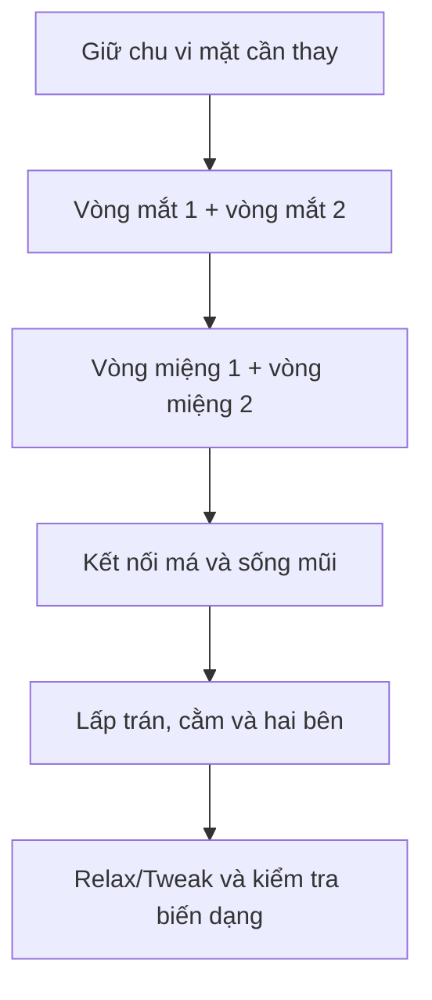

# Bài 10 — Retopology thủ công vùng mắt và miệng bằng RetopoFlow

> **Phân đoạn tham chiếu:** 48:44–1:09:59 trong bản ghi gốc.  
> **Đầu ra bài học:** sản phẩm/tài liệu theo mục tiêu và mục thực hành bên dưới.

## Mục tiêu
Thay lưới mặt khó deform bằng **edge loops có chủ đích** quanh mắt và miệng, đủ cho biểu cảm đơn giản.

## Quy trình
1. Trong **Edit Mode**, xóa vùng mặt trước của `HeadLow` đang không có edge flow phù hợp. Chỉ xóa phần cần dựng lại, giữ mép tiếp giáp rõ ràng.
2. Dùng **Mirror/Auto Mirror** để chỉ làm một bên; lưu bản high-poly/reference để snap. Đặt tên `HeadLow` và `Head_ref`.
3. Mở **RetopoFlow** với đúng *target mesh* và *reference mesh*; kiểm tra object active theo hướng dẫn add-on đang dùng. Tài liệu đôi lúc mô tả màu active khác phiên bản; thao tác thực tế cần xác nhận trên máy.
4. Tạo vòng quanh mắt bằng **PolyStrips** (tác giả giảm số phân đoạn từ ~31 còn **~12**). Dùng **PolyPen** di chuyển đỉnh, ghép các đoạn, tạo vòng thứ hai.
5. Dùng **Tweak/Relax** cân khoảng cách các đỉnh; khớp số đỉnh mí trên và mí dưới nơi cần nhắm mắt.
6. Tạo vòng quanh **miệng**, cố gắng giữ cạnh ở khóe miệng. Nếu PolyStrips sinh sai, tự vẽ bằng PolyPen.
7. Sau khi có vòng biến dạng, lấp mặt má/trán/cằm thành các quads đều, chèn loops ở nơi cần để tránh gãy form.
8. Nếu công cụ liên tục snap lên tai, tạm **ẩn phần tai** rồi vào lại retopo.
9. Kiểm tra ở góc trước và bên, làm mượt khoảng cách lưới. Một số triangles ở vùng ẩn/ít deform được chấp nhận trong ví dụ.

## Sơ đồ luồng cạnh tối thiểu

## Điểm quan trọng
Video ưu tiên tốc độ và hoạt hình tối thiểu, **không phải bài chuẩn topology giải phẫu đầy đủ**. Không đặt pole nhiều cạnh đúng tại khóe mắt hoặc khóe miệng nếu cần biến dạng mượt.

## Thực hành
Làm lại mắt và miệng cho một bên đầu; mirror sang bên kia. Dùng Edit Mode thử kéo mí xuống và khóe miệng để tìm vùng pinch. Ghi hình trước/sau sửa.

---

**Tiếp theo:** Bài 11.
