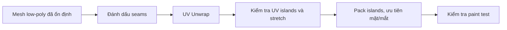

# Bài 12 — UV Unwrap: seams, đảo UV và ưu tiên vùng mặt

> **Phân đoạn tham chiếu:** 1:29:00–1:41:46 trong bản ghi gốc.  
> **Đầu ra bài học:** sản phẩm/tài liệu theo mục tiêu và mục thực hành bên dưới.

## Mục tiêu
Tạo UV có tổ chức để các texture được đặt đúng vị trí và dễ sửa về sau.

## Kiến thức nền
**UV map** là cách trải bề mặt 3D thành mặt phẳng 2D; **seam** là đường chủ động cắt. Cùng độ phân giải ảnh, vùng UV lớn hơn thường có nhiều texel hơn.

## Hướng dẫn thực hành
1. Sao lưu `.blend`; tránh sửa topology sau khi UV đã hoàn tất nếu không bắt buộc.
2. Mở workspace **UV Editing** và chọn một object, vào Edit Mode.
3. Với **thân**, bố trí seams ở vùng ít thấy: mặt sau, mặt trong cánh tay/chân hoặc đường nối hình học thuận tiện.
4. Với **đầu**, đánh dấu seams quanh **hốc mắt, miệng** và phần thích hợp trên tai. Các bộ phận rời (mày, mi, mũi) unwrap độc lập nếu cần.
5. Dùng **Mark Seam**, `A` chọn toàn bộ, `UV → Unwrap` (ví dụ Angle Based trong video). Quan sát islands.
6. Với chi tiết phẳng như lông mày, có thể thử **Project from View** khi thích hợp; phải kiểm tra méo góc cạnh.
7. Chỉnh tỷ lệ islands: ưu tiên **mặt, mống mắt và thân có họa tiết quan trọng**; vùng highlight/màu phẳng có thể nhỏ hơn.
8. **Pack UV** để tận dụng atlas, vẫn chừa margin chống bleeding. Tài liệu có nhờ AI điều chỉnh packing.
9. Nếu định cho **hai bên chia sẻ UV nhờ Mirror**, cần quyết định trước khi unwrap và bảo đảm không cần họa tiết bất đối xứng.

## Cảnh báo
`Apply Mirror` sau UV có thể đổi UV islands và texture; hãy kiểm tra bản test. Không có một cách seam duy nhất cho mọi nhân vật.

## Bài tập
Làm UV cho HeadLow và BodyLow. Dùng UV checker xem stretch, các đường cắt lộ rõ và phần diện tích dành cho mặt.

---

**Tiếp theo:** Bài 13.
