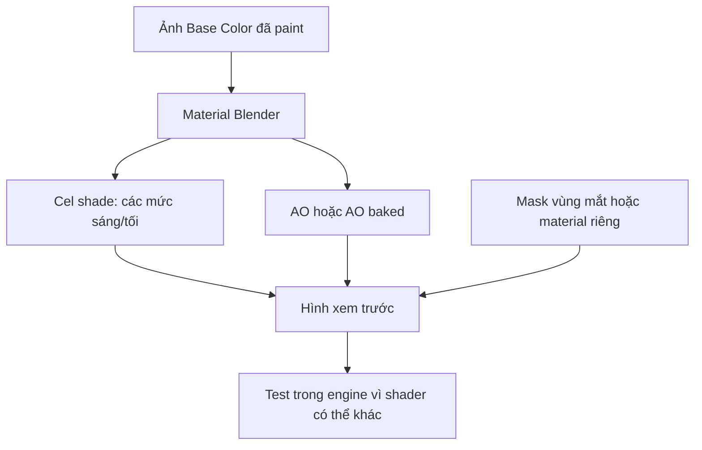

# Bài 15 — Vật liệu cel-shading, AO bake và vùng mắt không nhận bóng

> **Phân đoạn tham chiếu:** 2:05:19–2:10:13 trong bản ghi gốc.  
> **Đầu ra bài học:** sản phẩm/tài liệu theo mục tiêu và mục thực hành bên dưới.

## Mục tiêu
Tạo diện mạo anime/cel-like và hiểu sự khác nhau giữa **màu texture**, **shadow shader** và **ambient occlusion (AO)**.

## Quy trình nguồn
1. Dùng chất liệu đơn giản từ ảnh texture đã sửa, thử thiết lập **cel-shaded look** (bóng chia mức) thay vì chuyển sắc liên tục.
2. Tinh chỉnh **số cấp bóng** và ngưỡng tối để tránh nhân vật tối/đậm quá mức.
3. Tạo hoặc bake **AO** ở cổ, nách, giữa hai chân để giữ cảm giác khối. Tài liệu mô tả AO như lớp tối cố định trên texture — cần phân biệt **AO baked** với bóng chiếu thời gian thực.
4. Với đôi mắt, thử bố trí shader để vùng lòng trắng/highlight **không bị tối** như da, giúp giữ biểu cảm. Video dùng trợ lý tạo giải pháp qua dữ liệu đỉnh; cũng nhắc cách dùng **material riêng cho mắt**.
5. Nếu gộp mọi thứ về một material, kiểm tra xem engine đích có hỗ trợ cùng hệ node đó không; shader Blender có thể **không tự chuyển nguyên xi** sang Unity.

## Sơ đồ vật liệu

## Kiểm thử
| Kiểm tra | Điều cần xác nhận |
|---|---|
| Ánh sáng tắt/bật | Không nhầm baked AO với real-time shadow |
| Vùng mắt | Không bị tối bẩn, vẫn có highlight |
| Vùng cổ/nách | AO giúp tạo chiều sâu, không biến thành vệt đen |
| Số material | Hợp lý, tránh gộp làm mất quyền chỉnh riêng |

## Bài thực hành
Xuất 2 ảnh: một bản texture flat, một bản cel shading. Ghi lại pipeline material node và những thứ sẽ phải tạo lại trong Unity.

---

**Tiếp theo:** Bài 16.
