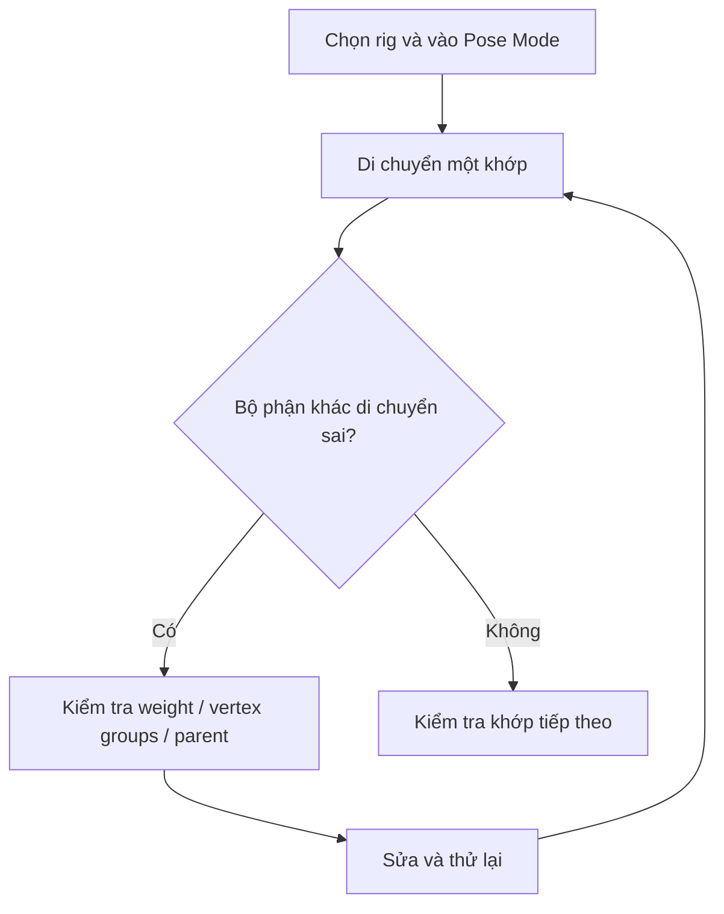

# Bài 16 — Rig nhân vật bằng Auto-Rig Pro và sửa weight

> **Phân đoạn tham chiếu:** 2:10:14–2:19:17 trong bản ghi gốc.  
> **Đầu ra bài học:** sản phẩm/tài liệu theo mục tiêu và mục thực hành bên dưới.

## Mục tiêu
Gắn xương cho nhân vật, kiểm thử tay/chân và phát hiện **weight paint sai**.

## Quy trình trong video
1. Hoàn tất geometry/texture cơ bản rồi tạo bản sao backup trước rig.
2. Tác giả thử nhờ trợ lý rig tự động, kết quả ban đầu còn hỏng, sau đó chuyển sang **Auto-Rig Pro (trả phí)**. Tài liệu có nhắc **Mixamo** như lựa chọn khác; đây không phải so sánh đầy đủ.
3. Chọn head/body, vào Auto-Rig Pro và **Get Selected Objects**; đặt markers theo cơ thể.
4. Nếu mẫu **không có ngón tay**, bỏ chọn cấu hình Fingers (nếu có trong phiên bản công cụ).
5. Chỉnh markers ở **đầu, cổ, vai, khuỷu, cổ tay, hông, gối, cổ chân**.
6. Kiểm tra **IK Directions**: hướng gập khuỷu và gối có hợp giải phẫu không; căn lại khi vector lệch.
7. Thực hiện thao tác **Match to Rig**, Bind/Skin theo workflow add-on.
8. Với object phụ (mắt, lông mi, mày, mũi), kiểm tra chúng đi cùng đầu sau khi Pose; nếu không thì gắn bone/weight thích hợp.
9. Test pose tại **khuỷu, gối, vai, cổ**, xem có sụp mesh, hở, hoặc tai di chuyển theo bàn tay hay không.
10. Ví dụ lỗi nguồn: **di chuyển tay làm tai chuyển động**. Đây là lỗi binding/weight; cần sửa nhóm đỉnh, bone influence, hoặc gán rigid parent cho tai tùy rig.

## Sơ đồ kiểm tra skinning


## Prompt sửa lỗi AI gợi ý
```text
Trong scene Blender hiện tại, khi xoay bone bàn tay, mesh tai cũng chuyển động.
Hãy kiểm tra Armature Modifier, vertex groups, weight ảnh hưởng đến tai,
parenting và bone constraints. Chỉ sửa các liên kết sai trên bản sao file;
không thay rig và không xóa shape keys. Xuất báo cáo bone nào đã gây lỗi,
đã sửa thế nào, và test lại ba tư thế tay/đầu.
```

## Bài tập
Chụp ít nhất 5 tư thế kiểm thử: neutral, nâng tay, gập khuỷu, co gối, nghiêng đầu. Ghi lỗi còn lại và sửa một lỗi weight.

---

**Tiếp theo:** Bài 17.
