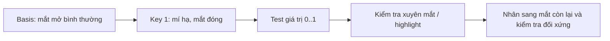

# Bài 17 — Shape Keys cho chớp mắt và biểu cảm

> **Phân đoạn tham chiếu:** 2:19:18–2:29:38 trong bản ghi gốc.  
> **Đầu ra bài học:** sản phẩm/tài liệu theo mục tiêu và mục thực hành bên dưới.

## Mục tiêu
Tạo biểu cảm **nhắm mắt** bằng Shape Keys, đồng thời giữ nguyên trạng thái mặt neutral.

## Các bước
1. Kiểm tra các object vùng mắt: lông mi, mí, lòng trắng, highlight — xem bộ phận nào cần thay đổi để nhắm mắt không xuyên mesh.
2. Với những phần cần chia sẻ Shape Key, video **Join** một số object, nhưng nên làm việc trên bản sao và lưu ý Join chỉ hợp lý nếu compatible mesh/material và không làm mất dữ liệu cần giữ.
3. Chọn mesh, vào **Object Data Properties → Shape Keys**, tạo **Basis** rồi **Key 1**. **Không chỉnh Basis** cho biểu cảm.
4. Tại **Key 1**, đưa các đỉnh mí/lông mi xuống theo hướng mắt đóng, sửa góc mắt và phần đáy mí.
5. Đặt value từ `0 → 1` để thử đóng/mở. Quan sát tròng trắng hoặc highlight có ló ra không.
6. Nếu còn xuyên mesh, lùi tròng mắt một chút hoặc nắn mí/mi. Đảm bảo không biến dạng đầu sai shape.
7. Video tạo biểu cảm một bên trước, rồi yêu cầu AI tạo tương tự cho bên kia; kết quả cần kiểm tra vì có lỗi đối xứng.
8. Thử thêm một shape key biểu cảm **ngạc nhiên** bằng điều chỉnh kích thước/độ mở mắt khi phù hợp.

## Lưu đồ shape key

## Danh mục lỗi
| Triệu chứng | Kiểm tra |
|---|---|
| Mắt trắng lộ khi nhắm | Eyeball depth, shape mí, highlight |
| Một mắt nhắm lệch | Mirror của phần sửa và hướng trục |
| Shape Key không hoạt động | Đang chỉnh `Key 1` hay `Basis`? |
| Join làm dữ liệu bất thường | Object scale, shape keys sẵn có, số object |

## Bài thực hành
Tạo `Blink_Left`, `Blink_Right`, (tùy chọn) `Surprised`, kiểm tra `0`, `0.5`, `1`. Quay demo ngắn hoặc xuất 3 ảnh tương ứng.

---

**Tiếp theo:** Bài 18.
