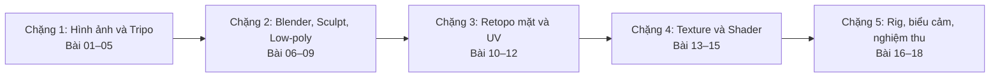

# Khóa học thực hành: Từ ảnh AI đến nhân vật 3D có rig trong Blender

> **Ngôn ngữ:** Tiếng Việt  
> **Ví dụ xuyên suốt:** Nhân vật thỏ cách điệu Lop  
> **Tài liệu nền:** Bản ghi lời thoại được người học cung cấp, dài khoảng 2 giờ 31 phút  
> **Tính chất:** Giáo trình biên tập lại từ bản ghi; không phải tài liệu chính thức của Tripo, Blender, Claude hay Auto-Rig Pro.

## Học xong có thể làm gì?
Thiết kế hình tham chiếu đa góc nhìn, sinh mesh cao từ Tripo, sửa lỗi hình khối, dựng topology đơn giản vùng mắt/miệng, UV Unwrap, chỉnh texture anime/cel-look, lắp rig và tạo chớp mắt bằng Shape Keys. Bước xuất Unity là **phần gợi ý thực hành mở rộng** và cần tự kiểm chứng trong engine.

## Lộ trình 5 chặng

## Danh sách bài học
- [Bài 01 — Tổng quan pipeline AI 3D và mục tiêu game-ready](01-tong-quan-pipeline.md) · nguồn 00:00–02:29
- [Bài 02 — Thiết kế nhân vật và hồ sơ tham chiếu](02-character-sheet.md) · nguồn 02:30–04:15
- [Bài 03 — Chuẩn bị multiview và tách các bộ phận](03-multiview.md) · nguồn 04:16–07:21
- [Bài 04 — Tripo AI: Sinh high-poly từ ảnh đa góc](04-tripo-highpoly.md) · nguồn 07:22–11:20
- [Bài 05 — Tạo chi tiết nhỏ và xuất FBX có tổ chức](05-chi-tiet-fbx.md) · nguồn 11:21–19:19
- [Bài 06 — Blender: Import, trục tọa độ, reference và AI hỗ trợ](06-blender-import.md) · nguồn 18:17–20:25
- [Bài 07 — Sculpt đầu: Smooth, Voxel Remesh, mask và hốc mắt](07-sculpt-dau.md) · nguồn 20:26–35:04
- [Bài 08 — Sculpt thân và thử Smart Mesh low-poly](08-sculpt-than.md) · nguồn 35:05–41:30
- [Bài 09 — Low-poly và Quad Remesher: giảm mặt nhưng giữ form](09-lowpoly-quad-remesher.md) · nguồn 41:31–48:43
- [Bài 10 — Retopology thủ công vùng mắt và miệng bằng RetopoFlow](10-retopoflow-mat-mieng.md) · nguồn 48:44–1:09:59
- [Bài 11 — Tạo hốc mắt, phần trong miệng và lắp mắt 3D](11-hoc-mat-lap-mat.md) · nguồn 1:10:00–1:28:58
- [Bài 12 — UV Unwrap: seams, đảo UV và ưu tiên vùng mặt](12-uv-unwrapping.md) · nguồn 1:29:00–1:41:46
- [Bài 13 — Tạo ảnh màu và texture trong Tripo](13-tripo-texture.md) · nguồn 1:41:47–1:51:28
- [Bài 14 — Texture Paint và hợp nhất atlas](14-texture-paint-atlas.md) · nguồn 1:51:29–2:05:18
- [Bài 15 — Vật liệu cel-shading, AO bake và vùng mắt không nhận bóng](15-cel-shading-ao.md) · nguồn 2:05:19–2:10:13
- [Bài 16 — Rig nhân vật bằng Auto-Rig Pro và sửa weight](16-rig-weight.md) · nguồn 2:10:14–2:19:17
- [Bài 17 — Shape Keys cho chớp mắt và biểu cảm](17-shape-keys.md) · nguồn 2:19:18–2:29:38
- [Bài 18 — Kiểm thử tổng kết, lỗi chưa giải quyết và xuất sang Unity](18-kiem-thu-unity.md) · nguồn 2:29:39–2:31:48

## Học theo thứ tự
Mỗi bài có mục tiêu, quy trình thao tác, lưu ý lỗi và bài tập. Học tuần tự hoặc quay lại phần cần sửa; không nên bỏ hẳn các mốc **backup → retopo → UV → material → rig**.

## Bài tập cuối khóa
Tạo một nhân vật thỏ/linh vật mới theo cùng pipeline, nộp:
- Ảnh concept + multi-view.
- `high.fbx`, `low.blend`, `final.blend`, textures đã lưu.
- Ảnh topology vùng mắt/miệng và UV layout.
- 3–5 ảnh kiểm thử rig + chớp mắt.
- `FINAL_REPORT.md` có lỗi, giải pháp và tình trạng test Unity.

## Quy ước đọc tài liệu
- **Thông số** (polycount, voxel size, 2K) ghi trong bài là **ví dụ từ video**, cần chỉnh theo scale/model/phần mềm.
- **Mở rộng** là kiến thức bổ sung thực hành, phân biệt với điều transcript đã thể hiện.
- AI và MCP có thể giúp tự động hóa, nhưng **phải kiểm tra kết quả** và lưu dự phòng.
- Việc làm trang phục không được hướng dẫn đầy đủ trong transcript này.
