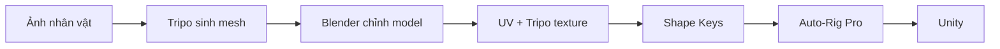

# Khóa học: Tripo P2 Smart Mesh → Blender → Unity

**Ngôn ngữ:** Tiếng Việt  
**Định dạng:** 13 bài học độc lập `.md` + tài liệu phụ trợ + bản chép lời tham chiếu.  
**Nội dung nguồn:** Bản chép lời video hướng dẫn khoảng 58 phút do người học cung cấp.  
**Mục tiêu:** Xây dựng nhân vật anime/chibi 3D từ ảnh bằng Tripo, sửa mesh/UV/texture trong Blender, rig bằng Auto-Rig Pro và kiểm thử trong Unity.

> **Tuyên bố phạm vi:** Khóa học này là bản **biên soạn lại theo chủ đề** từ bản chép lời được cung cấp, không phải bản dịch phụ đề từng câu. Các thông số/giao diện P1/P2, add-on và dịch vụ là những gì video mô tả tại thời điểm quay; chức năng thực tế có thể khác. Những hướng dẫn mở rộng được ghi rõ là bổ sung, đặc biệt ở Bài 12.

## Cấu trúc thư mục

```text
Khoa_hoc_Tripo_P2_SmartMesh_Blender_Unity/
├── README.md
├── bai-hoc/
│   ├── 00-tong-quan-va-lo-trinh.md
│   ├── 01-chuan-bi-anh-tham-chieu.md
│   ├── 02-tripo-smart-mesh-va-chon-bien-the.md
│   ├── 03-import-va-don-dep-trong-blender.md
│   ├── 04-sua-topology-khuon-mat.md
│   ├── 05-dung-mat-anime-va-can-chinh-mat.md
│   ├── 06-than-doi-xung-va-noi-mesh.md
│   ├── 07-toc-segmentation-va-sua-mesh.md
│   ├── 08-uv-unwrap-va-pack-islands.md
│   ├── 09-tripo-texture-va-texture-paint.md
│   ├── 10-shape-keys-bieu-cam.md
│   ├── 11-auto-rig-pro-va-weight-paint.md
│   └── 12-unity-kiem-thu-game-ready.md
├── tai-lieu/
│   ├── checklist-chat-luong.md
│   ├── loi-thuong-gap.md
│   ├── tu-dien-thuat-ngu.md
│   └── prompt-claude-blender-mcp.md
└── nguon/
    └── ban-chep-loi-goc.md
```

## Lộ trình bài học

| Bài | Chủ đề | Mốc trong video |
|---|---|---|
| [00](bai-hoc/00-tong-quan-va-lo-trinh.md) | Tổng quan và sản phẩm cuối | 00:00–02:15; 57:00 |
| [01](bai-hoc/01-chuan-bi-anh-tham-chieu.md) | Ảnh tham chiếu | 01:23–02:15 |
| [02](bai-hoc/02-tripo-smart-mesh-va-chon-bien-the.md) | Tripo P2 Smart Mesh, chọn mesh | 02:15–07:56 |
| [03](bai-hoc/03-import-va-don-dep-trong-blender.md) | Import và cleanup | 07:56–11:08 |
| [04](bai-hoc/04-sua-topology-khuon-mat.md) | Topology mặt và edge loops | 11:28–17:02 |
| [05](bai-hoc/05-dung-mat-anime-va-can-chinh-mat.md) | Mắt, lông mi và căn chỉnh mặt | 17:02–25:48 |
| [06](bai-hoc/06-than-doi-xung-va-noi-mesh.md) | Thân, Mirror, khớp | 26:10–30:47 |
| [07](bai-hoc/07-toc-segmentation-va-sua-mesh.md) | Tóc và segmentation | 30:47–35:08 |
| [08](bai-hoc/08-uv-unwrap-va-pack-islands.md) | UV Unwrap và texture space | 35:08–42:48 |
| [09](bai-hoc/09-tripo-texture-va-texture-paint.md) | Texture AI + Blender Paint | 42:48–48:38 |
| [10](bai-hoc/10-shape-keys-bieu-cam.md) | Blink và miệng chữ A | 48:46–52:30 |
| [11](bai-hoc/11-auto-rig-pro-va-weight-paint.md) | Auto-Rig Pro, bind, weights | 52:30–56:59 |
| [12](bai-hoc/12-unity-kiem-thu-game-ready.md) | Unity và QA | 56:59–57:40 |

## Sơ đồ tổng thể



## Cách học

Đọc theo thứ tự từ Bài 00 đến 12. Mỗi bài gồm mục tiêu, quy trình, mẹo/chú ý và thực hành. Khi hoàn thành một bài, hãy lưu phiên bản `.blend` đánh số. Cuối khóa dùng [Checklist chất lượng](tai-lieu/checklist-chat-luong.md) và [Bảng xử lý lỗi](tai-lieu/loi-thuong-gap.md).

## Phần mềm / điều kiện

Tripo AI; Blender; Unity. Auto Mirror, F2, Claude + Blender MCP và Auto-Rig Pro là công cụ tùy chọn hoặc thương mại tùy trường hợp. **Không có file model mẫu, ảnh minh họa hoặc video gốc** trong tài liệu đầu vào; khóa học không giả định có các tài nguyên đó.
