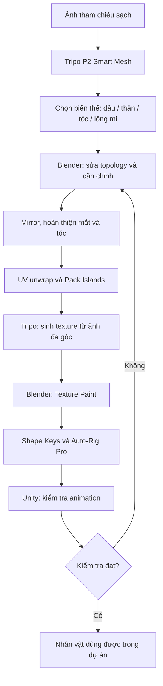

# Bài 00 — Tổng quan khóa học và lộ trình sản xuất nhân vật 3D

> **Chủ đề:** Tạo nhân vật phong cách anime/chibi có thể đưa vào game, dựa trên workflow được trình bày trong video 58 phút.  
> **Sản phẩm cuối:** nhân vật 3D có mesh tương đối sạch, UV, texture, Shape Keys biểu cảm, armature và hoạt ảnh kiểm tra trong Unity.

## 1. Mục tiêu học tập

Sau khóa học, người học có thể:

1. Chuẩn bị hình tham chiếu phù hợp cho quy trình image-to-3D.
2. Dùng **Tripo P2 / Smart Mesh** tạo các biến thể mesh và lựa chọn phần tốt nhất.
3. Đưa mesh vào **Blender** để sửa lưới, căn chỉnh, tách/ghép và làm đối xứng.
4. Xây dựng mắt anime, tóc và UV; tô texture bằng Tripo rồi hoàn thiện bằng Texture Paint.
5. Tạo biểu cảm chớp mắt, miệng chữ A bằng **Shape Keys**.
6. Dùng **Auto-Rig Pro** và đánh giá biến dạng xương, cuối cùng nhập sang **Unity**.

## 2. Sơ đồ quy trình

## 3. Công cụ, đầu vào và kết quả

| Thành phần | Vai trò | Lưu ý |
|---|---|---|
| Tripo AI | Sinh mesh; phân đoạn/tách mesh; sinh texture | Tính năng/phí/giao diện có thể thay đổi theo phiên bản |
| Blender | Chỉnh hình học, UV, sơn texture, shape keys và rig | Nên lưu các mốc `.blend` riêng |
| Auto Mirror / F2 | Tăng tốc chỉnh sửa topology | Tiện ích tùy chọn, có thể cần cài/khởi bật |
| Claude + Blender MCP | Trợ lý thao tác trong Blender | Tùy chọn, **không thay thế kiểm tra thủ công** |
| Auto-Rig Pro | Tạo hệ xương và bind | Add-on thương mại; có thể thay bằng công cụ tương đương |
| Unity | Kiểm thử chuyển động và biểu cảm | Không chỉ kiểm tra trạng thái tĩnh |

## 4. Sơ lược tình huống của video

Người hướng dẫn làm một nhân vật tỉ lệ khoảng **2–3 đầu**. Họ thử nhiều lần với Smart Mesh, lấy từng bộ phận đẹp nhất, sửa một số lỗi ở mặt và tóc, tạo UV, sinh texture rồi rig. Video thể hiện kết quả hoạt ảnh khá tốt nhưng **không chứng minh rằng mọi đầu ra P2 đều hoàn toàn game-ready ngay lập tức**.

> **Phân biệt:** Mô tả các nút, phiên bản P1/P2 và hành vi AI là **ghi nhận từ video gốc**, không phải cam kết tình trạng hiện tại của dịch vụ.

## 5. Tiêu chí tốt nghiệp

- [ ] Có bộ ảnh tham chiếu gọn, nhất quán và đúng tư thế.
- [ ] Mesh không còn các thành phần rác nổi bật, khớp khuỷu/gối/ngón tay không biến dạng bất thường.
- [ ] UV và texture không có lỗi nghiêm trọng ở mặt, mắt, tóc.
- [ ] Blink và miệng chữ A hoạt động, không làm biến dạng các phần không liên quan.
- [ ] Tóc đi theo đầu, tay/chân/ngón tay hoạt động khi Pose Mode.
- [ ] Nhân vật xuất sang Unity, hiển thị material và chơi animation kiểm thử.

**Bài thực hành mở đầu:** tạo thư mục `references/`, `tripo_exports/`, `blender/`, `textures/`, `unity_test/`. Đặt tên file theo mẫu `character_stage_version.ext` để có thể quay lại bước trước.

**Xem tiếp:** [Bài 01 — Chuẩn bị ảnh tham chiếu](01-chuan-bi-anh-tham-chieu.md).
