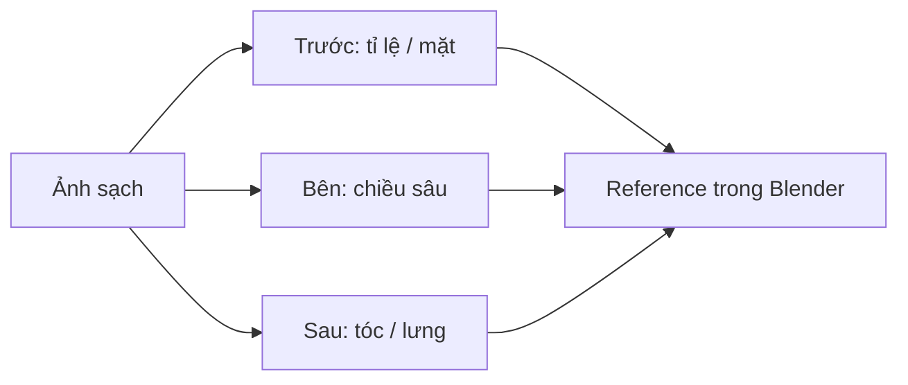

# Bài 01 — Chuẩn bị ảnh tham chiếu cho AI 3D

## Mục tiêu

Chuẩn bị bộ hình giúp AI tái tạo hình thể, nhưng vẫn đủ thông tin để sửa thủ công khi mô hình được sinh chưa chính xác.

## 1. Những hình ảnh tác giả đã chuẩn bị

- Ảnh chân dung/ảnh tổng thể của nhân vật.
- Bộ ảnh nhân vật ở **ba góc nhìn**, tách bỏ trang phục khi cần quan sát cấu trúc cơ thể.
- Ảnh trước mặt **không có tóc**, thuận tiện dựng đầu và chỉnh mắt.
- Bộ hình không tóc/không quần áo ở nhiều góc để tham chiếu cơ thể.

Trong video, tác giả nói ở thời điểm quay **P2 không hỗ trợ đầu vào đa góc**, vì vậy vẫn giữ các ảnh đa góc để căn chỉnh trong Blender. Đây là giới hạn được ghi nhận **ở thời điểm của video**.

## 2. Quy tắc chọn hình tham chiếu

| Tiêu chí | Làm đúng | Tránh |
|---|---|---|
| Nền | Nền sạch, đơn giản, độ tương phản tốt | Chữ, đạo cụ, vật thể thừa |
| Tư thế | Dáng rõ ràng, tay/ngón không che khuất | Tay dính thân, chân chồng nhau |
| Tỉ lệ | Thống nhất chiều cao và góc giữa ảnh | Mỗi ảnh một tỉ lệ cơ thể |
| Chi tiết | Nhìn rõ hốc mắt, miệng, khớp tay/chân | Chi tiết tóc che cả mắt và cổ |
| Đối xứng | Trục dọc cơ thể tương đối thẳng | Góc camera nghiêng gây méo hình |

Tác giả thử sinh đầu từ hình chụp cắt nhưng nhận thấy **rác trong hình** làm đầu ra kém. Kết luận thực tế: đầu vào sạch quan trọng hơn việc cứ tăng độ phức tạp của prompt.

## 3. Dựng bộ tham chiếu trong Blender

1. Tạo ba ảnh front/side/back hoặc lấy ảnh gốc đã chuẩn bị.
2. Vào Blender, thêm ảnh tham chiếu cho từng hướng; căn mặt phẳng ảnh theo trục nhìn tương ứng.
3. Nếu dùng trợ lý Claude + Blender MCP, video dùng yêu cầu chia bộ ảnh thành ba phần và đặt làm reference trong scene.
4. Căn đường giữa cơ thể, sàn chân và đầu. Kiểm tra ảnh không lệch phối cảnh quá nhiều.
5. Ẩn lớp ảnh khi cần kiểm tra silhouette của mesh thực tế.

## 4. Thực hành

Chuẩn bị tối thiểu 3 ảnh tham chiếu và một ảnh mặt trước không có tóc. Tạo một scene Blender chỉ chứa references và lưu `01_references.blend`.

**Tự kiểm:** Nếu nhìn từ bên hông mà tỷ lệ mắt/mũi không khớp mặt trước, đánh dấu vùng đó là *cần hiệu chỉnh*, không cố bóp mesh khớp tuyệt đối với mọi ảnh.

**Bài tiếp:** [Bài 02 — Sinh mesh bằng Tripo](02-tripo-smart-mesh-va-chon-bien-the.md).
