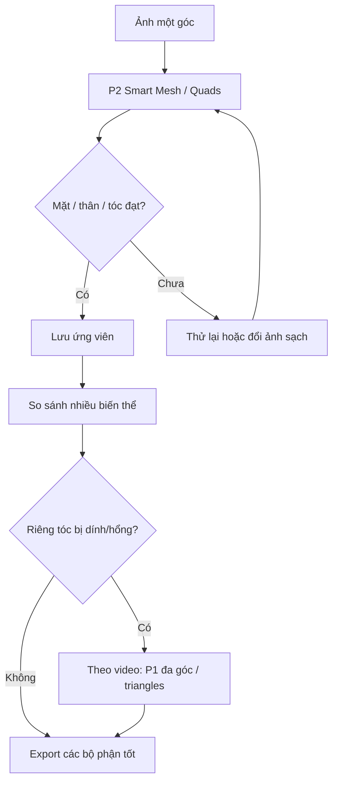

# Bài 02 — Tripo P2 Smart Mesh: sinh mesh và chọn biến thể

## Mục tiêu

Hiểu lý do không nên chỉ sinh **một model hoàn chỉnh** rồi chấp nhận toàn bộ lỗi của nó; thay vào đó tạo **nhiều ứng viên** và chọn bộ phận tốt nhất.

## 1. Smart Mesh, Quads và giới hạn topology

Trong video, tác giả chọn **Smart Mesh**, **Single Image**, bật **Quads** ở Tripo P2. Lần đầu đặt khoảng **5.000 quads**, được ước lượng tương đương **10.000 triangles** khi chia mỗi quad thành hai tam giác. Đây là **ước tính hình học**, không nhất thiết bằng triangle count sau export/triangulation.

Kết quả được đánh giá:

- Tóc, ngón tay và nhiều phần quần áo khá tốt.
- Mặt vẫn có topology thô; tóc phía sau có lúc thiếu và bị biến thành kiểu undercut.
- Lưới ở một số vị trí có thể lệch, thiếu kết nối hoặc phát sinh chi tiết rác.

> **Bài học:** Polygon count chỉ là một tham số; cần nhìn **edge loops, khớp uốn và độ tương đồng** trước khi giữ mesh.

## 2. Chiến lược sinh từng phần

| Bộ phận | Cách làm trong video | Tiêu chí quyết định |
|---|---|---|
| Toàn thân | Sinh quads khoảng 5.000 | Silhouette, bàn tay, đầu gối, tỷ lệ |
| Đầu | Thử sinh riêng khoảng 2.500; so sánh với đầu của bản toàn thân | Vòng quanh miệng/mắt, độ giống ảnh |
| Thân | Thử lại nhiều lần quanh 4.300–4.500 | Khớp gối và ngón tay sạch, ít lỗi |
| Tóc | Sinh cùng đầu khoảng 3.000 | Tóc sau đầu, độ tách khỏi mặt |
| Lông mi / lông mày | Lấy từ model khác có phần này đẹp | Hình dạng sạch, dễ tách rời |

Những số polygon ở đây là **thông số thử nghiệm trong video**, không phải preset tối ưu chung. Người hướng dẫn dùng chiến lược thử nhiều lần, rồi chọn kết quả tốt nhất.

## 3. Khi nào đổi từ P2 sang P1?

Video gặp vấn đề tóc bị hổng hoặc dính với mặt. Tác giả quyết định dùng đầu vào **đa góc** và chuyển từ **P2 sang P1**, vì tại thời điểm quay P2 không có multiview trong workflow họ dùng; bản P1 được sinh bằng **triangles** khoảng 4.000. Tác giả chấp nhận tam giác ở tóc vì topology tóc ít ảnh hưởng trực tiếp tới uốn khớp như đầu gối, khuỷu hay khuôn mặt.

## 4. Quy trình lựa chọn

## 5. Thực hành

Sinh ít nhất 2 ứng viên cho đầu và 2 ứng viên cho toàn thân; lưu ảnh chụp các góc và bảng điểm 1–5 theo: mặt, tóc sau, ngón tay, đầu gối, độ đối xứng. Chỉ đưa các mesh đã chọn vào Blender.

**Câu hỏi ôn tập:** Tại sao một bàn tay đẹp quan trọng hơn một texture bóng đẹp khi mục tiêu là rigging?

**Bài tiếp:** [Bài 03 — Import và dọn dẹp Blender](03-import-va-don-dep-trong-blender.md).
