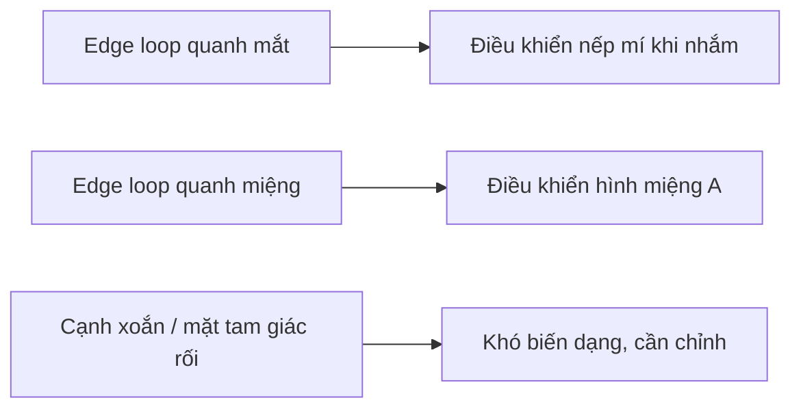

# Bài 04 — Sửa topology khuôn mặt và các edge loop

## Mục tiêu

Sửa những vùng ảnh hưởng nhiều đến biến dạng biểu cảm: mắt, miệng, má; đồng thời biết khi nào cần ưu tiên đủ dùng thay vì retopology hoàn toàn.

## 1. Vì sao edge loop quan trọng?

Một **edge loop** là chuỗi cạnh có cấu trúc chạy liên tục quanh một vùng. Quanh miệng và hốc mắt, các loop giúp mesh thay đổi dáng theo Shape Keys một cách có kiểm soát. Video nhấn mạnh vòng quanh miệng do Tripo tạo tương đối tốt, trong khi mắt có các đường xoắn/đứt cần sửa.

## 2. Làm đối xứng

Trong video tác giả dùng add-on **Auto Mirror** để chỉnh một nửa mesh và phản chiếu sang bên kia. Blender cũng có **Mirror Modifier**; phải đặt đúng mặt phẳng đối xứng và tùy chọn Merge/Clipping khi phù hợp.

1. Xác định bên nào của đầu sạch hơn.
2. Chọn dùng một nửa làm gốc; giữ đường giữa ở tọa độ mặt phẳng đối xứng.
3. Bật Mirror; quan sát khi mở/tắt hiển thị modifier.
4. Giữ mắt, miệng và đường giữa không tạo ra mặt chồng lên nhau.

## 3. Các thao tác sửa topology trong video

- `Alt + Click` (Windows) / `Option + Click` (Mac) chọn edge loop theo chế độ chọn phù hợp.
- `F` điền cạnh/mặt; video đề cập **F2** add-on để điền topology nhanh ở một số ngữ cảnh.
- `M → At Center` gộp hai hoặc nhiều đỉnh.
- `J` kết nối vertices qua faces trong những tình huống hỗ trợ.
- Dùng Knife (`K`) và **Dissolve Edges** để sửa hướng đi loop.
- `G`, `G` (Vertex Slide) dời đỉnh dọc theo topology hiện có, tránh làm méo mesh không cần thiết.

**Cẩn thận:** Một phím có thể cho kết quả khác tùy Edit Mode, Selection Mode, add-on và phiên bản Blender. Hãy quan sát trước/sau thay vì làm theo như macro mù.

## 4. Sửa mắt anime và cavity

Nguồn mô tả kiểu mắt anime trong ví dụ này là **vùng hốc mắt/lòng mắt tương đối lõm**, kết hợp một mống mắt dạng bề mặt phẳng/cong nhẹ, thay vì một nhãn cầu lồi như mắt người thật. Đó là **một lựa chọn phong cách**, không phải quy tắc bắt buộc với mọi nhân vật anime.

1. Xóa các face rối phía trong vùng mắt.
2. Chọn vòng biên và `E` extrude vào trong theo các nấc.
3. Dùng `S` để thay đổi bán kính vòng biên và `G` để điều chỉnh độ sâu.
4. Khép đáy hợp lý; tránh các mặt tự xuyên nhau.
5. Bật **Face Orientation** để kiểm tra mặt trước/sau; sửa normals nếu cần.
6. Đánh dấu `Mark Sharp` cho cạnh cần giữ sắc nét — không lạm dụng.

## 5. Giới hạn thực tế

Tác giả nói rõ **không sửa toàn bộ tam giác** và chấp nhận một số vùng chưa hoàn hảo để hoàn thành pipeline. Với model dùng nhiều biểu cảm, vẫn nên dành nhiều thời gian hơn cho các loop quanh mắt và miệng.

**Bài tập:** chụp ảnh các loops quanh một mắt và miệng trước/sau; đảm bảo khu vực vừa sửa có thể chọn một vòng liên tục. Lưu `04_face_topology.blend`.

**Bài tiếp:** [Bài 05 — Mắt anime và căn chỉnh chi tiết mặt](05-dung-mat-anime-va-can-chinh-mat.md).
