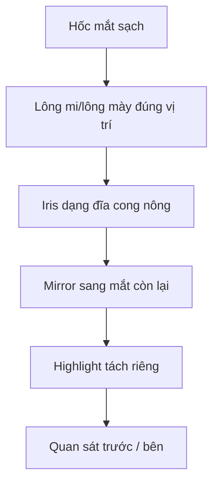

# Bài 05 — Căn chỉnh đầu, lông mi, lông mày và mắt anime

## Mục tiêu

Căn đầu theo ảnh tham chiếu vừa đủ, dựng mống mắt riêng, tạo điểm sáng và dùng Mirror để bảo đảm hai mắt thống nhất.

## 1. Căn đầu theo reference

1. Căn chân nhân vật lên mặt đất và trục dọc cơ thể về giữa; có thể cô lập reference với `/`.
2. Đặt hướng trước theo scene đang dùng (trong video nhân vật hướng về **-Y**).
3. Bật X-Ray để nhìn reference xuyên qua đầu; điều chỉnh `G`, `S` và **Proportional Editing**.
4. Kiểm tra **mặt trước và mặt bên**, ưu tiên hình dáng tổng thể.
5. Không bóp méo khuôn mặt chỉ để khớp từng pixel của reference; tác giả ưu tiên cảm giác nhìn từ trước.

## 2. Căn lông mi và lông mày

- Đặt lại origin hợp lý để thao tác di chuyển/xoay trực quan.
- `P → Selection` tách các vùng cần chỉnh độc lập nếu chúng ở chung object.
- Dùng Proportional Editing nhẹ, đưa đường lông mi về gần bề mặt quanh mắt.
- `Mark Sharp` tại đường viền cần giữ cạnh sắc.
- Thêm **Mirror Modifier** và chỉ định một object đối xứng thích hợp (trong video chọn đầu làm mirror object); cần xác nhận origin/trục đúng.

## 3. Dựng iris/mống mắt bằng tay

Video nhận định tự dựng iris nhanh hơn thử AI nhiều lần:

1. `Shift+A → Mesh → UV Sphere`.
2. Xoay khoảng 90° theo trục phù hợp, xóa nửa sau hình cầu trong Edit Mode.
3. Dùng Proportional Editing chỉnh bề mặt còn lại thành dạng **đĩa/lòng chảo nông**.
4. Thu nhỏ, nghiêng và đưa vào hốc mắt; kiểm tra từ cạnh bên.
5. `Shade Smooth` để giảm cảm giác các mặt polygon.
6. Mirror sang mắt còn lại; so góc nhìn trước/sau khi quyết định.

## 4. Tạo điểm sáng mắt

Theo video, chọn một vùng giữa mống mắt, `Shift+D` để nhân bản, đẩy ra trước vừa đủ. Khi chỉnh highlight cần bật **Connected Only** trong Proportional Editing nếu không muốn các phần khác cùng dịch chuyển. Có thể tạo thêm điểm sáng nhỏ qua texture thay vì geometry.

## 5. Những lỗi cần tránh

| Lỗi | Nguyên nhân | Hướng sửa |
|---|---|---|
| Iris xuyên qua mí | Iris quá lớn hoặc đặt quá nông | Thu nhỏ/dời iris; kiểm tra bên hông |
| Hai mắt không đồng đều | Mirror origin/trục sai | Kiểm tra plane và transform |
| Mí bị gãy | Edge loop mặt chưa hợp lý | Quay lại Bài 04 |
| Lông mi chìm vào mặt | Chi tiết AI không khớp đầu cuối | Dời cục bộ, dùng X-Ray |

**Bài thực hành:** hoàn thiện `Iris_L`, `Eyelash_L`, `Eyebrow_L`, `Highlight_L` và bản mirror tương ứng; lưu `05_eyes.blend`.

**Bài tiếp:** [Bài 06 — Thân và các khớp](06-than-doi-xung-va-noi-mesh.md).
