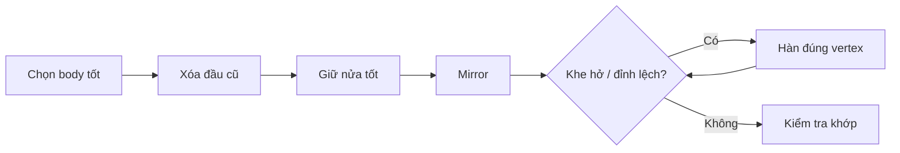

# Bài 06 — Hoàn thiện thân, đối xứng và nối mesh

## Mục tiêu

Chọn thân tốt nhất, bỏ đầu dư trên body model, đối xứng tay/chân và xử lý các điểm cần nối mà không làm hỏng khớp uốn.

## 1. Chọn bản thân tối ưu

Tác giả so sánh hai ứng viên cơ thể, ưu tiên cấu trúc **ngón tay và đầu gối**. Dáng được chỉnh theo reference nhưng không ép khớp 100% vì đầu vào Tripo khi đó chỉ có mặt trước.

Các điểm cần xem: vai → khuỷu → cổ tay, hông → gối → cổ chân, sự tách biệt từng ngón và độ dày của cổ/ngón.

## 2. Loại bỏ phần đầu thừa khỏi body

Khi đã chọn một đầu riêng đẹp hơn, trong Edit Mode của thân:

1. Cô lập object thân, bật X-Ray nếu khó nhìn.
2. Chọn vùng đầu cũ theo island/đỉnh liên thông phù hợp.
3. `X → Vertices` xóa phần không cần.
4. Kiểm tra đường cắt tại cổ, tránh để các mặt hỏng lộ ra.

**Quyết định thiết kế:** Nguồn trình bày cả việc **giữ đầu và thân tách object** để dễ thao tác/animation, và có thử nối một số mảng về sau. Không có quy tắc bắt buộc tất cả bộ phận phải là một mesh duy nhất.

## 3. Đối xứng và hàn đúng

1. Dùng Auto Mirror hoặc Mirror Modifier cho body.
2. Chọn bên có khớp đẹp hơn để làm chuẩn.
3. Tạm tắt hiển thị Mirror khi topology làm khó chọn vertex.
4. Nếu gộp hai object, dùng `Ctrl+J`, sau đó **Auto Merge** hoặc `M` cho các cặp vertex liên kết thực sự.
5. Áp dụng lại Mirror nếu mô hình yêu cầu, kiểm tra đường giữa không có khe/nếp lạ.

## 4. Kiểm tra sẵn sàng rig

- Nhìn thẳng và nhìn nghiêng ở neutral pose.
- Ngón không dính nhau ở vùng khớp.
- Đầu gối và khuỷu tay có các vòng cạnh đủ để gập.
- Bàn chân đặt tương đối ổn trên mặt sàn.
- Không còn head mesh chồng lên đầu cuối.

Trong video, body sau sinh khá tốt nên tác giả hầu như không sửa tay. Đây là kết quả **riêng của ứng viên được chọn**, không có nghĩa mọi body AI đều tự rig tốt.

**Bài thực hành:** tạo `Body_Final`, lưu `06_body.blend`, kiểm tra đường mirror và những mặt nứt bằng chế độ Wireframe.

**Bài tiếp:** [Bài 07 — Tóc](07-toc-segmentation-va-sua-mesh.md).
