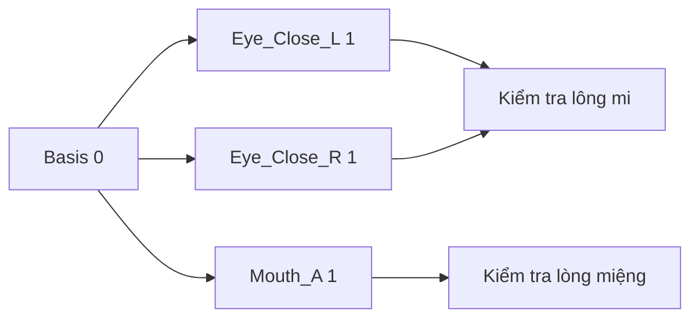

# Bài 10 — Tạo biểu cảm chớp mắt và miệng chữ A với Shape Keys

## Mục tiêu

Tạo tối thiểu hai dạng biểu cảm mặt để có thể điều khiển bằng animation: **Blink** và **Mouth_A**.

## 1. Khái niệm Shape Keys

Shape Key lưu hình dạng biến đổi của mesh so với **Basis**. Khi giá trị thay đổi từ 0 đến 1, Blender nội suy vị trí đỉnh để tạo biểu cảm. Trong video, tác giả tạo một trạng thái nhắm một bên mắt trước, nhờ trợ lý tạo tương ứng bên còn lại, rồi làm hình miệng chữ A.

## 2. Tạo blink

1. Chọn mesh đầu, trong Object Data Properties mở **Shape Keys**.
2. Tạo **Basis**, tiếp đến shape key `Eye_Close_L` (tên bài học đề xuất).
3. Vào Edit Mode khi shape key mới được chọn, chỉnh các đỉnh mí trên/dưới cho mắt nhắm tự nhiên.
4. Kiểm tra lông mi không chìm vào mặt; trong video tác giả phải kéo lông mi ra trước.
5. Quay lại Object Mode, thay đổi slider từ 0 → 1 → 0 để kiểm tra.
6. Tạo `Eye_Close_R` đối xứng. Trong video, Claude Code qua Blender MCP thực hiện bước tương ứng này từ yêu cầu ngôn ngữ tự nhiên.

**Lưu ý:** Mesh mắt trái và phải phải có topology phù hợp mới có thể mirror/copy biểu cảm thuận lợi; nếu không, cần chỉnh thủ công.

## 3. Tạo hình miệng chữ A

- Thêm key `Mouth_A` từ Basis.
- Dùng tùy chọn đối xứng X khi chỉnh để hai bên miệng đồng đều.
- Di chuyển vòng môi và vùng liên quan tạo miệng mở vừa đủ.
- Đảm bảo phần trong miệng không lộ bề mặt lỗi hoặc xuyên nhau.

## 4. Test cơ bản

| Thử nghiệm | Mong đợi |
|---|---|
| Eye_Close_L = 1 | Chỉ mắt trái đóng |
| Eye_Close_R = 1 | Chỉ mắt phải đóng |
| Cả hai cùng 1 | Hai mắt nhắm tự nhiên |
| Mouth_A = 1 | Miệng mở không kéo méo mí mắt |
| Tất cả = 0 | Quay lại Basis đúng |

Tác giả trong video chỉ tạo **một hình miệng cơ bản**, chưa xây đủ hệ viseme/lip sync cho thoại hoàn chỉnh.

**Bài thực hành:** lưu `10_shapekeys.blend`; ghi lại các giá trị key kiểm tra và ảnh trước/sau.

**Bài tiếp:** [Bài 11 — Auto-Rig Pro](11-auto-rig-pro-va-weight-paint.md).
