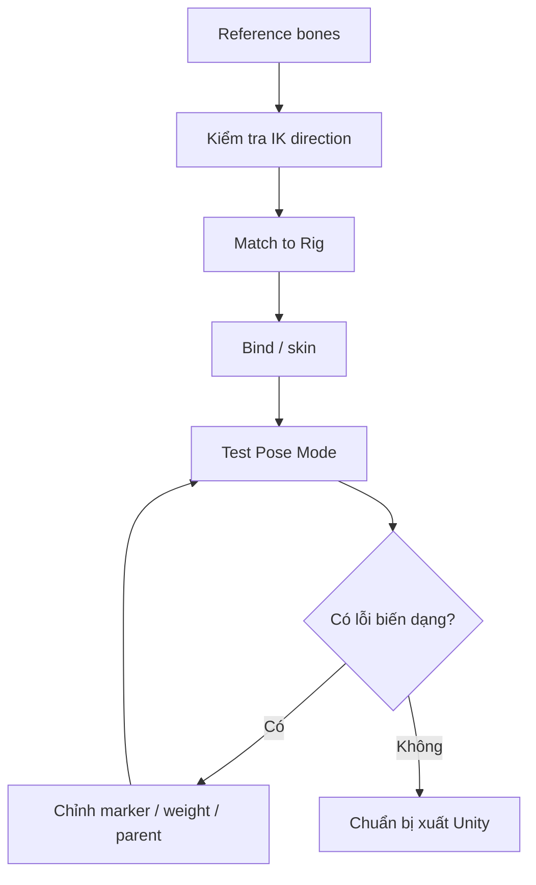

# Bài 11 — Rig nhân vật bằng Auto-Rig Pro và xử lý lỗi skinning

## Mục tiêu

Tạo rig cơ bản cho nhân vật hình người, kiểm tra hướng IK và các vùng biến dạng khi gập; làm cho tóc đi theo đầu.

## 1. Tạo rig theo video

1. Mở **Auto-Rig Pro**, chọn model và lệnh tương ứng **Get Selected Objects**.
2. Dùng **Guess Markers** để đoán vị trí mốc cơ thể.
3. Sửa thủ công mốc đầu hoặc những marker chưa phù hợp; xác nhận bàn tay có **5 ngón**.
4. Chạy `Go` để tạo reference bones.
5. Kiểm tra **IK Direction**: hướng khuỷu gối hiện bằng chỉ dẫn; tránh hướng gập ngược.
6. Điều chỉnh vị trí gối, khuỷu nếu cần rồi `Match to Rig`.
7. Chọn body và rig, dùng chức năng **Skin / Bind** tương ứng bản add-on.
8. Vào **Pose Mode** và kiểm thử chuyển động.

Tính năng cụ thể hoặc tên nút có thể khác giữa phiên bản Auto-Rig Pro. Đây là chuỗi thao tác theo video, **không phải hướng dẫn cho một phiên bản phần mềm cố định**.

## 2. Kiểm tra các khớp

| Vùng | Test | Dấu hiệu thất bại |
|---|---|---|
| Gối | Gập chân theo hướng tự nhiên | Gối lõm/hướng ngược, mesh rách |
| Khuỷu | Gập tay | Khối thịt gãy/gấp thành cạnh sắc |
| Cổ tay | Xoay nhẹ cổ tay | Bàn tay lệch khỏi cẳng tay |
| Ngón | Tạo nắm đấm và mở tay | Ngón xuyên nhau hoặc bị kéo không đều |
| Đầu / tóc | Xoay đầu | Tóc không đi theo hoặc đi theo một phần |

Trong video, khớp ngón tay và đầu gối hoạt động tương đối tốt ngay sau bind, còn tóc **bị lỗi không theo đầu**.

## 3. Các thao tác trợ giúp

- Với bones bị lưới che khuất, bật **In Front** cho armature.
- Khi thử ngón tay có thể dùng **Individual Origins** làm pivot để xoay từng bộ phận.
- Với IK/FK, thao tác **Snap IK** theo hệ công cụ để chuyển cách điều khiển khi kiểm tra.
- Nếu vị trí cổ tay chưa đúng, trong Auto-Rig Pro quay lại **Edit Reference Bones**, sửa vị trí rồi làm bước khớp rig/bind theo yêu cầu.
- Nếu tóc không theo đầu, kiểm tra **Armature Modifier**, vertex groups/weight của hair mesh, parent phù hợp với head bone; video còn dùng Claude để sửa tự động sau khi gửi ảnh lỗi.

## 4. Phân biệt rigging và weight paint

Rigging tạo hệ xương và điều khiển; **skinning/weight paint** xác định mỗi vertex bị ảnh hưởng bởi bone nào. Không phải chỉ cần tạo bones là đủ: cổ áo, tóc hoặc chi tiết tách object cần liên kết đúng.

**Bài thực hành:** thử 4 pose: gập gối, gập khuỷu, nắm đấm, xoay đầu; lưu `11_rigged.blend`.

**Bài tiếp:** [Bài 12 — Nhập Unity và QA](12-unity-kiem-thu-game-ready.md).
