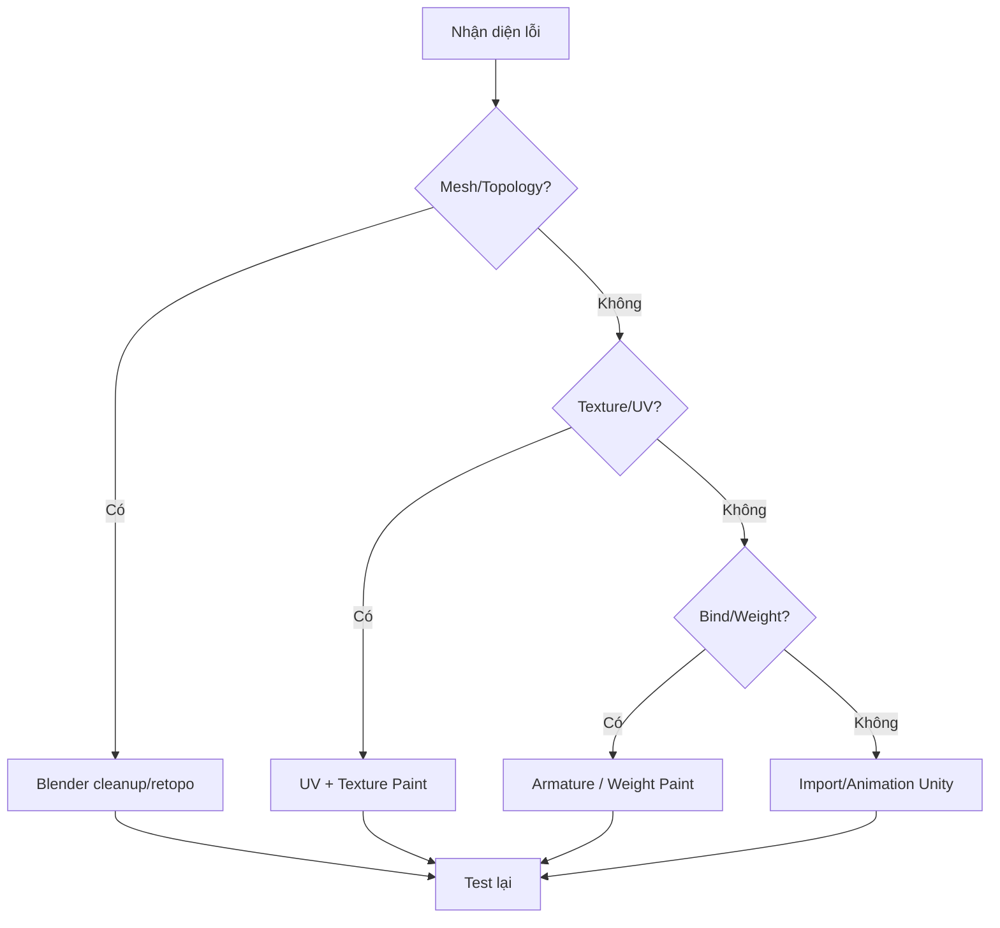

# Bảng xử lý lỗi thường gặp

| Vấn đề | Nguyên nhân có thể | Cách kiểm tra / sửa | Bài |
|---|---|---|---|
| Tóc sau bị biến thành undercut | Ảnh đầu vào thiếu thông tin mặt sau | Thêm ảnh đa góc, sinh lại tóc | [02](../bai-hoc/02-tripo-smart-mesh-va-chon-bien-the.md), [07](../bai-hoc/07-toc-segmentation-va-sua-mesh.md) |
| Mặt bị nhăn hoặc edge loop xoắn | Topology AI chưa sạch | Xóa mặt/cạnh rối, sửa loop | [04](../bai-hoc/04-sua-topology-khuon-mat.md) |
| Mesh gãy tại vị trí gộp | Chỉ Ctrl+J hoặc merge sai vertices | Weld/bridge đúng ngữ cảnh, kiểm tra normals | [03](../bai-hoc/03-import-va-don-dep-trong-blender.md), [06](../bai-hoc/06-than-doi-xung-va-noi-mesh.md) |
| Iris xuyên qua mí mắt | Iris quá to/đặt quá nông | Chỉnh kích thước/độ sâu từ góc bên | [05](../bai-hoc/05-dung-mat-anime-va-can-chinh-mat.md) |
| Texture lem quanh mắt/tóc | AI texture/UV không khớp | Paint lại, kiểm tra UV | [08](../bai-hoc/08-uv-unwrap-va-pack-islands.md), [09](../bai-hoc/09-tripo-texture-va-texture-paint.md) |
| Blink kéo lông mi vào trong | Shape Key không tính đến mi | Dời mi, xem key ở value = 1 | [10](../bai-hoc/10-shape-keys-bieu-cam.md) |
| Gối gập ngược | IK direction/reference bones sai | Chỉnh marker, kiểm tra lại rig | [11](../bai-hoc/11-auto-rig-pro-va-weight-paint.md) |
| Một phần tóc không theo đầu | Hair weight/parent không đúng | Kiểm tra head bone, weight và armature | [11](../bai-hoc/11-auto-rig-pro-va-weight-paint.md) |
| Chỉ một clip Unity bị giật | Animation tỷ lệ/retarget chưa hợp | Test clip khác trước khi kết luận lỗi model | [12](../bai-hoc/12-unity-kiem-thu-game-ready.md) |

## Thứ tự khắc phục đề xuất

