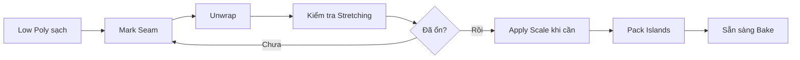

# Bài 03 — UV Mapping và Texture Baking từ High Poly sang Low Poly

> **Chủ đề:** Mark Seam, Unwrap, UV Islands, Normal Map, Diffuse/Base Color Bake  
> **Công cụ:** Blender UV Editor, Shader Editor, Cycles Bake  
> **Sản phẩm:** Low Poly có UV chuẩn, Normal Map và Base Color đã bake và lưu thành file ảnh.

## 1. Tóm tắt

Sau Retopology, nhân vật có lưới nhẹ hơn nhưng mất các đường rãnh và bề mặt phức tạp của bản Sculpt. **UV Mapping** giúp trải bề mặt 3D lên mặt phẳng 2D để có thể đặt hình ảnh texture đúng vị trí; **Texture Baking** chuyển thông tin từ bản High Poly hoặc mô hình AI ban đầu sang bản Low Poly. Hai kỹ thuật kết hợp sẽ cho hình ảnh giàu chi tiết mà không bắt buộc giữ số đa giác lớn khi dùng trong game.

## 2. Mục tiêu học tập

Người học có thể:

- Giải thích khái niệm UV Island, Seam, Stretching và Texture Resolution.
- Phân biệt `Smart UV Project` với Unwrap thủ công bằng Mark Seam.
- Bố trí seam tại các vùng ít thấy trên đầu, tay, chân, gai, đuôi, mắt và răng.
- Kiểm tra UV Stretching, xử lý sai tỷ lệ bằng Apply Scale và Pack Islands.
- Bake Normal Map theo luồng High Poly → Low Poly bằng Cycles.
- Bake màu từ mô hình AI cũ và nhận biết những lỗi do sai khác hình học.

## 3. Tư duy UV: trải mô hình 3D thành ảnh 2D

Hãy tưởng tượng muốn dán một hình in phẳng lên bề mặt khủng long: nếu không cắt bề mặt theo đường thích hợp, hình sẽ bị kéo giãn tại các vùng cong. Trong Blender, **Seam** là đường cắt được chỉ định; **UV Island** là mảnh bề mặt được mở phẳng sau khi `Unwrap`.

`Smart UV Project` tự phân mảnh rất nhanh, hợp với đạo cụ đơn giản, mô hình tĩnh hoặc thử nghiệm. Tuy vậy, nhân vật dùng texture độ phân giải thấp hơn, chẳng hạn **1K/2K**, cần kiểm soát seam kỹ vì đường ghép có thể tạo viền màu hoặc mất liên tục. Texture **4K** đôi khi che bớt vấn đề trong ví dụ render, nhưng độ phân giải cao **không tự sửa** UV xấu hay vết cắt sai.

| Cách UV | Điểm mạnh | Hạn chế |
| --- | --- | --- |
| `Smart UV Project` | Nhanh, ít thao tác | Dễ tạo nhiều đảo nhỏ; seam đặt nơi khó sơn |
| `Mark Seam` + `Unwrap` | Kiểm soát đường cắt và hình đảo | Cần dành thời gian phân tích cấu trúc nhân vật |

## 4. Chuẩn bị Seam và đường sắc

### 4.1. Phân biệt Sharp và Seam

- **Mark Sharp:** Đánh dấu cạnh phục vụ xử lý shading/độ sắc khi kết xuất theo thiết lập liên quan.
- **Mark Seam:** Đánh dấu vị trí cắt để Unwrap UV.

Hai loại thuộc tính có thể trùng vị trí, nhưng **không phải cùng một thứ**. Với nhân vật có gai, việc đặt seam ở chân gai có thể hợp lý vì đó cũng là ranh giới hình học. Có thể chọn các cạnh dựa trên đặc tính đã gắn bằng công cụ Select Similar khi tiện lợi, sau đó rà soát trước khi `Mark Seam`.

### 4.2. Xác định đường cắt của khủng long

1. **Gai lưng:** Đặt seam quanh chân gai và dọc một mặt khuất để mở được từng gai thành miếng phẳng.
2. **Tay:** Tách vòng nối tay–thân; đặt đường cắt dài ở mặt dưới tay; mở các khe giữa ngón.
3. **Chân và bàn chân:** Ngắt vòng ở gốc chân, phía dưới bàn chân và các khe giữa ngón.
4. **Đầu:** Ưu tiên đường cắt phía sau hoặc nơi ít nhìn thấy; tránh rải seam xuyên qua chính diện khuôn mặt.
5. **Mũi:** Với hình mũi lõm sâu, có thể thêm seam bên trong lỗ để giảm kéo giãn.
6. **Đuôi và thân:** Đặt một đường cắt dài ở vùng dưới đuôi và thân nếu island bị kéo giãn.
7. **Mắt và răng:** Chỉnh UV riêng theo hình học; các đối tượng này có thể dùng material và texture riêng.

## 5. Unwrap và kiểm tra UV

### 5.1. Mở phẳng từng phần

Vào `Edit Mode`, chọn các cạnh đã xác định, dùng menu cạnh hoặc chuột phải chọn `Mark Seam`. Chọn vùng hình học cần kiểm tra, dùng `UV > Unwrap` rồi mở workspace `UV Editing` để quan sát island tương ứng. Có thể cô lập một Object bằng Local View (phím `/` trên numpad trong keymap phù hợp) để thao tác chính xác hơn.

Nếu đảo UV xuất hiện như một dải dài, bị xoắn hoặc không mở hẳn, kiểm tra chỗ thiếu seam ở khe ngón, mặt dưới chân hoặc giữa phần nối thân và đuôi.

### 5.2. Kiểm tra kéo giãn và tỷ lệ

UV Editor có chế độ đánh giá kéo giãn (`Stretching`) để nhận diện vùng bất thường. Quan sát cả hình học 3D lẫn đảo UV thay vì chỉ dựa vào màu hiển thị. Trường hợp mắt chiếm tỷ lệ bất hợp lý trong UV dù kích thước vật lý nhỏ có thể do **Object Scale chưa Apply**. Về Object Mode, kiểm tra Transform, rồi `Ctrl + A > Rotation & Scale` trên mesh thích hợp trước khi Unwrap lại. Với armature đã rig, không áp dụng biến đổi tùy tiện.

### 5.3. Pack Islands và phân chia texture set

Sau Unwrap, dùng `UV > Pack Islands` để tận dụng diện tích texture và chừa khoảng cách giữa các đảo. Bài thực hành có thể để **mắt một material/texture riêng**, còn thân và răng dùng texture set chung. Ví dụ nêu khoảng đệm **2–8 pixel** ở một cách pack; giá trị cuối phải phù hợp độ phân giải ảnh và mức mipmap/lọc texture của ứng dụng.



## 6. Bake Normal Map

### 6.1. Normal Map dùng để làm gì?

Normal Map lưu hướng pháp tuyến bề mặt, giúp ánh sáng phản ứng như thể Low Poly chứa các nếp gấp và đường rãnh nhỏ của High Poly. Nó **không bổ sung thực đa giác**; silhouette và biến dạng thực vẫn do mesh Low Poly quyết định.

### 6.2. Cài đặt vật liệu nhận kết quả

1. Chọn Low Poly, mở `Shader Editor`.
2. Thêm `Image Texture` bằng `Shift + A`, tạo ảnh mới, chẳng hạn `Dino_Normal_4K`.
3. Dùng độ phân giải ví dụ **4K**, tắt alpha nếu không cần.
4. Đảm bảo node ảnh đích **đang được chọn/active** trong material nhận bake.
5. Dùng render engine `Cycles`, thiết lập `Bake Type: Normal` và chế độ **Selected to Active**.
6. Chọn đối tượng High Poly làm nguồn, rồi chọn **Low Poly cuối cùng để nó là active object**. Cách này đảm bảo dữ liệu chuyển từ High Poly sang đối tượng Low Poly có ảnh đích.
7. Kiểm tra tham số `Extrusion` và `Max Ray Distance` dựa trên khoảng cách thật giữa hai bề mặt; dùng margin ví dụ **8 px**.
8. Chạy `Bake`, quan sát ảnh thu được và lưu ảnh ngay (`Image > Save As`).

> **Điều kiện quan trọng:** High Poly và Low Poly phải trùng vị trí trong không gian. Nếu chọn sai active object, chọn sai Image Texture node hoặc ray distance không phù hợp, bake có thể bị đen, lỗi hoặc ghi đè nhầm ảnh.

### 6.3. Kết nối Normal Map đúng cách

Trong Shader Editor của Low Poly:

```text
Image Texture (Normal, Non-Color)
            |
            v
        Normal Map
            |
            v
     Principled BSDF / Normal
```

Normal Map là **dữ liệu**, nên đặt `Color Space: Non-Color`. Không cắm trực tiếp ảnh normal vào `Base Color`. Kiểm tra ánh sáng từ vài hướng để nhận diện vùng phồng lõm sai.

## 7. Bake màu từ mô hình AI ban đầu

Bản AI gốc có thể mang texture màu đẹp nhưng hình học chưa sạch. Nếu bản Low Poly đã thay đổi không quá xa bề mặt gốc, có thể **bake màu** từ vật thể AI nguồn sang texture của Low Poly, sau đó chỉnh sửa tiếp.

1. Tạo một Image Texture node mới, ví dụ `Dino_BaseColor`, trên Low Poly và chọn đúng node làm đích.
2. Chọn `Bake Type: Diffuse` và cấu hình để lấy **thành phần Color**, không đưa ánh sáng trực tiếp/gián tiếp vào ảnh màu khi mục tiêu là Base Color thuần.
3. Bật `Selected to Active` theo cùng chiều nguồn → đích như Normal Bake.
4. Chạy Bake, lưu ảnh, kết nối ảnh màu vào `Base Color` của `Principled BSDF`.
5. Kiểm tra các vùng khác cấu trúc gốc: quanh mắt dựng mới, miệng/răng, sọc hoặc mặt dưới đuôi.

**Phân biệt:** Base Color thường dùng không gian màu sRGB; Normal, Roughness và Metallic thường dùng `Non-Color` khi mang dữ liệu vật liệu.

## 8. Debug khi bake bị lỗi

| Vấn đề | Nguyên nhân cần kiểm tra | Cách sửa |
| --- | --- | --- |
| Texture hoàn toàn trống/đen | Chưa chọn ảnh đích hoặc vật liệu sai | Chọn Image Texture node đúng trước Bake |
| Màu/chi tiết dính sang bộ phận khác | Ray từ Low Poly chạm nhầm bề mặt | Kiểm tra khoảng cách ray, vùng chồng lấn, tách bake nếu cần |
| Detail biến mất | Low Poly lệch quá xa High Poly | Căn mesh, điều chỉnh Extrusion/Max Ray Distance |
| Vết xước tại seam | UV thiếu đệm hoặc stretch | Unwrap/Pack lại, tăng margin phù hợp |
| Normal nhìn lồi/lõm kỳ lạ | Sai Color Space hoặc node Normal Map | Dùng `Non-Color`, nối qua node `Normal Map` |
| Texture màu có ánh sáng cố định | Bake sai thành phần Diffuse | Chỉ lấy Color khi muốn Base Color thuần |
| UV mắt chiếm diện tích quá lớn | Scale chưa Apply | Kiểm tra Transform rồi UV lại mesh liên quan |

## 9. Bài thực hành và tiêu chí hoàn thành

**Nhiệm vụ:** Trên cùng một Low Poly, thực hiện UV thủ công cho thân, một cánh tay, một chân và một chi tiết riêng. Bake cả **Normal Map** và **Base Color** từ các bản nguồn thích hợp.

- [ ] Các seam có thể giải thích được và không lộ quá nhiều ở chính diện.
- [ ] Đảo UV không chồng không chủ ý và không có stretch nghiêm trọng.
- [ ] Ảnh Normal đã lưu với `Non-Color` khi đọc lại.
- [ ] Base Color đã lưu, hiển thị qua material và kiểm tra các vùng lỗi.
- [ ] File `03_uv_bake.blend` mở lại vẫn hiển thị texture.

## 10. Câu hỏi ôn tập

### Câu 1

Vì sao cần đặt Seam tại các vùng ít chú ý trên mặt nhân vật?

A. Vì Seam tự làm tăng số đa giác.  
B. Vì nó bắt buộc để dùng camera.  
C. Vì đường ghép texture có thể dễ lộ ở vùng người xem tập trung.  
D. Vì Seam sẽ xóa vật liệu tại đó.

**Đáp án:** C.  
**Giải thích:** Seam là vị trí UV bị ngắt; đường màu không khớp tại đó dễ lộ, đặc biệt trên khuôn mặt.

### Câu 2

Khác biệt quan trọng nhất giữa Normal Map và hình học High Poly là gì?

A. Normal Map thay đổi phản ứng ánh sáng nhưng không tạo thêm silhouette thực.  
B. Normal Map tăng số lượng xương.  
C. Normal Map tự động thêm ngón tay.  
D. Normal Map luôn thay thế Base Color.

**Đáp án:** A.  
**Giải thích:** Normal Map mô phỏng chi tiết bề mặt ở mức shading; hình dáng ngoài vẫn phụ thuộc mesh.

### Câu 3

Khi bake bằng `Selected to Active`, đối tượng nào cần là active để nhận kết quả texture?

A. Camera.  
B. High Poly tham chiếu.  
C. Light.  
D. Low Poly có Image Texture node đích.

**Đáp án:** D.  
**Giải thích:** Selected to Active lấy thông tin từ nguồn đã chọn và ghi vào ảnh đích của đối tượng active.

### Câu 4

Với ảnh Normal dùng trong Shader Editor, thiết lập nào phù hợp nhất?

A. sRGB đưa thẳng vào Base Color.  
B. Non-Color, qua node Normal Map rồi vào Normal của shader.  
C. Dùng node Emission thay cho Normal Map.  
D. Không cần material.

**Đáp án:** B.  
**Giải thích:** Normal là dữ liệu pháp tuyến, không phải ảnh màu hiển thị thông thường.

### Câu 5

Khi UV một nhãn cầu nhỏ nhưng đảo UV lại lớn bất thường so với thân, cần kiểm tra điều gì?

A. Độ sáng của đèn.  
B. Thời lượng animation.  
C. Object Scale/Rotation và việc Apply biến đổi trước Unwrap.  
D. Giá bán asset.

**Đáp án:** C.  
**Giải thích:** Scale chưa được áp dụng có thể khiến tỷ lệ các UV Island bị lệch so với kích thước hình học mong muốn.

## 11. Tổng kết

`Mark Seam → Unwrap → kiểm tra UV → Pack Islands → Bake` là chuỗi thao tác cốt lõi. Normal Map chuyển cảm giác chi tiết bề mặt từ High Poly sang Low Poly; Base Color là điểm khởi đầu tốt để chỉnh màu sau này. Luôn **lưu ảnh bake ra tệp** thay vì chỉ nhìn thấy kết quả trong bộ nhớ Blender.
