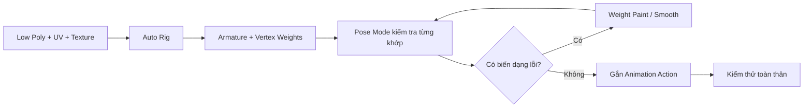

# Bài 05 — Rigging và Animation cho nhân vật 3D do AI tạo

> **Chủ đề:** Auto Rigging, Mixamo, AccuRig, Armature, Weight Paint và Action Editor  
> **Công cụ:** Blender; Mixamo hoặc AccuRig  
> **Sản phẩm:** Nhân vật được gắn xương, sửa biến dạng và thử tối thiểu một hoạt ảnh.

## 1. Tóm tắt

Một mô hình có topology đẹp và texture hoàn chỉnh vẫn là vật thể tĩnh cho đến khi được điều khiển bằng **Rigging**. Trong rigging, một hệ xương (`Armature`) được liên kết với mesh; các đỉnh nhận **trọng số ảnh hưởng (Vertex Weights)** từ các xương để chuyển động cùng nhân vật. Auto-rig giúp tạo nhanh bộ xương ban đầu nhưng thường vẫn cần chỉnh `Weight Paint`, đặc biệt với nhân vật có bụng lớn, tay ngắn hoặc hình dáng khác người thật.

Bài này giới thiệu hai quy trình: **Mixamo** để rig và lấy hoạt ảnh nhanh; **AccuRig** để đặt các mốc cơ thể và bàn tay chi tiết hơn. Blender đảm nhiệm việc kiểm tra, sửa trọng số và tổ chức các Action.

## 2. Mục tiêu học tập

Sau bài này, người học có thể:

- Chuẩn bị và xuất mesh để dùng dịch vụ auto-rig.
- Gắn mốc xương đúng cho thân, gối, cánh tay và số ngón tay thực tế.
- Nhập tệp FBX đã rig vào Blender và khôi phục vật liệu nếu thiếu.
- Xác định và sửa vùng biến dạng sai bằng `Weight Paint`.
- Nhập chuyển động mới và quản lý chúng bằng `Action Editor`.
- Kiểm tra animation lặp, độ xuyên mesh và tư thế nghỉ.

## 3. Rigging hoạt động như thế nào?

Khi xoay một xương, không phải mọi đỉnh trên nhân vật đều dịch chuyển như nhau. Một đỉnh gắn chủ yếu vào xương tay sẽ đi theo tay, còn một đỉnh ở bụng không nên bị kéo theo quá mạnh khi nâng vai. `Weight Paint` thể hiện và chỉnh những quan hệ đó bằng trọng số, trong đó giá trị **0** nghĩa là xương đang xét không ảnh hưởng đến đỉnh và **1** biểu thị mức ảnh hưởng tối đa của xương đó trước khi xét cách chuẩn hóa, các xương khác và thuật toán skinning.

## 4. Chuẩn bị nhân vật cho Auto Rig

- Chỉ xuất những mesh thuộc nhân vật, chẳng hạn thân và mắt; loại camera, đèn, nền và mô hình cũ khỏi tập xuất.
- Kiểm tra topology và các modifier cần xử lý. Nếu modifier thay đổi mesh khi xuất, hãy cân nhắc Apply trên **bản sao**.
- Kiểm tra nhân vật nhìn đúng hướng trước khi đưa vào dịch vụ rigging.
- Cân nhắc tư thế trung tính như T-pose hoặc tư thế phù hợp với công cụ.
- Lưu nguyên bản low-poly có UV/material để đối chiếu với bản FBX mới.

Trong ví dụ thực hành Mixamo, việc xuất FBX được điều chỉnh Scale **100** nhằm bù vấn đề tỷ lệ khi nhập lại. Đây là cách xử lý *cho pipeline cụ thể*, không phải luật chung. Hãy kiểm tra đơn vị, Import/Export Scale và kích thước thực tế thay vì luôn nhân 100.

## 5. Quy trình A — Rig với Mixamo

### 5.1. Auto Rig

1. Xuất nhân vật ở định dạng FBX phù hợp và tải lên Mixamo.
2. Kiểm tra chiều hướng nhân vật trước khi xác nhận.
3. Đặt các marker theo hướng dẫn của Mixamo: cằm/vùng giữa người, cổ tay, khuỷu tay, gối, háng tùy giao diện.
4. Chọn thiết lập số ngón phù hợp. Ví dụ khủng long thực hành có **ba ngón tay**, không nên giữ mặc định của bàn tay năm ngón nếu có lựa chọn tương ứng.
5. Chạy auto-rig, thử tư thế/chuyển động có sẵn và quan sát vùng bụng, vai, gối và bàn tay.

### 5.2. Nhập FBX vào Blender

Tải nhân vật đã rig với định dạng `FBX` và tư thế `Original Pose` hoặc tư thế trung tính phù hợp. Trong Blender, tạo collection mới như `MIXAMO_RIG`, nhập FBX và ẩn bản gốc để tránh nhìn nhầm đối tượng. Nếu material không hiện, gắn lại vật liệu từ bản low-poly đã có UV; kiểm tra ảnh texture có còn liên kết hay không.

Chọn Armature, bật hiển thị xương phía trước mesh (`In Front`) để có thể nhìn thấy bone trong thân. Chuyển `Pose Mode`, chọn xương và nhấn `R` để xoay thử. Xoay riêng hai tay, đầu và từng chân sẽ giúp phát hiện lỗi trọng số trước khi chạy cả một động tác nhảy.

## 6. Weight Paint — sửa hiện tượng kéo méo

### 6.1. Vùng bụng bị kéo theo vai

Với nhân vật bụng lớn, auto-rig có thể gán quá nhiều trọng số của xương vai vào những đỉnh bụng. Khi nâng tay, bụng bị kéo lệch hoặc lõm. Cách xử lý:

1. Chọn Armature và mesh theo cách phù hợp với phiên bản Blender, vào `Weight Paint` của mesh.
2. Chọn bone/Vertex Group có ảnh hưởng sai.
3. Dùng cọ đặt **Weight 0** hoặc giảm giá trị để bớt ảnh hưởng của xương tay tại bụng.
4. Dùng công cụ `Smooth` để làm mượt ranh giới trọng số.
5. Xoay xương liên tục để kiểm tra, tránh xóa quá nhiều trọng số khiến vùng da bị thiếu hỗ trợ.

Làm tương tự với chân, phần bụng dưới hoặc vùng hông khi chạy hoạt ảnh. Nên sửa từng bone có vấn đề thay vì làm mượt toàn bộ model không kiểm soát. Nếu công cụ Smooth có tham số Iterations, dùng số vòng vừa đủ để giữ form; ví dụ thực hành thử mức **5 lượt** cho một thao tác cụ thể.

### 6.2. Checklist kiểm thử biến dạng

| Bài thử | Điều cần quan sát |
| --- | --- |
| Nâng tay lên cao | Bụng không bị kéo theo vai quá nhiều |
| Dang tay và hạ tay | Không xuất hiện nếp gãy bất thường ở nách |
| Gập gối | Mặt đùi/bắp chân không xuyên qua nhau nghiêm trọng |
| Xoay đầu/cổ | Cổ và phần đầu nối mượt, không bị tách |
| Cử động ngón | Ngón đi đúng hướng, không bị xoắn hoặc dính |
| Chạy hoạt ảnh toàn thân | Không có xương gây ảnh hưởng sang vùng không liên quan |

## 7. Đưa animation Mixamo vào Blender

### 7.1. Tải và điều chỉnh chuyển động

Trong thư viện Mixamo, chọn animation phù hợp với tỷ lệ nhân vật, ví dụ điệu nhảy có khoảng cách tay rộng để tránh tay đâm vào bụng. Tham số điều chỉnh trên giao diện animation có thể giúp thay đổi độ rộng cánh tay trước khi tải về. Ví dụ thực hành sử dụng FBX với tốc độ **30 fps**.

### 7.2. Action Editor và Timeline

Nhập FBX animation vào Blender. Mở vùng `Dope Sheet`, chuyển sang `Action Editor`, tìm Action đã nhập và đặt tên rõ nghĩa như `Twist_Dance`. Khi dữ liệu Action đã được lưu và liên kết hợp lý trong file, có thể áp dụng Action lên Armature nhân vật cùng cấu trúc xương. Hãy đảm bảo Action được giữ lại khi xóa đối tượng phụ; cần quản lý số người dùng dữ liệu hoặc đánh dấu lưu Action phù hợp để tránh mất dữ liệu không dùng.

Ví dụ minh họa có một chuyển động với frame cuối khoảng **285**, một chuyển động khác khoảng **137**; mốc frame của project phải khớp **độ dài thực tế của Action đang chọn**. Đặt End Frame rồi phát thử để quan sát đoạn lặp. Không nên tự ý cắt về 225 nếu mục tiêu là giữ nguyên animation dài 285 frame; chỉ cắt khi đã kiểm tra chuyển động vẫn tạo vòng lặp mong muốn.

## 8. Quy trình B — Rig với AccuRig

AccuRig sử dụng ứng dụng/luồng riêng để gắn marker và tạo rig. Quy trình tổng quát:

1. Xuất nhân vật FBX ở tư thế thích hợp và nhập vào AccuRig.
2. Kiểm tra **đường tâm**; dùng hướng đối xứng nếu nhân vật phù hợp.
3. Đặt mốc thân, vai, hông, gối và bàn chân theo hình minh họa của công cụ.
4. Sang phần bàn tay, kiểm tra số ngón và vị trí ngón cái. Với bàn tay ba ngón, đánh dấu đúng từng ngón; không nên tin tuyệt đối vào kết quả tự phát hiện.
5. Quan sát hướng marker định hướng ngón cái/bàn tay. Nếu hướng sai, rig có thể hiểu toàn bộ cổ tay đã xoay.
6. Chạy rig, xem trước các tư thế và điều chỉnh nếu tay xuyên vào bụng hoặc chân bị đặt sai.
7. Xuất FBX ở tùy chọn phù hợp với Blender; có thể xuất nhân vật kèm rig hoặc đi cùng chuyển động nếu gói/tài khoản hỗ trợ.

Một số kho chuyển động yêu cầu thao tác thêm vào tài khoản hoặc giấy phép kể cả khi giá hiển thị bằng 0. Khi xuất asset để phân phối, luôn phân biệt **rig tự tạo** với **animation kèm theo** và quyền sử dụng animation.

### 8.1. Chỉnh tư thế khi nhập

Nếu FBX nhập vào Blender có pose lạ, kiểm tra `Pose Mode` và dùng thao tác reset biến đổi của bone phù hợp, chẳng hạn chọn xương rồi `Alt + R` để xóa rotation pose. Việc reset pose không nhất thiết sửa được lỗi `Rest Pose`, bone orientation hoặc trục import; hãy xác định đúng loại sai lệch trước khi chỉnh cấu trúc armature.

## 9. So sánh hai hướng triển khai

| Tiêu chí | Mixamo | AccuRig |
| --- | --- | --- |
| Luồng chính | Tải nhân vật, gắn marker, preview và lấy animation | Dùng ứng dụng/luồng rig với marker thân và bàn tay chi tiết |
| Tính thuận tiện | Nhanh cho nhân vật gần hình người | Hữu ích khi cần kiểm tra các mốc tay/ngón kỹ hơn |
| Sửa lỗi sau auto-rig | Blender Weight Paint | Blender Weight Paint |
| Chuyển động | Có thư viện animation để thử | Có thư viện/định dạng xuất tùy dịch vụ và giấy phép |
| Hạn chế chung | Cấu trúc nhân vật khác hình người có thể rig sai | Cấu trúc khác hình người vẫn cần kiểm tra thủ công |

Dù dùng công cụ nào, **auto-rig chỉ tạo bản xuất phát**. Chất lượng cuối phụ thuộc kiểm tra từng khớp và giảm ảnh hưởng sai của các xương.

## 10. Lỗi thường gặp

| Lỗi | Cách xử lý |
| --- | --- |
| FBX nhập vào quá nhỏ/quá lớn | Kiểm tra thang đo của file xuất và tùy chọn import, không nhân Scale tùy ý |
| Tay kéo méo bụng | Giảm trọng số bone tay ở bụng rồi Smooth |
| Ngón tay xoắn | Kiểm tra marker, hướng ngón cái và bone orientation |
| Action không xuất hiện | Kiểm tra Dope Sheet/Action Editor, armature và dữ liệu animation đã nhập |
| Xóa file phụ rồi mất Action | Đảm bảo Action được giữ trong file, kiểm tra người dùng dữ liệu |
| Hoạt ảnh bị giật khi lặp | Kiểm tra first/last frame, lựa chọn End Frame và sự liên tục của pose |

## 11. Bài thực hành và tiêu chí hoàn thành

**Đề bài:** Rig nhân vật có ít nhất hai tay, hai chân và phần đầu. Nhập một chuyển động (ví dụ dance/idle), sửa ít nhất một vùng Weight Paint sai và lưu kết quả.

- [ ] Bone chính nằm đúng vị trí trên nhân vật.
- [ ] Cánh tay, đầu và chân xoay được mà không kéo méo nặng vùng khác.
- [ ] Material/texture vẫn hiển thị trên mesh sau khi import FBX.
- [ ] Có ít nhất một Action tên rõ ràng trong file.
- [ ] Đã xem trước hoạt ảnh nhiều lần và kiểm tra đoạn lặp.
- [ ] Lưu `05_rigged_character.blend`.

## 12. Câu hỏi ôn tập

### Câu 1

Khi nâng tay, bụng bị kéo lên theo vai, phần nào cần kiểm tra đầu tiên?

A. Texture Base Color.  
B. UV Island của gai.  
C. Weight Paint / Vertex Group của các xương liên quan.  
D. Tên camera.

**Đáp án:** C.  
**Giải thích:** Hiện tượng mesh biến dạng ngoài vùng mong muốn thường liên quan trọng số xương hoặc vị trí bone.

### Câu 2

Trọng số bằng 0 của một bone đối với đỉnh có nghĩa gì?

A. Bone đó không có ảnh hưởng lên đỉnh xét theo trọng số đó.  
B. Bone đó làm đỉnh chuyển động gấp đôi.  
C. Bone sẽ tự bị xóa.  
D. Đỉnh trở thành UV Seam.

**Đáp án:** A.  
**Giải thích:** Weight 0 loại ảnh hưởng của bone đang xét tại đỉnh, còn Weight 1 là ảnh hưởng tối đa trong nhóm.

### Câu 3

Tại sao phải điều chỉnh mốc ngón tay khi nhân vật chỉ có ba ngón?

A. Vì ảnh texture chỉ hỗ trợ ba ngón.  
B. Vì Blender yêu cầu ít nhất năm ngón.  
C. Vì số ngón không ảnh hưởng kết quả.  
D. Vì marker sai có thể tạo bone ngón và hướng chuyển động không khớp hình học.

**Đáp án:** D.  
**Giải thích:** Marker là dữ liệu để công cụ auto-rig suy ra cấu trúc xương; cấu hình sai dễ tạo rig không chính xác.

### Câu 4

Trong Blender, nơi phù hợp để chọn và quản lý các chuyển động Action là gì?

A. UV Editor.  
B. Action Editor trong vùng Dope Sheet.  
C. Image Editor.  
D. Shader Node Group.

**Đáp án:** B.  
**Giải thích:** Action Editor là nơi gán, đổi tên và quản lý các Action của animation.

### Câu 5

Cách kiểm tra nào đáng tin cậy nhất sau auto-rig?

A. Chỉ render một ảnh chân dung.  
B. Xem số lượng texture.  
C. Xoay từng xương quan trọng rồi chạy hoạt ảnh toàn thân và quan sát biến dạng.  
D. Chỉ kiểm tra tổng số tam giác.

**Đáp án:** C.  
**Giải thích:** Kiểm thử cử động trực tiếp mới phát hiện được các vùng weight sai và chuyển động xuyên mesh.

## 13. Tổng kết

Rigging chuyển nhân vật từ mesh tĩnh thành một hệ có thể tạo dáng và gắn chuyển động. Mixamo và AccuRig giúp rút ngắn bước tạo xương, nhưng **Weight Paint và kiểm thử pose** quyết định sự tự nhiên của kết quả. Trước khi phân phối, cần xác nhận cả hình học, texture, bone lẫn Action đều hoạt động đúng.
