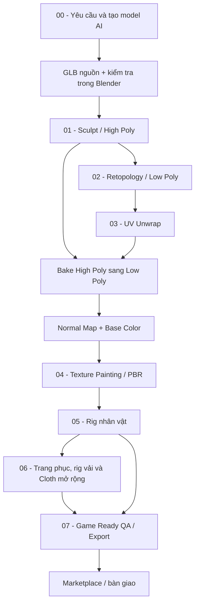

# Khóa học: Từ model AI đến game-ready bằng Blender

> **Trình độ:** Người mới làm quen Blender đến thực hành sản xuất asset 3D  
> **Định hướng:** Nhân vật phong cách stylized dùng cho game, hoạt hình và marketplace  
> **Công cụ:** Blender; Quad Remesher và RetopoFlow (tùy chọn); Mixamo hoặc AccuRig  
> **Sản phẩm xuyên suốt:** Một nhân vật 3D do AI tạo, được kiểm tra, sửa lưới, tối ưu, tạo texture, rig và đóng gói để nhập vào game engine.

## 1. Giới thiệu

Mô hình 3D tạo bằng AI thường gây ấn tượng ngay ở hình ảnh đầu tiên, nhưng vẻ ngoài đẹp chưa đồng nghĩa với **sẵn sàng đưa vào sản xuất**. Lưới có thể quá nặng, mắt và móng vuốt bị biến dạng, topology không phù hợp với khớp, texture không thể sửa thuận tiện hoặc hệ xương hoạt động sai. Khóa học này hướng dẫn giải quyết lần lượt những vấn đề đó bằng quy trình có thể kiểm tra được ở mỗi giai đoạn.

Đích đến không chỉ là một hình render đẹp. Người học cần có **bản High Poly giữ chi tiết**, **bản Low Poly có topology hợp lý**, **UV và texture đã lưu**, **nhân vật đã rig và kiểm thử cử động**, cùng **gói tệp có thể bàn giao**.

## 2. Lộ trình

| Bài | Nội dung | Đầu ra chính |
| --- | --- | --- |
| [00 — Tạo model 3D bằng AI](00-tao-model-3d-bang-ai.md) | Chốt yêu cầu asset, tạo model, xuất GLB, kiểm tra và lưu bản nguồn | Model nguồn + 00_import_check.blend |
| [01 — Sculpting và sửa lưới](01-sculpting-va-sua-luoi.md) | Import GLB, Sculpt Mode, Remesh, Mirror, sửa mắt–răng–sọc–móng | `01_sculpt_highpoly.blend` |
| [02 — Retopology](02-retopology-va-toi-uu-luoi.md) | Quad Remesher, RetopoFlow, Edge Loop cho vùng biến dạng | `02_lowpoly_retopo.blend` |
| [03 — UV Mapping và Baking](03-uv-mapping-va-texture-baking.md) | Seam, Unwrap, Pack Islands, bake Normal và Base Color | `03_uv_bake.blend` + ảnh texture |
| [04 — Texture Painting và PBR](04-texture-painting-va-pbr.md) | Paint, Clone, Smear, Roughness, Stencil Projection | `04_painted_character.blend` + texture |
| [05 — Rigging và Animation](05-rigging-va-animation.md) | Mixamo / AccuRig, Weight Paint, Action Editor, thử hoạt ảnh | `05_rigged_character.blend` |
| [06 — Trang phục, Rig và Cloth Simulation (mở rộng)](06_mo_rong_rig_trang_phuc_va_cloth/README.md) | 16 bài về gắn trang phục, rig vải, cloth simulation và bake chuyển động cho game | Nhân vật có trang phục đã kiểm tra |
| [07 — Game Ready, Export và Marketplace](07-game-ready-export-va-marketplace.md) | QA cho game, kiểm tra xuất nhập, đóng gói asset, chuẩn bị listing | Gói asset đã kiểm tra và nội dung listing |

Với asset có trang phục mô phỏng, học mô-đun 06 sau rig nhân vật rồi sang QA/Export ở mô-đun 07. Các asset khác có thể hoàn thành sau mô-đun 05 và dùng mô-đun 07 để kiểm tra.

## 3. Sơ đồ quy trình

**Giải thích:** Giữ model AI nguồn để đối chiếu. Bản High Poly lưu chi tiết đã sửa; bản Low Poly giữ silhouette và topology phù hợp với biến dạng. Low Poly cần có UV trước khi nhận kết quả bake. Sau khi hoàn thiện texture và animation, kiểm tra lại file xuất bằng cách nhập vào một scene hoặc project sạch.

## 4. Quy ước làm bài

- Giữ nguyên mô hình AI nhập ban đầu trong một collection dự phòng. Không chỉnh trực tiếp bản duy nhất.
- Sau mỗi bài, lưu một tệp `.blend` mới và kiểm tra kết quả trước khi học bài tiếp.
- Nếu không có khủng long, có thể dùng nhân vật khác; những bước đặc thù như gai, đuôi và ba ngón tay được điều chỉnh theo hình học thực tế.
- Tập trung vào kết quả quan sát được hơn là sao chép máy móc các giá trị tham số ví dụ. Tỷ lệ đối tượng, số đa giác và phiên bản Blender có thể khác nhau.
- Bài học có câu hỏi trắc nghiệm kèm đáp án và giải thích để tự ôn tập.

## 5. Tiêu chí hoàn thành khóa học

- [ ] Mô hình không còn các lỗi hình học chính gây khó chịu khi nhìn từ nhiều góc.
- [ ] Low Poly giữ được silhouette và có luồng cạnh phù hợp tại khớp.
- [ ] UV không kéo giãn nghiêm trọng; các đảo được đóng gói hợp lý.
- [ ] Normal Map và Base Color bake đúng vật thể, được lưu ra ảnh.
- [ ] Texture không còn lỗi rõ rệt tại các vùng đã chỉnh sửa.
- [ ] Rig có thể xoay các khớp chính mà không làm méo các vùng không liên quan.
- [ ] File xuất có scale, hướng, vật liệu và texture đúng với yêu cầu của project đích.
- [ ] Tệp FBX hoặc GLB đã được nhập thử lại; không thiếu texture, mesh hay animation cần bàn giao.
- [ ] File bàn giao có tên rõ ràng, có ảnh xem trước, và nội dung mô tả phản ánh đúng asset thực tế.

## 7. Tài liệu ChatGPT liên quan

Bộ ZIP gốc có sáu bài từ Sculpt tới Export. Bộ Markdown Blender_Clothing_Rigging_Cloth_Animation trong Downloads đã được thêm thành mô-đun mở rộng 06. Năm liên kết dưới đây được lưu làm nguồn tham khảo; nội dung riêng trong các cuộc trò chuyện chưa được đọc để xác định chúng có tài liệu bổ sung nào khác.

- [Cuộc trò chuyện 1](https://chatgpt.com/c/6addac54-ade0-83ec-b5c3-beb3c86f2b7b)
- [Cuộc trò chuyện 2](https://chatgpt.com/c/6addacc7-6544-83ec-acb7-0fa3b76e6066)
- [Cuộc trò chuyện 3](https://chatgpt.com/c/6addade5-c65c-83ec-b63b-7d196ee014ba)
- [Cuộc trò chuyện 4](https://chatgpt.com/c/6addaec5-54e4-83ec-ae98-ca5e66779c2d)
- [Cuộc trò chuyện 5](https://chatgpt.com/c/6addaf72-03c4-83ec-8747-6bce84f91ea1)

> **Ghi chú kỹ thuật:** Giao diện, tính năng add-on, định dạng hỗ trợ và quy định của marketplace có thể khác theo phiên bản hoặc thời điểm. Các giá trị như Voxel Size `0.002`, khoảng `4.000 quads` hay texture `4K` trong bài là **thiết lập của ví dụ thực hành**, không phải tiêu chuẩn bắt buộc với mọi mô hình.
