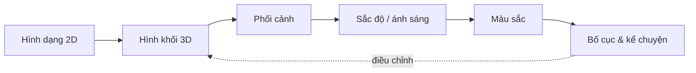
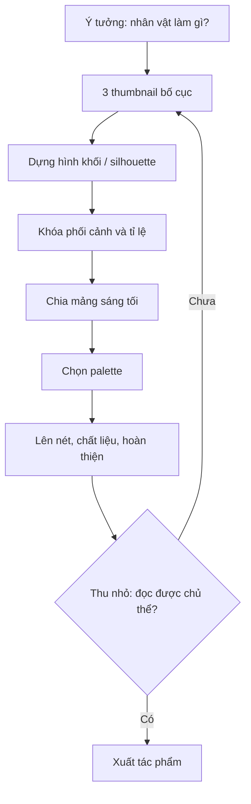

# Bài 01 — Năm yếu tố nền tảng của vẽ minh họa

**Mục tiêu:** (1) gọi đúng tên năm nhóm kiến thức; (2) phân biệt hình phẳng và hình khối; (3) thiết kế được trình tự vẽ tối ưu; (4) biết tự chẩn đoán lỗi tranh.

**Nguồn chính:** `Pasted markdown(20261028-163743).md`, khoảng 02:57–14:45. **Bổ sung biên soạn:** ví dụ minh họa manga, checklist và bài tập.

## 1. Vẽ không chỉ là sao chép đường viền

Một hình minh họa có thể là chân dung nhân vật, khung truyện, áp phích, hay một vật rất đơn giản. Khi xem, người xem phải nhận ra *cái gì đang hiện diện* và, nếu tranh có mục đích kể chuyện, *điều gì quan trọng*. Ngay cả tranh không mang thông điệp kể chuyện cụ thể vẫn cần ngôn ngữ thị giác để tạo trải nghiệm.

Các nhân tố cùng làm việc:

| Yếu tố | Câu hỏi cần giải quyết | Dấu hiệu thường gặp khi yếu |
|---|---|---|
| **Hình dạng/hình khối** (*shape/form*) | Vật thể có cấu trúc và thể tích gì? | Cơ thể méo, đồ vật mất độ dày |
| **Phối cảnh** (*perspective*) | Ta nhìn vật từ vị trí nào? | Bàn ghế không cùng không gian, nền sai tỉ lệ |
| **Sắc độ & ánh sáng** (*value/shading*) | Mặt nào hướng sáng, mặt nào tối? | Khối phẳng, bóng đổ vô lý |
| **Màu sắc** (*color*) | Tâm trạng, sự hài hòa và điểm nhấn màu ở đâu? | Mọi màu đều chói, điểm nhấn bị chìm |
| **Bố cục** (*composition*) | Người xem nhìn đâu trước, sau và cuối? | Tranh rối, điểm chính không rõ |

Sơ đồ là **thứ tự học đề xuất**, không phải các yếu tố tách biệt hoàn toàn. Trong thực tế, bố cục nên được dự kiến từ thumbnail đầu tiên, sau đó mới hoàn thiện phối cảnh và ánh sáng.

## 2. Hình dạng (shape) và hình khối (form)

- **Shape:** hình 2 chiều, có chiều rộng và chiều cao, như tam giác, tròn, vuông hoặc silhouette của nhân vật.
- **Form:** đối tượng được hiểu trong không gian 3 chiều, có chiều sâu: hộp, cầu, trụ, nón, hình khối hữu cơ.
- **Silhouette:** phần đường bao đặc trưng; nếu tô nhân vật thành một màu đen và vẫn đọc được tư thế, silhouette rõ.

Ví dụ: nón phù thủy có thể bắt đầu bằng **tam giác 2D**; khi dựng thành 3D ta thấy **hình nón**, phần vành là **đĩa elip**. Một chiếc cốc là **hình trụ**, quai là một **vòng cong có độ dày**.

### Quy trình vẽ một chiếc cốc

1. Xác định mặt trên bằng elip (hình tròn nhìn nghiêng).
2. Dựng hai đường biên thân cốc có độ rộng hợp lý.
3. Vẽ đáy cốc và độ dày miệng cốc.
4. Thêm quai bằng khối cong, phân biệt mặt trước/mặt sau.
5. Kiểm tra cấu trúc rồi mới thêm hoa văn và ánh sáng.

**Nguyên tắc:** *đúng khối trước, đẹp chi tiết sau*. Nếu bạn chỉ tô vân cốc mà bỏ qua độ dày thành cốc, người xem vẫn dễ cảm thấy vật không thật.

## 3. Phối cảnh — sự nhất quán của góc nhìn

Cùng một chiếc hộp, góc nhìn ngang tầm mắt, nhìn từ trên cao và nhìn từ dưới lên tạo ba cảm giác khác nhau. Phối cảnh không chỉ dùng cho tòa nhà; đầu, tay, chân, quần áo và các đạo cụ của nhân vật đều phải được đặt hợp lý trong không gian.

- Góc ngang: ổn định, quen thuộc.
- Góc từ thấp: có thể tạo cảm giác quy mô, uy lực.
- Góc từ cao: thường cho ta thấy sàn và quan hệ vị trí trong không gian.

Các hiệu ứng kể trên là khả năng biểu đạt, **không phải quy luật cảm xúc bất biến**. Xem [Bài 03](03-phoi-canh-mot-hai-ba-diem.md).

## 4. Sáng tối — thấy khối bằng giá trị

Tưởng tượng một hình tròn phẳng. Khi thêm vùng sáng, vùng tối và bóng đổ phù hợp, nó được đọc như một quả cầu. Nhưng bóng tối phải xuất phát từ cấu trúc khối và nguồn sáng, không phải bôi đen tùy ý.

Trình tự tốt: **phác khối → xác định hướng sáng → chia nhóm sáng/tối → thêm bóng đổ → tinh chỉnh chất liệu**. Xem [Bài 04](04-sac-do-va-ky-thuat-danh-bong.md) và [Bài 05](05-anh-sang-bong-do-va-chat-lieu.md).

## 5. Màu và bố cục là công cụ giao tiếp

- **Màu:** có thể gợi không khí, phân biệt vật thể và tạo vùng nổi bật. Không phải cứ chọn “màu thực” của từng vật là tranh sẽ hài hòa.
- **Bố cục:** quyết định vai trò chính/phụ, khoảng trống, sự cân bằng, thứ tự nhìn và nhịp chuyển động của mắt.

Hai tranh cùng nhân vật có thể tạo ấn tượng rất khác nếu một tranh dùng nền tối, điểm sáng ở khuôn mặt và đường nét hội tụ về mắt; tranh còn lại có họa tiết/độ tương phản dàn đều khắp nơi.

## 6. Quy trình 6 bước cho một minh họa manga

### Phân tích lỗi mẫu

**Tình huống:** mặt nhân vật đẹp, chi tiết tóc sắc, nhưng bàn tay như dán lên nền; bối cảnh nghiêng khác hướng. **Không nên** vẽ thêm hàng trăm sợi tóc. **Nên** quay lại dựng hộp đơn giản cho cánh tay/bàn tay, kiểm tra góc nhìn camera và vị trí các đường tụ trong bối cảnh.

## 7. Bài tập — 25–35 phút

1. Chọn một đồ vật trên bàn, vẽ **3 silhouette khác nhau** (3 × 2 phút).
2. Dựng vật thành hộp, cầu hoặc trụ trong **3 góc nhìn** (3 × 4 phút).
3. Vẽ **hai thumbnail** cho cảnh “nhân vật đứng trước cửa” với điểm nhấn khác nhau (2 × 4 phút).
4. Tự chấm: vật thể có độ dày? Góc nhìn thống nhất? Nhìn thu nhỏ có thấy chủ thể? (5 phút).

**Tiêu chí hoàn thành:** ít nhất 1 vật dựng được bằng 2–3 khối đơn giản; một thumbnail khiến người xem nhận ra chủ thể ngay trong 2 giây.

### Tự kiểm tra

- Vì sao dựng form thường quan trọng hơn render chất liệu ở giai đoạn đầu?
- Cần kiểm tra gì nếu nhân vật và bối cảnh trông như ở hai mặt phẳng khác nhau?
- Bố cục chỉ cần được nghĩ đến khi đã hoàn thành nét vẽ có đúng không?

**Tiếp theo:** [Bài 02 — Hình dạng và hình khối](02-hinh-dang-va-hinh-khoi.md).
