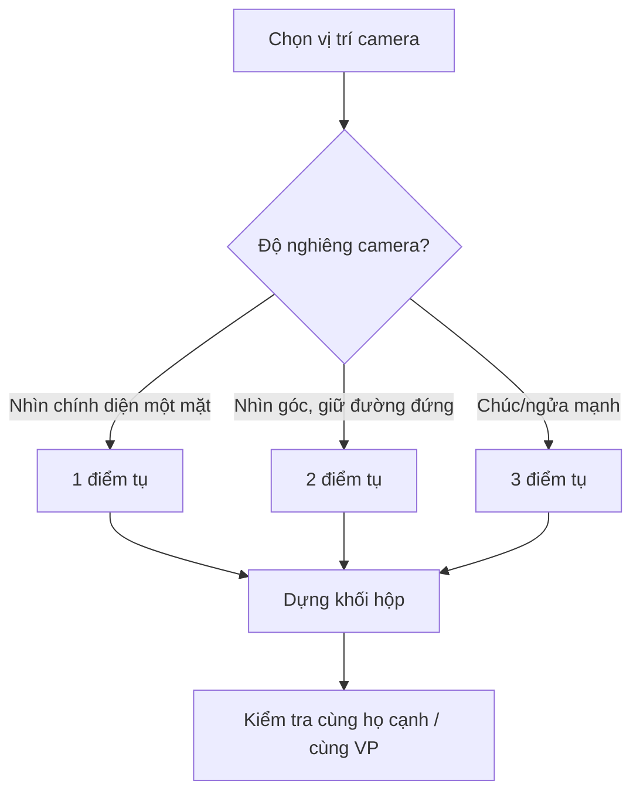

# Bài 03 — Phối cảnh một, hai và ba điểm tụ

**Mục tiêu:** hiểu đường chân trời, điểm tụ, đường hướng dẫn; dựng được hộp và không gian ở cả ba hệ phối cảnh; ứng dụng góc nhìn vào minh họa manga.

**Nguồn chính:** `Pasted markdown (6)(2).md` (00:01–34:29). **Đối chiếu và bổ sung:** tài liệu Interlochen, Adobe Certified Professional và Wacom (đường dẫn ở Bài 10).

## 1. Phối cảnh là gì?

**Phối cảnh tuyến tính** mô phỏng cách các đường song song trong không gian có thể xuất hiện hội tụ khi nhìn trên mặt phẳng ảnh. Đó là một cách xây dựng cảm giác xa–gần, không đồng nghĩa với toàn bộ khái niệm góc máy hay thị giác người.

Ba thuật ngữ:

- **Đường chân trời / đường tầm mắt (horizon/eye-level line):** trong bài vẽ phối cảnh ngang tiêu chuẩn, biểu diễn cao độ mắt của người quan sát; có thể nằm ngoài khung hình.
- **Điểm tụ (vanishing point, VP):** điểm trên mặt phẳng ảnh mà hình chiếu của một họ các đường song song theo cùng hướng dường như hội tụ về. Không phải “vật thể thực sự biến mất tại đây”.
- **Đường dựng hình/đường hướng dẫn (construction/orthogonal lines):** các tia hoặc cạnh được kéo về điểm tụ để giữ hình học nhất quán.

> Lưu ý chuẩn thuật ngữ: ở phối cảnh 1 điểm/2 điểm với phương đứng được giữ thẳng, các điểm tụ theo phương ngang nằm trên đường tầm mắt. Phối cảnh 3 điểm thêm một điểm tụ theo phương đứng ở trên hoặc dưới đường tầm mắt.

## 2. Phối cảnh một điểm tụ

**Phù hợp:** hành lang nhìn chính diện, đường phố thẳng, một phòng có mặt sau đối diện người xem.

```text
+--------------------------------------+
|  \                 |               /  |
|   \                |              /   |
|----\---------------VP------------/----|  ← đường tầm mắt
|     \              |            /     |
|      \             |           /      |
+--------------------------------------+
   các cạnh theo chiều sâu hướng về VP
```

**Dựng một căn phòng:**

1. Kẻ đường tầm mắt ngang; chấm một điểm tụ VP.
2. Vẽ một chữ nhật nhỏ làm tường cuối phòng.
3. Nối các góc chữ nhật tới rìa trang bằng tia hướng về VP.
4. Đặt đường sàn/tường và đồ vật; những cạnh vuông góc với mặt tranh đi về VP.
5. Kiểm tra độ lớn vật thể giảm hợp lý theo khoảng cách; thêm nhân vật cuối cùng.

*Không phải mọi cạnh trong hình đều đi về VP.* Các cạnh nằm trên mặt phẳng song song mặt tranh vẫn có thể hiện ngang hoặc đứng.

## 3. Phối cảnh hai điểm tụ

**Phù hợp:** nhìn một góc tòa nhà, hộp quay so với người xem, đường phố có hai hướng mặt tiền.

```text
VP trái •------------------------------• VP phải
          \        |         /
           \       |        /
            \      |       /
             \     |      /
               cạnh đứng gần nhất
```

**Dựng một tòa nhà:**

1. Chọn đường tầm mắt và **VP trái/VP phải**, nên đặt cách nhau đủ xa để tránh méo mạnh.
2. Vẽ **cạnh thẳng đứng gần người xem nhất**.
3. Từ hai đầu cạnh này, kẻ đường về cả VP trái và VP phải.
4. Xác định bề rộng hai mặt bằng hai cạnh đứng phụ.
5. Dóng về VP đối diện để đóng mặt mái/đáy, sau đó thêm cửa sổ và đường gạch theo cùng hệ tụ.

**Kiểm tra:** cùng một họ cạnh song song trong thế giới 3D phải có cùng hướng tụ. Không để một hàng cửa sổ chạy về VP trái trong khi mái cùng phương lại chạy về chỗ khác.

## 4. Phối cảnh ba điểm tụ

Hệ này dùng khi camera **ngửa mạnh hoặc chúc xuống**, nên ngay cả các cạnh từng thẳng đứng trong phối cảnh 2 điểm cũng bắt đầu có xu hướng hội tụ.

- **Nhìn từ thấp lên:** điểm tụ thứ ba có thể ở phía trên; tòa nhà có cảm giác vươn cao.
- **Nhìn từ cao xuống:** điểm tụ thứ ba thường nằm phía dưới; nhấn cảm giác nhìn xuống.
- Cả hai trường hợp đều cần kiểm soát độ méo. Đặt điểm tụ quá gần khung hình thường khiến vật bị kéo giãn mạnh.



## 5. Ba góc nhìn cho cùng một cảnh manga

**Cảnh:** nhân vật đứng trước cổng trường.

| Phương án | Bố trí | Hiệu quả thường gặp |
|---|---|---|
| Ngang tầm mắt, 1 VP | Hành lang kéo dài sau nhân vật | Hút mắt vào nhân vật; rõ không gian |
| Góc 3/4, 2 VP | Thấy hai mặt của tòa nhà | Có chiều sâu, thiết lập bối cảnh |
| Góc thấp, 3 VP | Camera gần đất, nhân vật/tòa nhà vươn lên | Kịch tính, nhấn chiều cao/quy mô |

Các hiệu quả tâm lý phụ thuộc thêm vào ánh sáng, kích thước khung và bối cảnh truyện; không có công thức bắt buộc.

## 6. Từ khối hộp sang nhân vật

1. Vẽ **hộp quy ước** bao quanh đầu/thân theo hướng camera.
2. Đặt mặt trước, hai bên và đường trục; sau đó thay hộp bằng cấu trúc giải phẫu đơn giản.
3. Với cánh tay đưa về trước, đặt tay lớn hơn tương ứng gần camera (foreshortening — rút ngắn hình chiếu).
4. Chú ý khối vai, ngực, chậu có thể xoay khác nhau nhưng vẫn sống trong cùng không gian.

Đường dựng hình có thể được lược bỏ khi tay nghề tăng, nhưng việc không vẽ chúng ra **không đồng nghĩa** nghệ sĩ không tư duy theo phối cảnh.

## 7. Bài thực hành bắt buộc

- **Bài A (20 phút):** căn phòng 1 VP có giường, bàn, cửa; đánh dấu VP rõ.
- **Bài B (25 phút):** tòa nhà 2 VP có 2 tầng, 4 cửa sổ mỗi mặt; mọi cửa sổ bám mặt tường.
- **Bài C (25 phút):** 1 tòa nhà 3 VP nhìn từ dưới lên; so sánh với phiên bản 2 VP cùng tòa nhà.
- **Bài D (15 phút):** vẽ 3 thumbnail nhân vật cùng một bối cảnh từ ba vị trí camera.

**Rubric 10 điểm:** chân trời/VP 2; tính nhất quán cạnh 3; tỉ lệ xa–gần 2; đọc được khối 2; lựa chọn góc nhìn phù hợp câu chuyện 1.

### Sai lầm và cách sửa

- **Các đường lùi không tụ đúng:** kéo cạnh bằng thước ra ngoài canvas để đối chiếu.
- **VP quá gần:** mở rộng vùng giấy hoặc giảm độ nghiêng camera.
- **Dùng 1 VP cho hộp quay góc:** đổi sang 2 VP nếu nhìn thấy hai mặt bên rõ.
- **Nhầm méo ống kính với phối cảnh 3 VP:** phối cảnh tuyến tính giữ đường thẳng là đường thẳng; méo quang học dạng cong là vấn đề khác.

**Tiếp theo:** [Bài 04 — Sắc độ](04-sac-do-va-ky-thuat-danh-bong.md).
