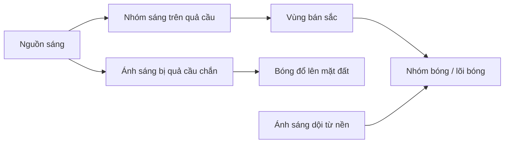

# Bài 04 — Sắc độ (value) và nền tảng đánh bóng (shading)

**Mục tiêu:** đọc tranh bằng các mảng sáng–tối; dựng giá trị xám của các khối cơ bản; phân biệt bóng trên vật, bóng đổ và ánh sáng phản xạ.

**Nguồn chính:** `Pasted markdown (2)(20261028-163808).md`, khoảng 00:42–15:50. **Bổ sung biên soạn:** thang giá trị, bài tập 2/3/5 sắc độ và lưu ý hình học ánh sáng.

## 1. Vì sao không nên bắt đầu bằng chi tiết bóng?

Trong phần giảng, tác giả ví một chiếc bánh mới có hình dáng giống như phần dựng khối; trang trí giống như lớp hoàn thiện. Một bánh dựng sai cấu trúc thì nhiều kem chưa chắc khiến nó tốt hơn. Với vẽ cũng vậy: nếu hình khối và phối cảnh sai, tô bóng tinh vi thường chỉ làm lỗi rõ hơn.

**Thứ tự khuyến nghị:**

1. Dựng hình khối đúng.
2. Chọn vị trí nguồn sáng.
3. Phân nhóm sáng và tối lớn.
4. Tinh chỉnh chuyển sắc theo độ cong của bề mặt.
5. Chỉ sau đó xử lý chất liệu và chi tiết.

## 2. Giá trị sáng tối là gì?

**Value** trong hội họa nghĩa là *độ sáng/tối nhìn thấy* của một vùng. Trong tranh đen trắng, có thể mô tả trên dải từ đen đến trắng. Trong tranh màu, value vẫn quan trọng dù hai màu khác hue.

Thang 5 mức:

| Mức | Ký hiệu gợi ý | Chức năng minh họa |
|---|---|---|
| 1 | Đen | Hốc rất tối, bóng tiếp xúc sâu |
| 2 | Xám đậm | Nhóm bóng |
| 3 | Xám trung bình | Trung gian / giá trị vật liệu |
| 4 | Xám sáng | Mặt sáng |
| 5 | Trắng | Điểm nhấn sáng (khi phù hợp) |

**Không phải mỗi vật thể đều cần đủ năm mức.** Manga đen trắng thường làm việc hiệu quả với chỉ hai hoặc ba nhóm giá trị nhờ silhouette, nét và screentone.

## 3. Ánh sáng trên quả cầu

Một quả cầu dưới nguồn sáng tương đối rõ có thể gồm:

- **Highlight / điểm sáng mạnh:** vùng có phản xạ gương hướng về mắt; vị trí phụ thuộc cả hướng nhìn lẫn nguồn sáng và tính chất bề mặt.
- **Light family / nhóm sáng:** những mặt nhận ánh sáng trực tiếp.
- **Halftone / bán sắc:** chuyển tiếp từ sáng về tối trên bề mặt cong.
- **Core shadow / lõi bóng:** dải tương đối tối trên phía không nhận ánh sáng trực tiếp của khối cong trong điều kiện ánh sáng nhất định.
- **Reflected light / ánh sáng phản xạ:** ánh sáng từ nền/vật xung quanh chiếu ngược vào vùng bóng; thường không sáng hơn vùng nhận ánh sáng trực tiếp.
- **Cast shadow / bóng đổ:** vùng trên mặt phẳng hoặc vật khác bị quả cầu che nguồn sáng.
- **Contact shadow / bóng tiếp xúc:** nơi vật chạm nền, thường có vùng rất tối do ít ánh sáng lọt tới.

Lưu ý: sơ đồ phân loại hiện tượng, không phải bản vẽ quang học đúng tỉ lệ. Nguồn sáng lớn và ánh sáng môi trường mạnh có thể khiến các ranh giới mềm, không thấy rõ lõi bóng.

## 4. Ba mức sắc độ cho người mới

Nguồn gốc bài giảng dùng một số giá trị đơn giản để minh họa quả cầu. Khi bắt đầu, chỉ dùng:

- **Sáng:** toàn bộ những vùng nhận sáng tương đối mạnh.
- **Trung gian:** mặt xoay lệch khỏi hướng sáng hoặc vùng sáng thấp hơn.
- **Tối:** mặt khuất sáng + bóng đổ.

Bài tập thuần đen–trắng có thể chỉ dùng hai mức **sáng/tối** để rèn khả năng nhận mảng. Sau khi mảng lớn đúng, thêm các biến thiên mịn khi thật sự cần.

## 5. Cách dựng một quả cầu bằng chì hoặc digital

1. Vẽ vòng tròn và một đường gợi trục quả cầu.
2. Chọn ánh sáng ở phía **trên bên trái**; ghi một mũi tên hướng sáng ngoài vật.
3. Đánh dấu phần **phía phải/dưới** tương đối tối; thiết lập ranh sáng–tối.
4. Vẽ **bóng đổ trên nền** về phía đối diện nguồn sáng, điều chỉnh theo vị trí đèn và mặt đất.
5. Phân bố vùng bán sắc và phản xạ nhẹ trong nhóm bóng nếu muốn.
6. Thêm điểm sáng mạnh có tiết chế; đánh bóng phải phục vụ cảm giác khối tròn.
7. Thu nhỏ và kiểm tra: ngay khi chưa thêm texture, hình có được đọc là quả cầu không?

### Hộp, trụ và cầu khác nhau thế nào?

| Khối | Thay đổi hướng pháp tuyến bề mặt | Dáng chuyển sáng–tối thường gặp |
|---|---|---|
| Hộp | Đột ngột ở cạnh | Mảng sáng/tối tách rõ theo mặt phẳng |
| Trụ | Liên tục quanh mặt cong, đột ngột ở nắp phẳng | Chuyển sáng–tối mềm trên thân, cứng hơn ở mép nắp |
| Cầu | Liên tục theo mọi hướng | Dải bán sắc chuyển mềm theo độ cong |

## 6. Manga: sắc độ trước màu

Một minh họa manga có thể dùng **nền đen**, nhân vật trắng và vài mảng xám để điều khiển tương phản. Đừng đánh bóng từng sợi tóc: gom cả khối tóc thành 2–3 nhóm sáng–tối trước. Sử dụng screentone chỉ sau khi đã rõ tách biệt giữa nhân vật và nền.

**Bài tập 2-value:** dùng màu đen và trắng, vẽ một chân dung bán thân. Không sử dụng nét viền để “cứu” khối; nếu hình chưa đọc được, sửa hình mảng.

## 7. Bài thực hành và đánh giá

- **A (10 phút):** tạo hai thang 5 giá trị, một mịn một phân đoạn; chụp ảnh kiểm tra độ phân biệt các mức.
- **B (20 phút):** đánh sáng 1 hộp, 1 trụ, 1 cầu cùng hướng đèn.
- **C (15 phút):** chuyển 1 hình tham chiếu thành 3 giá trị lớn, không thêm chi tiết.
- **D (10 phút):** đổi hướng sáng của quả cầu từ trái sang phải mà không đổi vị trí vật.

**Checklist:** nguồn sáng nhất quán; bóng đổ đi đúng hướng; vật đọc được thể tích; vùng tối không sáng hơn vùng sáng vì thêm phản xạ quá tay; không bị dàn đều tương phản.

### Câu hỏi

1. Vì sao phải học value trước khi phối màu phức tạp?
2. Bóng trên bề mặt quả cầu và bóng quả cầu đổ lên đất khác nhau gì?
3. Tại sao chuyển sáng trên thân trụ thường mềm hơn trên mặt phẳng hộp?

**Tiếp theo:** [Bài 05 — Ánh sáng và bóng đổ](05-anh-sang-bong-do-va-chat-lieu.md).
