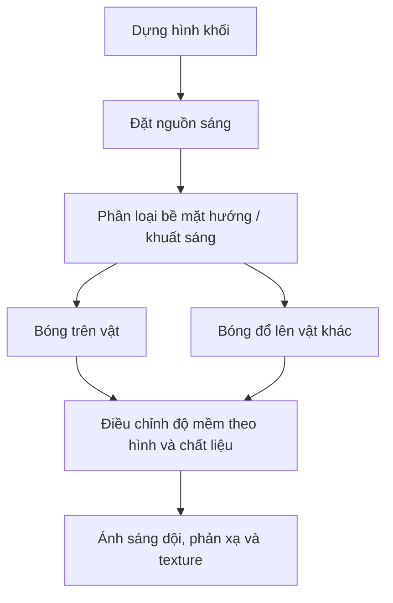

# Bài 05 — Tư duy ánh sáng, bóng đổ và chất liệu

**Mục tiêu:** xác định nguồn sáng và vùng tối trên khối phức tạp; kiểm soát cạnh bóng cứng/mềm; hiểu khi nào nên thêm texture, ánh phản xạ, vật liệu.

**Nguồn chính:** `Pasted markdown (5)(2).md`, khoảng 01:52–12:31; liên hệ `Pasted markdown (2)(20261028-163808).md`, khoảng 07:00–11:50. **Bổ sung:** phân biệt độ mềm bóng, phản xạ và màu vật liệu.

## 1. Ba năng lực tác giả nhấn mạnh

1. **Hiểu hình khối 3D** của đối tượng cần chiếu sáng.
2. **Suy luận được hướng nguồn sáng** và nơi hình thành vùng sáng, vùng tối, bóng đổ.
3. **Điều khiển cách chuyển mảng sáng–tối** dựa vào bề mặt phẳng, cong, nhám hay bóng.

Điều này ứng dụng trực tiếp từ hình trụ đơn giản đến đầu người, xe cộ hoặc đạo cụ manga.

## 2. Học ánh sáng bằng hình trụ

Tưởng tượng một hộp nước hình trụ có đáy phẳng, đặt trên bàn và được chiếu từ trái trên:

- **Mặt bên cong:** hướng bề mặt thay đổi từ nơi gần đèn sang phía khuất, thường cho dải chuyển sắc.
- **Mặt trên phẳng:** nhận lượng ánh sáng khá đồng đều nếu nguồn sáng đủ xa, có thể khác hẳn vùng thân trụ.
- **Bóng đổ trên bàn:** vị trí phụ thuộc quan hệ đèn–trụ–mặt bàn; không đơn giản sao chép đường viền hình trụ rồi làm đen.

**Quy trình:** dựng trục đứng của trụ → kẻ elip trên/dưới → đánh dấu nguồn sáng → thiết lập sáng/tối lớn trên thân → vẽ hướng bóng đổ → tinh chỉnh cạnh và phản xạ.

## 3. Bóng mềm và bóng cứng

Cần phân biệt **ranh giới sáng–tối trên bề mặt vật** với **rìa bóng đổ**:

- **Bề mặt phẳng và có góc cạnh:** chuyển mức tại cạnh có thể rất rõ khi hai mặt quay khác hướng.
- **Bề mặt cong:** pháp tuyến thay đổi liên tục; nếu ánh sáng tương đối khuếch tán, chuyển sáng–tối thường mềm hơn.
- **Nguồn sáng diện tích lớn:** thường cho bóng đổ với vùng nửa tối (penumbra) rộng hơn, mềm hơn.
- **Nguồn sáng nhỏ/xa tương đối:** thường tạo bóng đổ rìa sắc hơn.
- **Khoảng cách bóng với vật chắn:** bóng đổ có thể mềm hơn khi bề mặt nhận bóng ở xa vật chắn; còn phụ thuộc kích thước góc của nguồn sáng.

**Sửa hiểu nhầm:** cạnh bóng mềm/cứng không chỉ do vật là “tròn” hay “vuông”; bóng đổ còn do hình dạng, kích thước nguồn sáng và khoảng cách đến bề mặt nhận bóng.

## 4. Ánh sáng trực tiếp, ánh sáng dội và highlight

| Thành phần | Ý nghĩa | Lưu ý để tranh không giả |
|---|---|---|
| Ánh sáng trực tiếp | Đến từ nguồn chính như mặt trời, đèn | Nên có hướng và độ mạnh tương đối nhất quán |
| Ánh sáng môi trường | Ánh sáng tán xạ từ toàn cảnh | Có thể làm vùng tối sáng lên |
| Ánh sáng phản xạ/dội | Ánh sáng từ bàn, tường, quần áo phản vào vật | Không tùy tiện biến mặt tối thành vùng sáng mạnh hơn mặt chính |
| Highlight | Phản xạ có hướng tạo điểm lóe trên bề mặt | Mạnh/nhỏ trên kim loại hoặc vật bóng; khuếch tán trên vật nhám |
| Bóng tiếp xúc | Giảm sáng tại các khe hoặc tiếp xúc | Đặt nơi có tiếp xúc hợp lý, tránh tô viền đen khắp vật |

## 5. Chất liệu không phải là hoa văn

- **Kim loại:** phản xạ môi trường rõ, chênh sáng–tối và biến thiên phản xạ có thể mạnh, nhanh.
- **Thủy tinh:** truyền sáng, phản xạ và khúc xạ; chỉ tô trắng vài nét sáng không phải lúc nào cũng đủ.
- **Vải cotton nhám:** highlight rộng và yếu hơn bề mặt bóng; nếp gấp quyết định mảng sáng–tối.
- **Da:** chuyển khối mềm, mức độ highlight phụ thuộc tình trạng bề mặt/ánh sáng.
- **Tóc anime:** có thể cách điệu thành những dải sáng, nhưng trước tiên cần thống nhất khối tóc và hướng nguồn sáng.

**Mẹo luyện:** giữ nguyên vật nhưng đổi chất liệu từ gốm mờ sang kim loại bóng. Silhouette và bóng đổ tổng thể gần như giữ nguyên; cách phân bố phản xạ thay đổi. Bài tập này buộc bạn tách **hình học** khỏi **cách thể hiện vật liệu**.

## 6. Hai phong cách thể hiện

### Tô bóng mảng (cel shading)

Sử dụng 2–4 lớp giá trị rõ ràng, thường hữu ích trong manga/anime và render NPR. Hợp với hình stylized; ưu tiên đường ranh mảng được thiết kế có chủ đích.

### Đánh bóng mềm (soft shading)

Dùng các chuyển sắc mịn hơn, thuận lợi cho bề mặt cong hay ánh sáng khuếch tán. Không có nghĩa là cứ dùng cọ mềm toàn bộ tranh: ranh giới bề mặt, nếp gấp sắc và bóng tiếp xúc vẫn cần cạnh rõ.

## 7. Bài tập

1. **Ba hình trụ (30 phút):** cùng hình trụ, nguồn sáng lần lượt trái trên, phải trên và phía sau. Phải thay đổi cả bóng trên thân lẫn bóng đổ.
2. **Hai chất liệu (20 phút):** một cốc gốm mờ và một cốc thép bóng, cùng kích thước/hướng đèn.
3. **Chuyển tranh (20 phút):** từ một ảnh tham chiếu, dựng lại 3 mảng value kiểu anime; sau đó thử một bản soft shading.
4. **Sửa lỗi (10 phút):** cố tình đặt bóng đổ sai hướng, giải thích vì sao sai và sửa.

### Bảng tự chấm (mỗi tiêu chí 0–2 điểm)

| Tiêu chí | 0 | 1 | 2 |
|---|---|---|---|
| Nguồn sáng | Không rõ | Có nhưng lúc đúng lúc sai | Nhất quán |
| Hình khối | Phẳng | Khá rõ | Rõ và tin được |
| Bóng đổ | Sai hướng | Đúng hướng, thiếu cấu trúc | Phù hợp đèn–vật–nền |
| Cạnh sáng tối | Đồng đều bất kể chất liệu | Đôi chỗ hợp lý | Kiểm soát có chủ đích |
| Chất liệu | Khó phân biệt | Nhận ra một phần | Nhận ra dễ dàng |

**Tiếp theo:** [Bài 06 — Màu sắc](06-mau-sac-va-phoi-mau.md).
