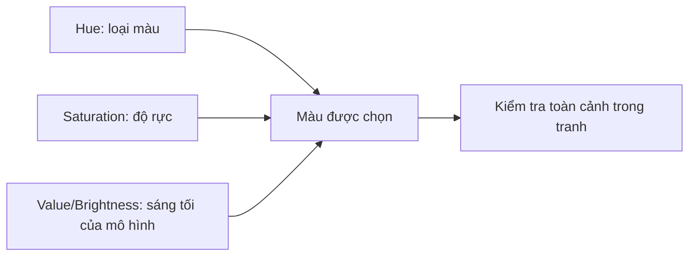

# Bài 06 — Màu sắc: hue, saturation, value và phối màu

**Mục tiêu:** hiểu vai trò biểu cảm của màu; vận dụng H–S–V/HSB; xây bảng màu đơn sắc, tương đồng, bổ túc và tam giác; dùng màu hỗ trợ điểm nhấn minh họa.

**Nguồn chính:** `Pasted markdown (3)(5).md`, 00:00–14:56. **Đối chiếu:** tài liệu Adobe về HSB và bánh xe màu (Bài 10).

## 1. Tại sao màu sắc quan trọng?

Bản vẽ đen trắng vẫn có thể kể chuyện. Màu sắc bổ sung những khả năng hữu ích:

1. **Không khí và cảm giác:** ánh hoàng hôn ấm, sắc xanh lạnh của đêm, cảnh ngày hè rực rỡ.
2. **Kể chuyện bằng đối lập:** thay đổi palette giữa hai cảnh để báo hiệu tâm trạng hoặc không gian.
3. **Tập trung chú ý:** màu nhấn tương phản có thể hướng mắt về nhân vật/vật thể chính.

Màu sắc **không tự động quyết định cảm xúc**. Ý nghĩa còn phụ thuộc ngữ cảnh, văn hóa, mức sáng, chất liệu và các màu xung quanh.

## 2. Bộ ba H–S–V / HSB

Trong phần mềm số, một cách tiếp cận dễ hiểu là:

- **Hue (H) — sắc màu / sắc tướng:** nhóm màu đỏ, cam, vàng, xanh lá, xanh lam, tím...; thường biểu diễn trên vòng 0°–360°.
- **Saturation (S) — độ bão hòa:** mức độ rực hay xỉn của màu trong mô hình cụ thể; giảm S thường đưa màu về xám tại cùng brightness.
- **Value/Brightness (V/B) — độ sáng biểu diễn trong HSV/HSB:** trong bộ chọn HSV, V=0 là đen, V lớn hơn cho phép màu sáng hơn.

**Phân biệt kỹ thuật:** value trong hội họa nói về độ sáng cảm nhận; thông số `V` của HSV không phải phép đo độ chói cảm nhận chính xác. Hai màu có cùng HSV-V vẫn có thể trông sáng khác nhau. Hãy kiểm tra bằng chế độ grayscale thay vì chỉ nhìn giá trị thanh trượt.

### Thí dụ đổi một màu nền

Chọn màu xanh lam và tạo ba biến thể: xanh sáng xỉn làm nền, xanh trung bình làm vật phụ, xanh đậm làm bóng. Thêm một điểm nhấn vàng ấm nếu muốn nhân vật nổi hơn. Không cần dùng đồng thời mọi màu trong hộp màu.

## 3. Bốn cách phối màu cơ bản

| Kiểu phối màu | Cách chọn | Khi áp dụng | Rủi ro / cách tránh |
|---|---|---|---|
| **Đơn sắc** (*monochromatic*) | Một hue chính, thay đổi S và V | Tranh tâm trạng, poster tối giản | Dễ thiếu phân biệt hình: tăng chênh value |
| **Tương đồng** (*analogous*) | Hue gần nhau trên vòng màu, như xanh–lam–tím | Tạo cảm giác thống nhất | Dễ phẳng: chừa một vùng value khác biệt |
| **Bổ túc** (*complementary*) | Hai hue đối diện, như xanh lam–cam | Cần điểm nhấn màu mạnh | Nếu dùng 50/50 bão hòa cao dễ chói: chọn màu chủ đạo, màu phụ |
| **Tam giác đều** (*triadic*) | Ba hue cách nhau tương đối đều trên bánh xe màu | Cảnh nhiều nhân vật, minh họa sôi động | Dễ quá tải: một màu chiếm chính, hai màu phụ tiết chế |

> Vòng màu trong thiết kế là **công cụ tổ chức phối màu**, không phải công thức vật lý cho mọi chất màu. Màu bổ túc sẽ thay đổi tùy hệ mô hình và bánh xe màu được sử dụng.

## 4. Công thức 70–20–10 (gợi ý, không phải luật)

- Khoảng **70%** diện tích thị giác: màu chủ đạo hoặc nhóm màu chính.
- Khoảng **20%**: màu hỗ trợ, thường gần hue hoặc value chủ đạo.
- Khoảng **10%**: màu điểm nhấn có tương phản đủ mạnh.

Tỷ lệ này chỉ là **heuristic** để người mới khỏi sử dụng mọi màu với sức nặng ngang nhau. Giá trị điểm nhấn thực tế còn phụ thuộc diện tích, saturation, đường nét và độ tương phản nền.

## 5. Vì sao da màu xanh vẫn có thể đẹp?

Ví dụ mở đầu bài giảng là tác giả bất ngờ thấy làn da được vẽ bằng tông xanh nhưng cả bức tranh vẫn hài hòa. Câu trả lời không phải “da xanh là màu đúng”, mà là **quan hệ màu sắc trong toàn bộ bức tranh**.

Một làn da màu lạ có thể hợp nếu: (a) cùng chịu một hệ ánh sáng xanh; (b) các phần khác của tranh đối ứng với hue và value đó; (c) palette nhất quán với phong cách; (d) khuôn mặt còn tách ra khỏi nền nhờ tương phản. Nếu thay riêng một vùng da bằng xanh mà không sửa các vùng khác, tranh có thể bị lạc tone.

## 6. Quy trình phối màu minh họa manga/anime

1. **Thiết lập câu chuyện:** vui tươi buổi trưa, đêm mưa, căng thẳng trước trận chiến...?
2. **Phác grayscale:** nhân vật có tách khỏi nền khi bỏ màu không?
3. **Chọn palette hẹp:** 1 hue chủ đạo, 1–2 hue hỗ trợ, 1 nhấn.
4. **Rải màu theo mảng lớn:** nhân vật, hậu cảnh, đạo cụ; chưa tô lông mi hay đường viền nhỏ.
5. **Kiểm tra ở thumbnail:** có vùng chói không cần thiết tranh điểm nhấn?
6. **Thêm biến thiên ánh sáng:** bề mặt cùng chất liệu dưới ánh ấm/lạnh không nhất thiết có một mã màu duy nhất.
7. **Rà soát grayscale lần cuối** để đảm bảo tương phản value vẫn hoạt động.

## 7. Bài thực hành

**A. Bốn bảng màu:** cùng một silhouette nhân vật, tạo 4 palette: đơn sắc xanh, tương đồng xanh–tím, bổ túc xanh–cam, tam giác cam–xanh–tím. Mỗi palette chỉ dùng 5–7 ô màu.

**B. Hai thời điểm:** cùng cảnh một người ngồi bên cửa sổ, vẽ **buổi trưa** và **đêm muộn**; giữ nguyên line art, thay palette và bố trí ánh sáng.

**C. Giới hạn màu:** vẽ một bìa manga chỉ dùng 3 màu + trắng đen. Giải thích vì sao một màu được chọn làm điểm nhấn.

### Bảng tự kiểm tra

- Palette có màu chủ đạo rõ không?
- Chuyển sang grayscale có còn thấy nhân vật không?
- Vùng bão hòa nhất có nằm gần điểm nhấn mong muốn không?
- Bóng có thống nhất với điều kiện ánh sáng trong bối cảnh không?
- Có lạm dụng 100% bão hòa trên mọi chi tiết không?

**Tiếp theo:** [Bài 07 — Bố cục](07-bo-cuc-va-dan-huong-thi-giac.md).
