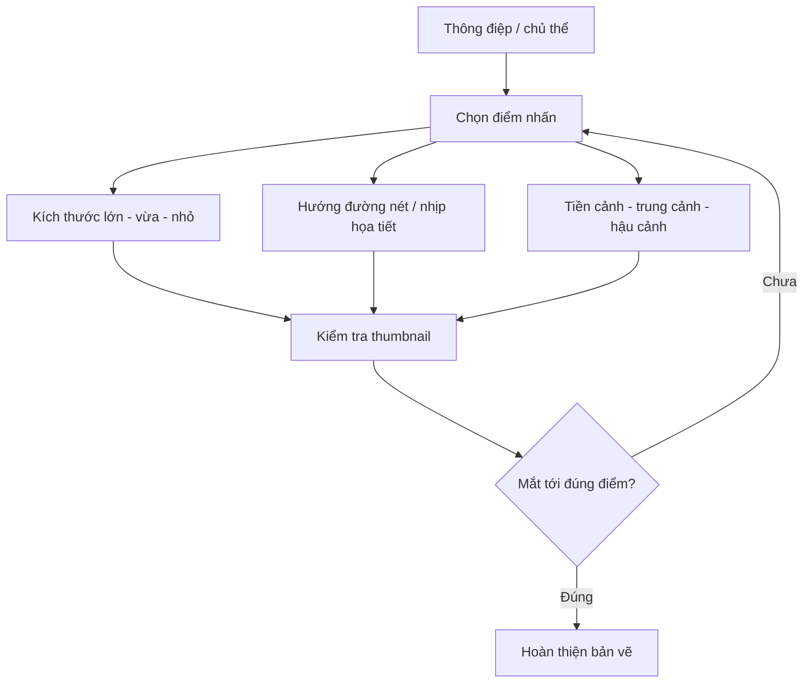

# Bài 07 — Bố cục (composition), điểm nhấn và đường dẫn mắt

**Mục tiêu:** hiểu bố cục là sự sắp đặt các yếu tố thị giác; chủ động tạo điểm nhấn; dùng biến thiên kích thước, hướng đường nét, phân lớp không gian và các sơ đồ bố cục cơ bản.

**Nguồn chính:** phụ đề 00:00–10:22 người học gửi trực tiếp trong hội thoại. **Bổ sung biên soạn:** khoảng trống, kiểm tra thumbnail, cách phân tích bố cục mà không lầm một quy tắc thành công thức tuyệt đối. Đối chiếu thêm tài liệu Getty Museum và Art Gallery of South Australia.

## 1. Bố cục là gì và tại sao cần học?

**Bố cục** là việc sắp xếp các thành phần nhìn thấy được trong khung tranh: hình dạng, đường nét, sáng tối, màu sắc, khoảng trống và sự chồng lấp. Mục đích thường là tạo **trật tự thị giác**, định hướng sự chú ý, nhịp điệu, cảm xúc hoặc hỗ trợ câu chuyện.

Bài giảng dẫn minh họa của **Yusuke Nakamura** làm ví dụ: ngay khi cách dựng nhân vật hoặc đổ bóng trông tương đối giản lược, sự tổ chức hình phẳng, đối tượng và nhịp đường nét vẫn có thể tạo nên một bức tranh cuốn hút. Không nên hiểu thành “kỹ năng vẽ chỉ cần trung bình là đủ”; đúng hơn, **bố cục là năng lực độc lập và rất quan trọng**.

### Điểm nhấn (focal point)

Điểm nhấn là vùng tác giả muốn mắt người xem chú ý trước hoặc ghi nhớ rõ nhất. Đó có thể là **mặt nhân vật**, một vật thể nhỏ, một đốm sáng hoặc điểm gặp nhau của các đường dẫn. Điểm nhấn không bắt buộc là đối tượng lớn nhất.

Có thể dùng kết hợp: tương phản sáng–tối, tương phản màu, kích thước, độ sắc nét, cách cô lập bằng khoảng trống, hướng nhìn/đường chéo, khung cảnh bao quanh.



## 2. Kỹ thuật 1 — Biến thiên kích thước lớn, vừa, nhỏ

Đoạn 01:38–03:21 của bài gốc giới thiệu ba nhóm kích thước như một phương pháp dễ áp dụng. Khi tất cả vật thể có diện tích và độ nổi bật gần nhau, tranh dễ rối; khi có phân cấp, người xem dễ nhận ra vai trò các yếu tố.

**Ví dụ:** một cảnh góc phố gồm (1) khối tường và cây tạo mảng **lớn**, (2) cô gái là chủ thể **vừa**, (3) thùng rác/đạo cụ là mảng **nhỏ**. Tác giả phân nhóm theo hình dáng và khoảng cách để xác định ba mảng chính.

| Nhóm | Vai trò có thể dùng | Sai lầm cần tránh |
|---|---|---|
| Lớn | Tạo nền, khung, khối dẫn dắt | Quá nhiều chi tiết làm lấn át điểm nhấn |
| Vừa | Chủ thể hoặc nhóm phụ quan trọng | Thiếu tương phản nên bị chìm |
| Nhỏ | Chi tiết nhấn, nhịp phụ | Phân tán quá nhiều chấm sáng/cạnh sắc |

**Không có yêu cầu tranh phải chứa đúng ba vật.** “Lớn, vừa, nhỏ” là cách **nhóm quy mô thị giác**; có thể có hàng chục vật nhỏ thuộc cùng một nhóm.

### Bài thử nhanh

Vẽ 6 hình chữ nhật bất kỳ. Tạo hai phiên bản: A — kích thước gần như nhau; B — một mảng lớn, hai mảng vừa, ba mảng nhỏ. Tô đen hình trên nền trắng. So sánh phiên bản nào tạo trật tự rõ hơn và tại sao.

## 3. Kỹ thuật 2 — Đường nét và họa tiết tạo hướng nhìn

Đoạn 03:28–04:29 nhắc đến minh họa có **đường mây**, hướng nhìn nhân vật và hướng cánh/đuôi chim tương ứng. Khi nhiều yếu tố có hướng tương thích, chúng tạo **nhịp và sự thống nhất**, có thể đưa mắt qua bố cục.

**Đường dẫn không bắt buộc là một đường vẽ thật.** Nó cũng có thể được gợi ra từ:

- Hướng nhìn của nhân vật hoặc hướng tay chỉ.
- Dãy cửa sổ, đèn đường, mây, nếp quần áo.
- Biên của hai mảng sáng–tối.
- Nhiều vật xếp nối nhau tạo thành một đường ngầm (*implied line*).

**Ví dụ manga:** nhân vật nhìn về phía một lá thư; tay nhân vật chỉ về lá thư; ánh sáng từ cửa chiếu vào chính lá thư. Cả ba tín hiệu cùng giúp người xem chú ý vào lá thư.

**Cẩn thận:** nếu mọi đường đều kéo mắt ra mép tranh, người xem có thể rời chủ thể quá sớm. Có thể dùng một đường cong hoặc vật phụ để đưa mắt quay lại.

## 4. Kỹ thuật 3 — Tiền cảnh, trung cảnh, hậu cảnh

Đoạn 04:29–07:04 phân chia cảnh thành ba lớp không gian:

- **Tiền cảnh (foreground):** phần gần camera, có thể cắt khung hoặc che một phần vật ở sau.
- **Trung cảnh (middle ground):** thường là vùng xuất hiện nhân vật/chủ thể chính, nhưng không bắt buộc.
- **Hậu cảnh (background):** môi trường xa như tường, cửa sổ, đường phố, núi hoặc bầu trời.

```text
 NGƯỜI XEM / CAMERA
      ↓
 [TIỀN CẢNH]   tay đưa lên / mép cửa / tán cây
      ↓ che một phần
 [TRUNG CẢNH]  nhân vật chính / vật quan trọng
      ↓
 [HẬU CẢNH]   bức tường / cửa sổ / con phố
```

### Hai ví dụ từ bài giảng

1. **Người đàn ông chuẩn bị châm thuốc:** các bàn tay cầm bật lửa và mảng tối ở gần camera hình thành khung tiền cảnh; người đàn ông ở trung cảnh trở thành điểm nhấn; bức tường nằm phía sau.
2. **Hai phụ nữ trong không gian nội thất:** người phía trước, bàn/ngăn kéo tạo vùng bao; nhân vật đang cởi dép gần trung tâm là nơi người xem được hướng tới; cửa sổ và cảnh xa thuộc hậu cảnh.

**Tác dụng:** tạo chiều sâu qua chồng lấp, tổ chức vai trò của đối tượng và dùng tiền cảnh để **đóng khung trong khung** (*frame within a frame*).

**Sửa hiểu nhầm:** đối tượng ở tiền cảnh không nhất thiết luôn “ít quan trọng”, và việc có đủ ba lớp không tự động làm tranh đẹp. Đây chỉ là một cách dễ học để sắp đặt chiều sâu.

## 5. Ba bố cục thông dụng được giới thiệu ở cuối video

### 5.1. Quy tắc một phần ba (rule of thirds)

Chia khung thành lưới 3 × 3, tạo bốn điểm giao. Đặt vùng quan trọng **gần** một hoặc nhiều điểm giao hay dọc các đường chia thường cho cảm giác bớt chính diện và có thêm không gian kể chuyện.

```text
┌────────┬────────┬────────┐
│        │        │        │
├────────●────────●────────┤
│        │        │        │
├────────●────────●────────┤
│        │        │        │
└────────┴────────┴────────┘
● = bốn vị trí gợi ý cho điểm quan trọng
```

**Lưu ý:** không phải vật thể phải chạm đủ bốn điểm, cũng không phải tranh đặt ở giao điểm thì mặc nhiên đẹp. Đây là một công cụ gợi ý, không phải quy định chấm điểm.

### 5.2. Bố cục tam giác / kim tự tháp

Sắp xếp các vật thể tạo một cấu trúc tam giác lớn. Tam giác đáy rộng có thể gợi ổn định; tam giác nghiêng tạo chuyển động. Chân dung hoặc nhóm nhân vật thường sử dụng dạng hình học ngầm này.

```text
           ▲ đỉnh/điểm nhấn
          / \
         /   \
        /     \
       /_______\
   các mảng phụ tạo đáy
```

Có thể phân tích nhiều bức tranh kinh điển dưới dạng tam giác, nhưng không nên khẳng định mọi chi tiết của một tác phẩm đều cố ý tuân theo hình này nếu không có chứng cứ.

### 5.3. Bố cục cân bằng

Sắp xếp trọng lượng thị giác giữa hai bên khung. Có hai cách:

- **Cân bằng đối xứng:** hai bên khá tương ứng, hữu ích cho chân dung chính diện, tạo cảm giác nghi lễ/ổn định.
- **Cân bằng bất đối xứng:** một vật lớn mờ có thể cân bằng với nhiều vật nhỏ có độ tương phản cao ở phía đối diện.

> Cân bằng **không đồng nghĩa** với hai bên phải chứa số vật thể hoặc diện tích bằng nhau. Màu, độ tương phản, khoảng trống và sự cô lập đều ảnh hưởng trọng lượng thị giác.

## 6. Thêm một công cụ: khoảng trống (negative space)

Đây là **phần bổ sung biên soạn**, không phải một trong ba kỹ thuật chính được giảng trong nguồn. Khoảng trống là vùng trống hoặc ít chi tiết quanh/giữa các đối tượng. Một chủ thể nhỏ nằm trong nền ít chi tiết đôi khi nổi bật hơn chủ thể lớn bị bao phủ bởi hoa văn hỗn loạn.

**Bài thử:** vẽ một nhân vật nhỏ ở góc dưới phải, dành phần lớn diện tích là bầu trời. Thử tăng mảng trống; cảm giác cô đơn/không gian có thay đổi không?

## 7. Quy trình phân tích một bức tranh bạn thích

1. **Thu nhỏ** ảnh còn khoảng 200–300 px chiều rộng (hoặc nheo mắt); bỏ qua chi tiết.
2. Khoanh **3–5 mảng lớn** theo hình dạng/độ tương phản.
3. Đánh dấu **điểm bạn nhìn đầu tiên**; dự đoán vì sao.
4. Dùng mũi tên vẽ **hướng chuyển động của mắt**.
5. Gán nhãn tiền/trung/hậu cảnh; xem có chồng lấp giúp phân lớp không.
6. Thử chồng lưới 3×3, tam giác hoặc trục cân bằng; chỉ ghi nhận những gì thực sự hỗ trợ cách hiểu.
7. Tạo một **thumbnail mới** cùng nguyên tắc, nhưng dùng nhân vật/đạo cụ của riêng bạn.

## 8. Bài thực hành — sáu thumbnail

**Đề:** “Một học sinh phát hiện lá thư bí mật trong lớp học sau giờ tan trường”. Giữ nguyên câu chuyện, vẽ 6 thumbnail cỡ 5 × 8 cm:

1. Kích thước lớn–vừa–nhỏ rõ rệt.
2. Đường bàn, cửa sổ dẫn đến lá thư.
3. Tiền cảnh là tay nắm cửa, nhân vật trung cảnh, tủ lớp ở hậu cảnh.
4. Trọng tâm gần giao điểm 1/3.
5. Bố cục tam giác gồm nhân vật, bàn, cửa sổ.
6. Cân bằng bất đối xứng: nhân vật lệch một bên, vùng sáng/đạo cụ ở bên còn lại.

**Tự chấm (mỗi mục 0–2):** điểm nhấn nhận ra trong 2 giây; nhóm hình lớn-vừa-nhỏ; hướng mắt có chủ ý; phân lớp không gian; phù hợp câu chuyện. Tổng 10.

### Điều cần nhớ

- Bố cục tốt là **tổ chức sự chú ý**, không phải nhồi thật nhiều quy tắc.
- Hãy thiết kế ở mức thumbnail, **trước** khi vẽ chi tiết.
- Không có một bố cục duy nhất đúng; lưới 1/3, tam giác và cân bằng là điểm khởi đầu để **thử nghiệm**.

**Tiếp theo:** [Bài 08 — Đồ án minh họa manga](08-do-an-minh-hoa-manga.md).
