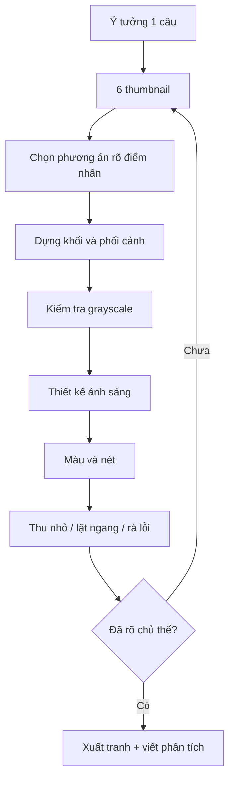

# Bài 08 — Đồ án tổng hợp: minh họa manga có bối cảnh

**Loại bài:** Bài tập tích hợp do người biên soạn thiết kế từ 7 bài trước. Không phải một bài nộp được nêu nguyên văn trong phụ đề.

## 1. Brief dự án

**Chủ đề gợi ý:** “Trở về sau cơn mưa”. Vẽ một minh họa nhân vật anime/manga đứng hoặc đi trong một con phố nhỏ. Nhân vật đang hướng tới một chi tiết quan trọng: chiếc ô, tấm biển, mèo, bức thư hoặc một nguồn sáng ở xa.

**Yêu cầu tối thiểu:**

- 1 nhân vật chính và ít nhất 2 vật thể phụ.
- Có tiền cảnh, trung cảnh, hậu cảnh hoặc giải thích rõ vì sao không dùng đủ 3 lớp.
- Dùng nhất quán ít nhất một hệ phối cảnh tuyến tính đã học.
- Có 1 nguồn sáng chính và bóng đổ hợp lý.
- Có bản grayscale thể hiện ít nhất 3 nhóm giá trị.
- Có bảng màu giới hạn hoặc lựa chọn đen–trắng có chủ đích.
- Có điểm nhấn nhìn thấy được khi thu nhỏ.

Định dạng nộp: ảnh thành phẩm PNG/JPG (tùy chọn), kèm `phan-tich-do-an.md` và 3–6 thumbnail đã thử. Nếu vẽ giấy, chụp ảnh đủ sáng, không bị méo góc.

## 2. Quy trình 8 giai đoạn

| Giai đoạn | Thao tác | Sản phẩm trung gian | Kiểm tra |
|---|---|---|---|
| 1. Ý tưởng | Viết một câu mô tả hành động/điểm nhấn | 1 câu | Có chủ thể rõ |
| 2. Thumbnail | Vẽ 6 bản bố cục 2–3 giá trị | 6 ảnh nhỏ | Mắt hướng đúng chỗ |
| 3. Khối | Dựng nhân vật & khung cảnh thành hộp/trụ/cầu | Bản khối | Tỉ lệ và chồng lấp ổn |
| 4. Phối cảnh | Đường chân trời/VP, độ lớn xa–gần | Bản dựng | Cùng họ cạnh cùng VP |
| 5. Value | Chia mảng sáng–tối | Grayscale | Chủ thể rõ |
| 6. Ánh sáng | Xác định đèn, bóng đổ, cạnh bóng | Bản light pass | Bóng không tùy tiện |
| 7. Màu/nét | Chọn palette, tinh chỉnh chất liệu và nét | Bản hoàn thiện | Màu hỗ trợ điểm nhấn |
| 8. Phản biện | Thu nhỏ, lật ngang, so với brief | Bản sửa lần 2 | Sửa lỗi lớn trước |



## 3. Tiến độ gợi ý

- **Buổi 1 (60 phút):** brief, 6 thumbnail, chọn phương án.
- **Buổi 2 (90 phút):** khối, phối cảnh và nhân vật.
- **Buổi 3 (90 phút):** value, ánh sáng, màu lớn.
- **Buổi 4 (60–90 phút):** chi tiết, sửa và nộp.

Nếu mới học, dành thêm thời gian ở **giai đoạn 3–5**, không cố làm hoàn thiện tranh trong một buổi.

## 4. Mẫu hồ sơ `phan-tich-do-an.md`

```markdown
# Phân tích đồ án — [Tên tác phẩm]

## 1. Thông điệp
- Tình huống: ...
- Chủ thể chính: ...
- Người xem nên nhìn vào ... đầu tiên vì ...

## 2. Hình khối
- Nhân vật gồm các khối phác thảo: ...
- Vật thể khó nhất: ...

## 3. Phối cảnh
- Hệ phối cảnh: 1 / 2 / 3 điểm tụ
- Đường tầm mắt: ...
- Vị trí các điểm tụ: ...

## 4. Ánh sáng và sắc độ
- Nguồn sáng chính: ...
- Nhóm value: sáng ..., trung gian ..., tối ...
- Bóng đổ chính: ...

## 5. Màu sắc
- Kiểu palette: ...
- Màu chủ đạo: ...
- Màu nhấn: ...

## 6. Bố cục
- Sơ đồ chính: ...
- Hướng dẫn mắt: ...
- Tiền / trung / hậu cảnh: ...

## 7. Tự nhận xét
- Ba điểm tốt: ...
- Ba điểm cần sửa: ...
- Thay đổi lớn nhất sau phản biện: ...
```

## 5. Rubric 100 điểm

| Hạng mục | Điểm | Đạt mức tốt khi |
|---|---:|---|
| Hình khối & cấu trúc | 20 | Vật thể đọc được không cần texture |
| Phối cảnh & tính nhất quán | 20 | Các nhóm cạnh/độ lớn hợp lý |
| Sắc độ | 15 | Các mảng sáng–tối có tổ chức |
| Ánh sáng & bóng đổ | 15 | Hướng sáng, bề mặt và bóng khớp |
| Màu & cảm xúc | 10 | Palette có chủ đích, không lấn át |
| Bố cục & điểm nhấn | 15 | Đọc chủ thể rõ ở thumbnail |
| Tự đánh giá/sửa bài | 5 | Có bản trước/sau và nêu lý do |
| **Tổng** | **100** | |

**Nguyên tắc sửa:** nếu nhân vật bị sai khối, ưu tiên sửa khối thay vì tăng sáng mắt, thêm hoa văn áo hay hiệu ứng lens flare.

## 6. Thử thách nâng cao

- Biến bản màu thành **trang manga đen trắng** với 2–3 lớp screentone.
- Đổi góc camera từ ngang sang góc thấp, giữ câu chuyện và vị trí tương đối các vật.
- Dựng bố cục đối xứng rồi chuyển thành cân bằng bất đối xứng.
- Dùng cùng line art làm hai phiên bản màu: buổi trưa và cuối ngày, nhưng tránh thay đổi vị trí bóng vô căn cứ.

**Tiếp theo:** [Bài 09 — Tự kiểm tra và đáp án](09-cau-hoi-on-tap-va-dap-an.md).
