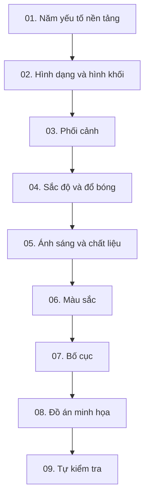

# KHÓA HỌC VẼ CƠ BẢN CHO MINH HỌA & MANGA

> **Ngôn ngữ:** Tiếng Việt · **Trình độ:** Mới bắt đầu → sơ trung cấp · **Thời lượng gợi ý:** 5 tuần, 20–30 giờ thực hành · **Định dạng:** Markdown, có sơ đồ Mermaid, bài tập và đáp án.

## Giới thiệu

Khóa học này biên soạn lại **6 bản chép lời người học cung cấp** và **phần bài giảng về bố cục** gửi trong hội thoại. Mục tiêu không phải chép nguyên phụ đề mà chuyển thành các **bài học có thể tự học**, theo thứ tự hình dạng → hình khối → phối cảnh → sắc độ → ánh sáng → màu sắc → bố cục → tác phẩm hoàn chỉnh. Ví dụ hướng đến minh họa, manga/anime nhưng nguyên tắc áp dụng rộng rãi cho vẽ vật thể, nhân vật và bối cảnh.

Bản chép lời đầu vào có nhiều chỗ dịch tự động không tự nhiên. Tài liệu đã sửa các thuật ngữ có thể xác định chắc chắn; chi tiết không xác định từ lời thoại được lược bỏ, không khẳng định suy đoán về tác giả/tác phẩm. Các nội dung **bổ sung để giảng dạy** (quy trình luyện tập, rubric, lưu ý kỹ thuật) là phần biên soạn mới; nguồn tra cứu mở rộng ở `10-thuat-ngu-va-tai-lieu.md`.

## Lộ trình

| Bài | Nội dung | Năng lực sau bài | Bài thực hành tối thiểu |
|---|---|---|---|
| [01](01-nam-yeu-to-nen-tang.md) | Năm yếu tố cốt lõi | Nhìn được sự liên hệ giữa hình, phối cảnh, sáng tối, màu và bố cục | 1 sơ đồ + 10 thumbnail |
| [02](02-hinh-dang-va-hinh-khoi.md) | Hình dạng & hình khối | Phân rã vật thể phức tạp thành khối cơ bản | 12 hình khối + 3 vật thể |
| [03](03-phoi-canh-mot-hai-ba-diem.md) | Phối cảnh 1/2/3 điểm | Xác định chân trời, điểm tụ, dựng hộp/tòa nhà | 3 bản vẽ phối cảnh |
| [04](04-sac-do-va-ky-thuat-danh-bong.md) | Sắc độ (value) & shading | Phân nhóm sáng–tối, dựng sáng tối quả cầu | 2 thang xám + 4 khối |
| [05](05-anh-sang-bong-do-va-chat-lieu.md) | Ánh sáng, bóng và bề mặt | Dự đoán bóng theo hình khối và nguồn sáng | 1 hình trụ với 3 hướng sáng |
| [06](06-mau-sac-va-phoi-mau.md) | Màu và bảng màu | Điều khiển hue–saturation–value; phối màu có chủ đích | 4 palette + 1 minh họa |
| [07](07-bo-cuc-va-dan-huong-thi-giac.md) | Bố cục & điểm nhấn | Sắp xếp tỷ lệ, hướng nét, lớp không gian và quy tắc cơ bản | 6 thumbnail bố cục |
| [08](08-do-an-minh-hoa-manga.md) | Đồ án tích hợp | Hoàn thành minh họa nhân vật có bối cảnh | 1 tác phẩm + bản phân tích |
| [09](09-cau-hoi-on-tap-va-dap-an.md) | Ôn tập và đáp án | Tự phát hiện và sửa lỗi nền tảng | 20 câu kiểm tra |
| [10](10-thuat-ngu-va-tai-lieu.md) | Thuật ngữ & tham khảo | Tra cứu từ vựng và nguồn học tiếp | 1 bảng thuật ngữ |

## Kế hoạch 5 tuần

- **Tuần 1:** Bài 01–02. Vẽ hàng ngày 15–30 phút khối hộp, trụ, cầu; quan sát vật thật.
- **Tuần 2:** Bài 03. Dựng ghế, bàn, căn phòng, góc phố bằng phối cảnh; rà soát điểm tụ.
- **Tuần 3:** Bài 04–05. Bỏ màu, luyện sáng–tối với một nguồn sáng rõ ràng.
- **Tuần 4:** Bài 06–07. Thử bốn bảng màu và ít nhất sáu bố cục nhỏ.
- **Tuần 5:** Bài 08–09. Hoàn thiện đồ án, tự chấm và sửa ít nhất một vòng.

## Quy tắc học hiệu quả

1. **Vẽ khối trước chi tiết:** nếu khối sai, tô bóng đẹp không đủ để cứu cấu trúc.
2. **Tách kỹ năng khi luyện tập:** không cần đồng thời giỏi giải phẫu, phối cảnh, màu và texture trong một bài tập.
3. **Tập từ tham chiếu trước khi vẽ tưởng tượng:** đối chiếu vật thật/ảnh, rồi dựng lại mà không nhìn mẫu.
4. **Kiểm tra ở kích thước thumbnail:** điểm nhấn và bố cục phải đọc được khi thu nhỏ.
5. **Ghi rõ giả định:** hướng sáng, tầm mắt, mặt phẳng đất, chất liệu; không dựa vào may rủi.

## Dụng cụ

- Giấy A4, bút chì HB/2B, thước và tẩy; **hoặc** phần mềm vẽ có layer (Krita, Photoshop, Clip Studio Paint, Procreate...).
- Hẹn giờ 15 phút và thư mục lưu ảnh tiến bộ qua từng tuần.
- Trong bài có sơ đồ **Mermaid**: nếu trình xem Markdown không hỗ trợ, mở trên GitHub/VS Code có tiện ích Mermaid hoặc xem phần diễn giải văn bản ngay cạnh sơ đồ.

## Nguồn đầu vào và giới hạn

| Nguồn người học cung cấp | Chủ đề sử dụng |
|---|---|
| `Pasted markdown(20261028-163743).md` | Tổng quan 5 yếu tố, định hướng vẽ hình khối |
| `Pasted markdown (4)(2).md` | Hình dạng và hình khối, tư duy phân rã vật thể |
| `Pasted markdown (6)(2).md` | Phối cảnh 1, 2 và 3 điểm tụ |
| `Pasted markdown (2)(20261028-163808).md` | Shading, giá trị sáng tối, đổ bóng cơ bản |
| `Pasted markdown (5)(2).md` | Ánh sáng, bóng đổ, điều khiển biên bóng |
| `Pasted markdown (3)(5).md` | Màu sắc, HSV/HSB, phối màu |
| Phụ đề trực tiếp trong hội thoại (00:00–10:22) | Bố cục, phân lớp, quy tắc một phần ba, tam giác và cân bằng |

**Lưu ý:** đây là giáo trình tự học, không phải bản dịch được tác giả video xác nhận; sơ đồ và bài tập đều được biên soạn lại. Không tự gắn hình minh họa có bản quyền từ tác phẩm của họa sĩ được nhắc trong phụ đề.
