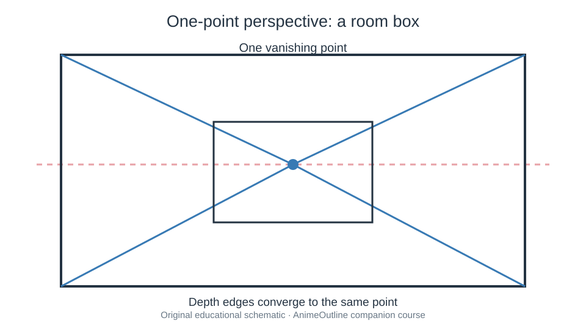

# 01. How to Learn to Draw Anime & Manga

> **Module:** 01 Foundations  
> **Level:** Beginner  
> **Suggested practice:** 25–45 minutes  
> **Original source:** [How to Learn to Draw Anime & Manga](https://www.animeoutline.com/how-to-learn-how-to-draw-anime/) · AnimeOutline

## Learning objective

Build a sustainable drawing plan that includes fundamentals and deliberate practice.

## Core principle

A strong drawing is easier to edit when large masses, directional guides, and relationships are established before any fine rendering. For **how to learn to draw anime & manga**, treat each visible line as evidence of an underlying form or a deliberate graphic design choice. Begin lightly, compare against a reference, and separate the *rough construction* from the *refined final drawing*.

The instructions below are an **independently written practice companion**, not a transcription or complete substitute for the original tutorial. Follow the site for its specific demonstrations and step sequences.

## Guided workshop

1. **Select one anime drawing goal and list its required skills.** After the step, compare the silhouette and relative placement to your reference.
2. **Dedicate a warm-up session to lines, circles, and simple solids.** After the step, compare the silhouette and relative placement to your reference.
3. **Use references to notice structure instead of copying outlines blindly.** After the step, compare the silhouette and relative placement to your reference.
4. **Keep dated drawings and review progress weekly.** After the step, compare the silhouette and relative placement to your reference.

## Visual reference

**Original website illustrations:** Open the tutorial link above to view the creator’s step-by-step images. The source artwork is not mirrored in this archive.

## Practice assignment

**Main exercise:** Design a seven-day practice schedule with one small finished drawing.

- **Warm-up (5 min):** Draw several quick studies using only large shapes and gesture lines.
- **Construction (10–15 min):** Produce a rough version with visible guides and a consistent reference.
- **Refinement (10–15 min):** Correct the largest issues, remove unnecessary guides, and strengthen important contours.
- **Review (5 min):** Compare both stages, write down two improvements and one point to practice again.

## Common pitfall

**Watch out for:** Trying complex characters without studying simple forms.

Correct the issue in the rough phase rather than hiding it with extra contour lines or shading. A useful test is to shrink your drawing to thumbnail size; major shapes should remain intelligible.

## Self-check

- [ ] I built and verified the main shape before adding fine detail.
- [ ] My landmarks, overlaps, or perspective cues are internally consistent.
- [ ] I can name the specific visual decision that makes this study successful.
- [ ] I compared the rough sketch and the finished version.
- [ ] I opened the original illustrated tutorial to check its examples.

## Source and image rights

- **Author/site:** AnimeOutline — https://www.animeoutline.com/how-to-learn-how-to-draw-anime/
- **Study note:** Newly written English educational companion prepared 2026-10-29.
- **Illustration:** The locally referenced SVG is an original explanatory schematic. Website art remains the property of the original rights holder and is not redistributed here.
