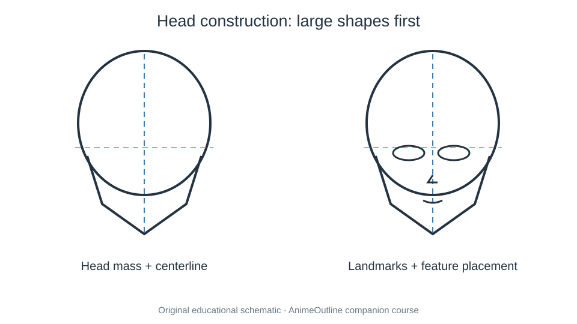

# 02 Heads and Faces

These lessons break heads into large cranial forms and landmarks. Each anime style can adapt the proportions; consistency in a single character matters more than a universal ratio.

- [01. Anime Face: Structure and Proportions](01-how-to-draw-anime-face-structure.md) — [source](https://www.animeoutline.com/how-to-draw-anime-face-structure/)
- [02. Anime Girl: Head and Face](02-how-to-draw-anime-girl-head-and-face.md) — [source](https://www.animeoutline.com/how-to-draw-anime-girl-head-and-face/)
- [03. Anime Male Head and Face](03-how-to-draw-anime-and-manga-male-head-and-face.md) — [source](https://www.animeoutline.com/how-to-draw-anime-and-manga-male-head-and-face/)
- [04. Anime Face in Side View](04-how-to-draw-anime-face-side-view-with-proportions.md) — [source](https://www.animeoutline.com/how-to-draw-anime-face-side-view-with-proportions/)
- [05. Female Anime Face in Three-Quarter View](05-how-to-draw-anime-female-face-3-4-view.md) — [source](https://www.animeoutline.com/how-to-draw-anime-female-face-3-4-view/)
- [06. Male Anime Face in Three-Quarter View](06-how-to-draw-male-anime-face-3-4-view-step-by-step.md) — [source](https://www.animeoutline.com/how-to-draw-male-anime-face-3-4-view-step-by-step/)
- [07. Different Anime Head and Face Styles](07-how-to-draw-different-styles-of-anime-heads-faces.md) — [source](https://www.animeoutline.com/how-to-draw-different-styles-of-anime-heads-faces/)
- [08. Anime and Manga Noses](08-how-to-draw-anime-and-manga-noses.md) — [source](https://www.animeoutline.com/how-to-draw-anime-and-manga-noses/)
- [09. Anime and Manga Ears](09-how-to-draw-anime-and-manga-ears.md) — [source](https://www.animeoutline.com/how-to-draw-anime-and-manga-ears/)
- [10. Anime and Manga Mouths](10-how-to-draw-anime-mouths-tutorial.md) — [source](https://www.animeoutline.com/how-to-draw-anime-mouths-tutorial/)
- [11. Anime Mouths in Side View](11-how-to-draw-anime-mouths-side-view.md) — [source](https://www.animeoutline.com/how-to-draw-anime-mouths-side-view/)
