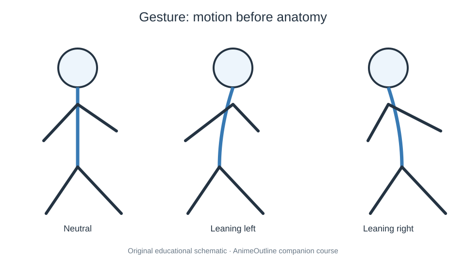

# 05 Body Hands and Poses

Anatomy begins with spatial relationships and gesture. Establish major masses, joints, balance, and overlapping forms before small details.

- [01. Anime Girl Full Body](01-how-to-draw-an-anime-girl.md) — [source](https://www.animeoutline.com/how-to-draw-an-anime-girl/)
- [02. Anime Boy Full Body](02-how-to-draw-an-anime-boy-full-body-step-by-step.md) — [source](https://www.animeoutline.com/how-to-draw-an-anime-boy-full-body-step-by-step/)
- [03. Anime Male Body](03-how-to-draw-an-anime-guy-step-by-step-tutorial.md) — [source](https://www.animeoutline.com/how-to-draw-an-anime-guy-step-by-step-tutorial/)
- [04. Muscular Male Body](04-how-to-draw-anime-muscular-male-body-step-by-step.md) — [source](https://www.animeoutline.com/how-to-draw-anime-muscular-male-body-step-by-step/)
- [05. Neck and Shoulders](05-how-to-draw-anime-neck-shoulders.md) — [source](https://www.animeoutline.com/how-to-draw-anime-neck-shoulders/)
- [06. Anime Arms](06-how-to-draw-anime-arms.md) — [source](https://www.animeoutline.com/how-to-draw-anime-arms/)
- [07. Female Anime Legs](07-how-to-draw-female-anime-legs-tutorial.md) — [source](https://www.animeoutline.com/how-to-draw-female-anime-legs-tutorial/)
- [08. Anime Hands Step by Step](08-how-to-draw-anime-and-manga-hands.md) — [source](https://www.animeoutline.com/how-to-draw-anime-and-manga-hands/)
- [09. Hand Poses](09-how-to-draw-hand-poses-step-by-step.md) — [source](https://www.animeoutline.com/how-to-draw-hand-poses-step-by-step/)
- [10. Anime Feet Different Views](10-how-to-draw-anime-and-manga-feet-from-different-views.md) — [source](https://www.animeoutline.com/how-to-draw-anime-and-manga-feet-from-different-views/)
- [11. Feet in Different Positions](11-how-to-draw-anime-feet-in-different-positions.md) — [source](https://www.animeoutline.com/how-to-draw-anime-feet-in-different-positions/)
- [12. Anime Action Poses](12-how-to-draw-anime-poses-step-by-step.md) — [source](https://www.animeoutline.com/how-to-draw-anime-poses-step-by-step/)
