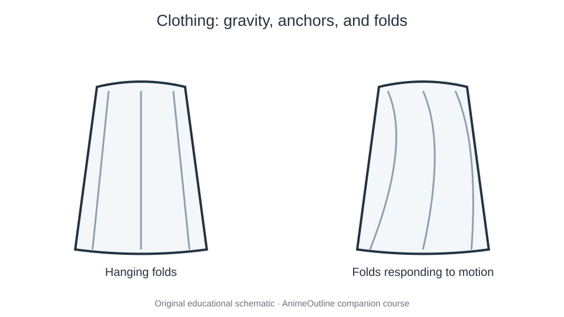

# 06 Clothes and Accessories

Costumes and accessories inherit the body’s structure. Make folds and contact points explain tension, gravity, and material.

- [01. Anime and Manga Clothes](01-how-to-draw-anime-clothing.md) — [source](https://www.animeoutline.com/how-to-draw-anime-clothing/)
- [02. Anime Skirts](02-how-to-draw-anime-skirts-step-by-step.md) — [source](https://www.animeoutline.com/how-to-draw-anime-skirts-step-by-step/)
- [03. Anime Shoes](03-how-to-draw-anime-shoes-step-by-step.md) — [source](https://www.animeoutline.com/how-to-draw-anime-shoes-step-by-step/)
- [04. Anime Hats](04-how-to-draw-anime-hats.md) — [source](https://www.animeoutline.com/how-to-draw-anime-hats/)
- [05. Anime Glasses](05-how-to-draw-anime-glasses.md) — [source](https://www.animeoutline.com/how-to-draw-anime-glasses/)
