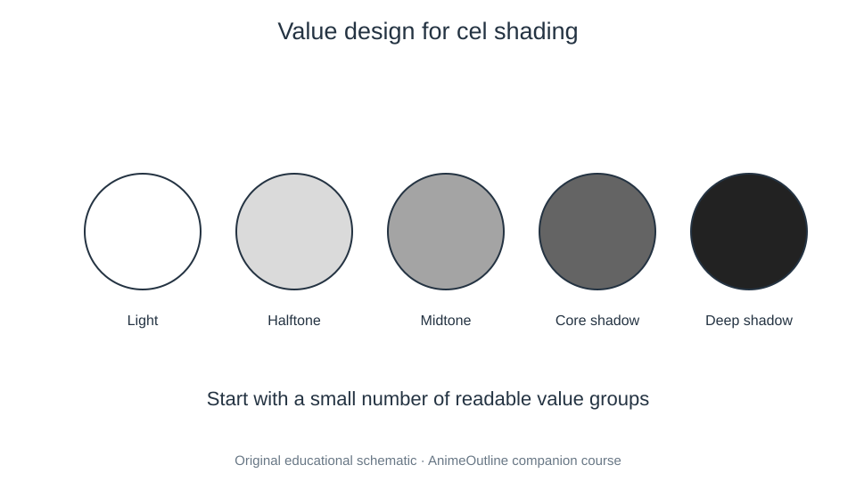

# 07 Light Color and Perspective

Drawing gains depth through consistent spatial and lighting rules. Keep values simple, control focal attention, and treat perspective as a construction tool.

- [01. Color Selection for Anime Art](01-beginner-guide-to-picking-colors-when-drawing-anime-manga.md) — [source](https://www.animeoutline.com/beginner-guide-to-picking-colors-when-drawing-anime-manga/)
- [02. Color an Anime Character](02-how-to-color-anime-character-step-by-step.md) — [source](https://www.animeoutline.com/how-to-color-anime-character-step-by-step/)
- [03. One-Point Perspective Room](03-one-point-perspective-room-drawing-tutorial.md) — [source](https://www.animeoutline.com/one-point-perspective-room-drawing-tutorial/)
- [04. Face Lighting Study](04-how-to-shade-an-anime-face-in-different-lighting.md) — [source](https://www.animeoutline.com/how-to-shade-an-anime-face-in-different-lighting/)
