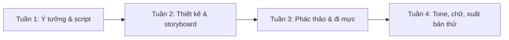

# Bài 00 — Xác định mục tiêu và lập lộ trình học manga

**Thời lượng gợi ý:** 45–60 phút.  
**Vai trò:** bài định hướng, do người biên soạn bổ sung dựa trên cấu trúc quy trình của video.

## Mục tiêu

Sau bài này, bạn có thể xác định loại sản phẩm muốn làm, đặt giới hạn dự án và tạo một tiến độ có thể thực hiện.

## 1. Phân biệt ba đích đến

- **Truyện ngắn độc lập (one-shot):** câu chuyện có khởi đầu, phát triển và kết thúc trong một tác phẩm. Phù hợp nhất để học đủ quy trình.
- **Truyện nhiều chương:** cần thiết kế mạch dài hơn, nhiều bản tóm tắt (cả bộ, từng chương), quản lý tính nhất quán giữa các chương.
- **Webtoon cuộn dọc:** kể chuyện theo luồng cuộn trên màn hình; nhịp khoảng trống và cách chia phân cảnh khác với sách hai trang mở.

Ở khóa này, mặc định chọn **one-shot 6–10 trang** vì đủ để luyện viết, chia khung, vẽ và hoàn thiện mà không tạo lịch trình quá tải. Đây là quyết định sư phạm, không phải chuẩn bắt buộc của ngành.

## 2. Chọn ý tưởng vừa sức

**[Bổ sung sư phạm]** Dùng quy tắc giới hạn phạm vi:

| Thành phần | Giới hạn gợi ý cho dự án đầu |
|---|---|
| Nhân vật chính | 1–2 |
| Bối cảnh | 1–2 địa điểm |
| Xung đột | 1 vấn đề trung tâm |
| Cảnh quan trọng | 3–5 |
| Độ dài | 6–10 trang |
| Kết quả | Một hành động hoặc thay đổi rõ ràng của nhân vật |

**Ví dụ xuyên suốt khóa:** *Chiếc ô cuối cùng* — trong cơn mưa cuối ngày, một học sinh muốn giữ chiếc ô duy nhất cho mình nhưng phải quyết định có giúp một người lạ đang mắc kẹt hay không. Ý tưởng minh họa này là ví dụ tự tạo.

## 3. Lộ trình 4 giai đoạn



Tiến độ trên chỉ để tham khảo. Với người mới, nên ước lượng dựa trên trang thực tế đã hoàn thành; cần có thời gian nghỉ và đệm sửa.

## 4. Bộ hồ sơ dự án

```text
manga-one-shot/
├── outline/        # Ý tưởng và bản tóm tắt
├── script/         # Kịch bản và lời thoại
├── design/         # Nhân vật, bối cảnh, đạo cụ
├── storyboard/     # Nemu / thumbnail từng trang
├── pages/          # Phác thảo, line-art, tone
└── export/         # Tệp để đọc và bản in thử
```

Đặt tên trang nhất quán, ví dụ `page_01_sketch`, `page_01_ink`, `page_01_final`. Tạo ít nhất một bản sao lưu.

## 5. Bài thực hành

1. Viết một câu về người đọc bạn muốn hướng đến và cảm xúc bạn muốn họ nhận được.
2. Chọn định dạng: trang sách, đọc dọc, hay cả hai.
3. Ghi ba giới hạn phạm vi bạn cam kết không vượt quá.
4. Tạo thư mục dự án và bảng tiến độ theo trang.

**Hoàn thành khi:** bạn mô tả được thành phẩm, độ dài, kênh đọc và tài liệu cần giao ở từng giai đoạn.

**Tiếp theo:** [Bài 01 – Tổng quan manga và định dạng](01-tong-quan-manga-va-dinh-dang.md).
