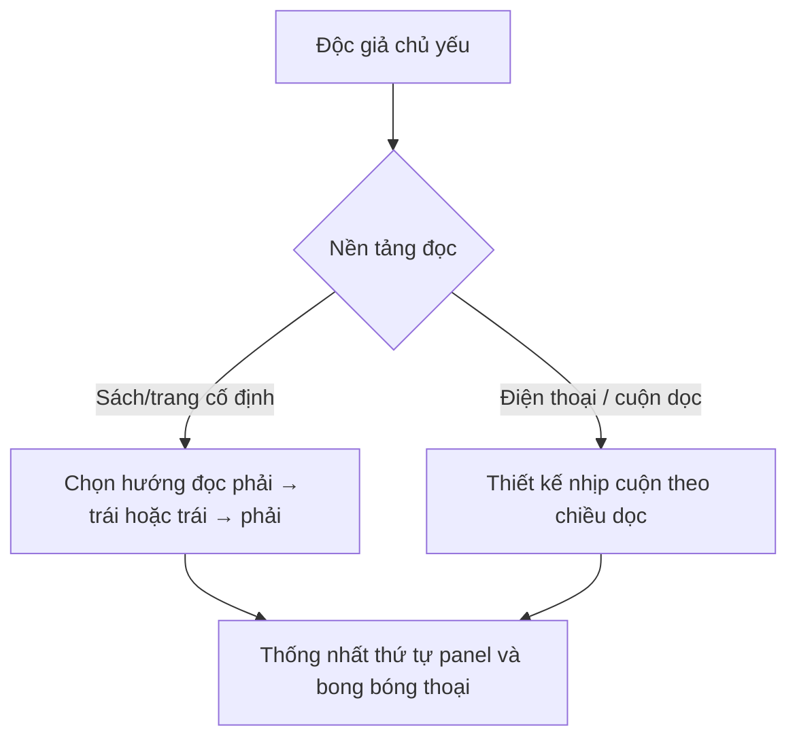

# Bài 01 — Manga là gì? Các hình thức kể chuyện bằng tranh

**Nguồn video:** 00:00–02:00; 03:35–04:19; 13:11–13:52.  
**Thời lượng gợi ý:** 50 phút.

## Mục tiêu

- Phân biệt manga, truyện tranh trang giấy và webtoon về bối cảnh văn hóa, cách trình bày và trải nghiệm đọc.
- Hiểu *mangaka*, *one-shot*, *serialization* (đăng nhiều kỳ) và *tankōbon* (tập tuyển in lại).
- Chọn một hình thức sản xuất và xuất bản phù hợp dự án.

## 1. Cốt lõi là kể chuyện theo trình tự

**[Từ video]** Dù gọi là manga, comic hay webtoon, nhân vật và sự kiện được truyền tải qua **một chuỗi hình ảnh có trình tự**. Người đọc suy luận các hành động diễn ra giữa hai khung tranh liên tiếp. Sự khác nhau có thể nằm ở văn hóa xuất bản, hướng đọc, chất liệu hình ảnh và định dạng hiển thị.

**Lưu ý thuật ngữ:** Trong cách hiểu phổ biến tại Nhật, “manga” là từ chỉ truyện tranh nói chung; khi dùng ở thị trường quốc tế, nó thường gợi đến truyện tranh Nhật Bản hoặc phong cách chịu ảnh hưởng Nhật Bản. Video tập trung cách làm phong cách lấy cảm hứng từ Nhật, không đặt ra một bộ tiêu chí duy nhất quyết định “đâu mới là manga”.

## 2. Những dạng phát hành

| Hình thức | Điểm mạnh | Điều phải tính trước |
|---|---|---|
| One-shot | Phạm vi hữu hạn; thử ý tưởng và phong cách | Kết thúc đủ rõ trong thời lượng ngắn |
| Đăng nhiều kỳ | Có không gian phát triển nhân vật và thế giới | Nhịp sản xuất, liên tục tình tiết, thời hạn |
| Tập tuyển / sách in | Có thể đọc thành tập, sở hữu vật lý | Lề an toàn, gáy, cắt xén, kiểm bản in |
| Webtoon cuộn dọc | Phù hợp điện thoại và nhịp cuộn | Kích thước chữ, khoảng cách cảnh, nền tảng đăng |

**[Từ video]** Tác giả giải thích rằng một series có thể bắt đầu từ một *one-shot* làm bản thử nghiệm. Một phiên bản thử không nhất thiết có cốt truyện hoặc thiết kế giống bản series sau này. Kết quả được đánh giá khác nhau tùy nhà xuất bản; một one-shot không tự động dẫn đến hợp đồng.

## 3. Hướng đọc và thiết kế trang

**[Từ video]** Truyện tranh tại Nhật thường đọc từ **phải sang trái**; sản phẩm hướng đến thị trường khác có thể dùng **trái sang phải**, còn webtoon thường **từ trên xuống**. Hãy quyết định sớm để storyboard và bố cục dẫn mắt được nhất quán.

**[Bổ sung sư phạm]** Tránh lật gương một trang đã vẽ chỉ để đổi hướng đọc: chữ trên biển hiệu, tay thuận, vật thể và tính nhất quán có thể bị thay đổi. Tốt hơn là chốt luồng đọc ngay từ storyboard.

## 4. Nghề sáng tác và lịch đăng

**[Từ video]** Video nhấn mạnh áp lực thời hạn đối với tác giả đăng nhiều kỳ; có thể có trợ lý, biên tập viên và các bước phối hợp. Đây là mô tả thực tế nghề nghiệp của người nói, không phải lý do để làm việc thiếu ngủ. **Chất lượng bền vững quan trọng hơn chạy theo tốc độ của ê-kíp chuyên nghiệp.**

## 5. Ví dụ minh họa

Cùng ý tưởng “Chiếc ô cuối cùng”:

- **One-shot in sách:** người đọc mở trang, nhìn khung mở đầu bên phải/trái theo hướng đã chọn; cao trào có thể đặt ở cuối trang để tạo động lực lật trang.
- **Webtoon:** một khoảng trống dài trước cú chạm tay trao ô giúp tạo nhịp chờ khi cuộn xuống.

## 6. Bài tập và tự kiểm

1. Chọn định dạng chính cho truyện của bạn. Viết 3 lý do từ góc nhìn độc giả.
2. Vẽ nhanh hai sơ đồ cho cùng một cảnh: một trang có 4 panel và một dải cuộn dọc.
3. Trả lời: vì sao không thể nói mọi manga đều bắt buộc phải đọc từ phải sang trái?

**Hoàn thành khi:** bạn chọn được định dạng và có thử nghiệm 1 cảnh ở định dạng đó.

**Tiếp theo:** [Bài 02 – Công cụ và quy trình](02-cong-cu-va-quy-trinh.md).
