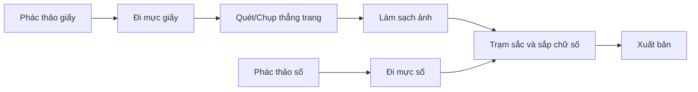

# Bài 02 — Chọn công cụ và xây dựng quy trình sản xuất

**Nguồn video:** 00:46–01:37; 06:43–06:53; 07:57–08:59.  
**Thời lượng gợi ý:** 60–90 phút.

## Mục tiêu

- Hiểu ba mô hình làm việc: truyền thống, kỹ thuật số, kết hợp.
- Lập được một pipeline từ phác thảo đến xuất tệp cuối cùng.
- Biết chọn công cụ theo nhu cầu thay vì mua theo danh sách người khác.

## 1. Ba mô hình chính

**[Từ video]**

### Truyền thống

Vẽ bút chì và đi mực trên giấy; có thể sử dụng trạm sắc (screentone) vật lý. Ưu điểm là trải nghiệm trực tiếp với vật liệu; nhược điểm là sửa đổi khó và vật tư tiêu hao có thể tốn kém.

### Kỹ thuật số

Phác thảo, đi nét, screentone, tô màu và sắp chữ trong phần mềm. Video nhắc đến **Clip Studio Paint** và **Photoshop** như các lựa chọn, không phải công cụ bắt buộc.

### Kết hợp (hybrid)

Vẽ hoặc đi mực trên giấy → quét ảnh → xử lý, thêm screentone và chữ trên máy. Đây là cách người trình bày từng sử dụng trước khi chuyển sang hoàn toàn kỹ thuật số.

## 2. Dụng cụ được nhắc đến trong video

| Công cụ | Vai trò | Lưu ý |
|---|---|---|
| Giấy chuyên dụng vẽ manga | Bề mặt cho phác thảo và đi mực | Video có đề cập B4; chọn cỡ theo mục đích và yêu cầu in |
| Bút chì | Dựng hình và bố cục | Chọn loại kiểm soát nét tốt |
| Bút G (G-pen) | Nét biến thiên dày/mỏng | Cần luyện lực tay và mực thích hợp |
| Sakura Pigma Micron | Đi nét kỹ thuật truyền thống | Cỡ ngòi khác nhau cho độ dày khác nhau |
| Bút cọ mực | Nét đậm, mảng đen, hiệu ứng | Cẩn thận khi cần cạnh thẳng sắc nét |
| Clip Studio Paint | Làm truyện tranh kỹ thuật số | Hỗ trợ quản lý trang, nét và tone tùy phiên bản |

**[Bổ sung sư phạm]** Bạn có thể dùng phần mềm vẽ tương đương phù hợp ngân sách. Những tính năng cần ưu tiên là layer, cọ nét, quản lý chữ, xuất ảnh và kiểm soát kích thước.

## 3. Chọn workflow theo điều kiện

| Tình huống | Quy trình hợp lý |
|---|---|
| Có bút bảng vẽ, thường xuyên sửa | Kỹ thuật số |
| Mạnh về vẽ bút giấy, có máy quét | Kết hợp |
| Muốn luyện mực thủ công | Truyền thống hoặc kết hợp |
| Làm nhóm từ xa | Ưu tiên tệp số và quy ước layer |

## 4. Quản lý tệp và lớp

**[Bổ sung sư phạm]** Đề xuất nhóm layer: `Guide`, `Sketch`, `Ink`, `Black`, `Tone`, `SFX`, `Text`. Việc phân lớp làm đơn giản hóa sửa lỗi hoặc thay đổi bản xuất. Ghi phiên bản `v01`, `v02` và sao lưu trước khi gộp layer.

**Kiểm tra đầu ra:** phóng to 100% để đánh giá đường nét; thu nhỏ bằng kích thước đọc thực tế để xem chữ có đủ lớn, khung có rõ không. Nếu dự định in, xác minh thông số trang và vùng cắt với bên in cụ thể, không dựa vào một con số chung.

## 5. Thực hành: cùng một panel, hai cách làm

Vẽ cảnh nhân vật chìa chiếc ô trong 1 panel bằng công cụ bạn đang có, sau đó thử một bước thay thế (vẽ giấy rồi scan, hoặc chuyển một phần sang layer số). Ghi lại:

- Thời gian thực hiện.
- Dễ/khó khi sửa 3 lỗi nhỏ.
- Chất lượng nét sau khi xem ở kích thước điện thoại.

**Hoàn thành khi:** bạn chọn workflow chính và biết cách lưu, chỉnh sửa, xuất thử một panel.

**Tiếp theo:** [Bài 03 – Ý tưởng và tóm tắt](03-y-tuong-va-tom-tat-cot-truyen.md).
