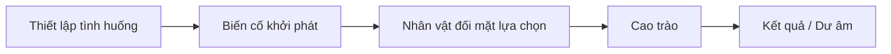

# Bài 03 — Phát triển ý tưởng, thông điệp và bản tóm tắt cốt truyện

**Nguồn video:** 03:09–04:55.  
**Thời lượng gợi ý:** 90 phút.

## Mục tiêu

- Biến một ý tưởng mơ hồ thành logline và tóm tắt có mở đầu–diễn biến–kết thúc.
- Phân biệt bản tóm tắt toàn series, bản tóm tắt chương và one-shot.
- Đặt được xung đột cụ thể để chuyển sang viết kịch bản.

## 1. Bắt đầu từ câu chuyện muốn kể

**[Từ video]** Trước khi vẽ trang, hãy xác định **mình muốn kể câu chuyện gì** và **vì sao muốn kể**. Quan điểm, chủ đề và cảm xúc muốn truyền tải sẽ định hướng mọi khâu thiết kế.

**[Bổ sung sư phạm]** Có thể bắt đầu bằng ba câu hỏi:

1. Nhân vật chính muốn điều gì ngay lúc này?
2. Điều gì ngăn họ đạt được nó?
3. Cuối truyện họ thay đổi hoặc đưa ra lựa chọn nào?

## 2. Bản tóm tắt (synopsis) và đề cương (treatment)

Bản chép lời dùng thuật ngữ *treatment* nhưng dịch máy không nhất quán. Trong thực hành sáng tác:

- **Logline:** 1–2 câu nêu nhân vật, mục tiêu, xung đột đặc trưng.
- **Synopsis:** vài đoạn tóm tắt các sự kiện lớn, thường kể cả kết thúc để người cùng sản xuất hiểu toàn bộ truyện.
- **Treatment/đề cương phát triển:** bản mô tả các tuyến sự kiện chi tiết hơn synopsis nhưng chưa cần đầy đủ hội thoại/khung tranh.
- **Script/kịch bản:** phân cảnh, hành động, lời thoại và thông tin cần thiết để dựng storyboard.

**[Từ video]** Đối với series, tác giả đề xuất có thể có nhiều cấp tóm tắt: toàn bộ loạt truyện, từng chương; đối với one-shot, tập trung một câu chuyện độc lập.

## 3. Khung mẫu kể chuyện ngắn

**[Bổ sung sư phạm]**

Không phải mọi truyện bắt buộc theo năm bước, nhưng khung này hữu ích khi luyện một one-shot ngắn.

## 4. Ví dụ: Chiếc ô cuối cùng

**Logline:** Trong cơn mưa lớn cuối buổi học, một học sinh luôn sợ bị muộn phải chọn giữa giữ chiếc ô duy nhất hay giúp người khác đang mắc kẹt.

**Synopsis minh họa:** Minh phát hiện mình chỉ còn vài phút để về nhà trước giờ hẹn. Trong sân trường, một bạn nhỏ không có ô đứng trước vũng nước lớn. Minh cố tránh mắt và bước tiếp, nhưng nhìn thấy tập vở của bạn sắp ướt. Minh đưa ô, hai người cùng chạy dưới mưa. Cuối truyện, Minh vẫn về muộn nhưng chủ động kể lại lý do và mỉm cười.

**Nhận xét:** Mục tiêu (về đúng giờ) xung đột với nhu cầu đạo đức (giúp người). Cao trào là lựa chọn **trao ô**, không nhất thiết là một cảnh chiến đấu hoành tráng.

## 5. Công cụ rà soát synopsis

- Nhân vật có **mục tiêu đoán được** không?
- Có tình huống làm mục tiêu ấy khó đạt không?
- Mọi cảnh chính có đẩy đến một hành động hoặc quyết định không?
- Kết thúc có trả lời câu hỏi truyện đặt ra không?
- Có chi tiết nào yêu cầu thêm rất nhiều nhân vật/bối cảnh mà không cần thiết không?

## 6. Bài thực hành

Viết:

1. Logline không quá 40 từ.
2. Synopsis 150–250 từ, nêu cả kết thúc.
3. Danh sách 3–5 cảnh quan trọng.
4. Một câu mô tả *thay đổi của nhân vật* sau cao trào.

**Hoàn thành khi:** người khác đọc synopsis có thể kể lại diễn biến cơ bản mà chưa cần xem tranh.

**Tiếp theo:** [Bài 04 – Kịch bản và thiết kế](04-kich-ban-va-thiet-ke.md).
