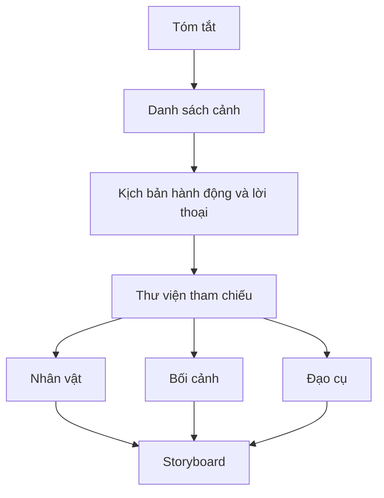

# Bài 04 — Viết kịch bản và thiết kế nhân vật, bối cảnh

**Nguồn video:** 04:54–05:22.  
**Thời lượng gợi ý:** 90–120 phút.

## Mục tiêu

- Chuyển tóm tắt thành các cảnh có hành động, lời thoại và cảm xúc.
- Tạo bộ tham chiếu nhân vật và bối cảnh để tránh nghĩ mọi thứ từ đầu ở mỗi trang.
- Hiểu quan hệ giữa kịch bản, thiết kế ý tưởng (*concept art*) và storyboard.

## 1. Kịch bản là cầu nối từ chữ sang tranh

**[Từ video]** Từ synopsis, tác giả viết *script* với mô tả và lời thoại. Trước khi vẽ các trang chính thức, họ phát triển thiết kế nhân vật, môi trường và những yếu tố thị giác cần xuất hiện.

**[Bổ sung sư phạm]** Mỗi cảnh nên có: nơi chốn, thời điểm, hành động quan trọng, cảm xúc chủ đạo, lời thoại dự kiến. Tránh lời thoại lặp lại điều hình ảnh đã nói quá rõ.

### Mẫu script dễ dùng

```text
CẢNH 02 — SÂN TRƯỜNG, CHIỀU MƯA
Mục đích: Minh nhận ra có người cần giúp.
Hành động: Minh nhìn đồng hồ rồi nhìn bạn nhỏ đang ôm sách.
Cảm xúc: Do dự.
Lời thoại: (bạn nhỏ) “Mình... có thể đi cùng không?”
Âm thanh: RÀO RÀO (mưa).
Ghi chú hình ảnh: Cận cảnh bàn tay Minh siết cán ô.
```

Đây là **mẫu học tập**, không phải chuẩn kịch bản chính thức duy nhất.

## 2. Thiết kế nhân vật nhất quán

**[Bổ sung sư phạm]** Với nhân vật quan trọng, tạo *character sheet* gồm:

| Nhóm | Nội dung cần ghi |
|---|---|
| Nhận diện | Tóc, dáng mặt, trang phục, phụ kiện |
| Biểu cảm | Bình thường, vui, lo, tức giận |
| Dáng người | Mặt trước, nghiêng, sau; tỷ lệ cơ bản |
| Hành vi | Tư thế quen thuộc, cách cầm đồ vật |
| Chuyển động | Một hành động thường gặp trong truyện |

Chọn các đặc điểm dễ lặp lại trong nhiều góc nhìn. Không cần dựng hàng chục tư thế khi nhân vật chỉ xuất hiện một trang.

## 3. Thiết kế môi trường và đạo cụ

Để vẽ nhất quán, xác định lối ra/vào, nguồn sáng, tương quan không gian giữa các vật thể và hướng nhân vật di chuyển. Ví dụ: cổng trường luôn nằm bên phải sân, ghế dài phía trái cổng. Bản phác sơ đồ mặt bằng đơn giản đã đủ hỗ trợ storyboard.



## 4. Đừng chi tiết hóa quá sớm

Thời điểm này nhằm đảm bảo các cảnh **có thể vẽ được** và nhân vật **nhận diện được**, không phải để hoàn thiện mọi đường nét. Đầu tư vào những thiết kế xuất hiện nhiều lần sẽ tiết kiệm công ở các trang sau.

## 5. Bài thực hành

1. Chọn 1 cảnh trong synopsis, viết script với 3–6 hành động quan sát được.
2. Vẽ nhân vật chính ở 3 góc nhìn và 4 biểu cảm.
3. Vẽ sơ đồ bối cảnh chính, đánh dấu hướng đi và vị trí camera giả định.
4. Kiểm tra: một người khác đọc script có hình dung được hành động mà không cần bạn giải thích không?

**Hoàn thành khi:** có script sơ bộ cho toàn truyện, ít nhất một character sheet và một sơ đồ bối cảnh.

**Tiếp theo:** [Bài 05 – Storyboard và ngôn ngữ khung tranh](05-storyboard-va-khung-tranh.md).
