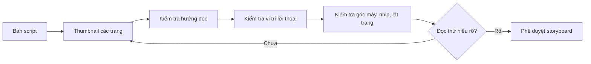

# Bài 05 — Storyboard (nemu): nhịp kể, panel và hướng nhìn

**Nguồn video:** 05:21–06:17.  
**Thời lượng gợi ý:** 120–180 phút.

## Mục tiêu

- Biến script thành thumbnail của từng trang hoặc đoạn cuộn.
- Điều khiển sự chú ý bằng cỡ khung, góc máy, thứ tự đọc và nhịp lật trang.
- Phát hiện vấn đề kể chuyện trước khi đầu tư vào bản vẽ chi tiết.

## 1. Storyboard không phải tranh hoàn chỉnh

**[Từ video]** Người nói mô tả bước tạo những hình thu nhỏ (*thumbnail*) để tính trước bố trí panel, chỗ đặt lời thoại và diễn biến của trang. Trong ngành manga Nhật, bản nháp bố cục này thường gọi là *name* hoặc *nemu* (ネーム). Mục đích: **sửa sai sớm trên bản nháp**, rẻ hơn sửa sau khi đã vẽ chì và đi mực.

Một storyboard tốt có thể rất đơn giản: hình que, mũi tên chuyển động, vài từ mô tả là đủ nếu người khác đọc hiểu cảnh.

## 2. Chức năng của kích cỡ panel

**[Bổ sung sư phạm]**

- **Panel rộng:** thiết lập không gian, nhấn cảm xúc hoặc một khoảnh khắc lớn.
- **Panel nhỏ liên tiếp:** cảm giác hành động nhanh hoặc nhiều nhịp rất ngắn.
- **Cận cảnh:** làm nổi bật thông tin như ánh mắt, tay, vật thể.
- **Toàn cảnh:** giúp người đọc định vị vị trí và quan hệ không gian.

Không có công thức cố định “panel càng lớn thời gian càng dài”. Hiệu quả phụ thuộc hình ảnh, khoảng trống, số chữ và vị trí trên trang.

## 3. Dẫn mắt và thứ tự đọc

**[Từ video]** Người làm truyện cần để ý quy tắc 180°, góc máy, vị trí trang trái/phải và trải nghiệm lật trang đối với sách in.

**[Bổ sung sư phạm]** Quy tắc 180°: khi hai người đối diện nhau, tưởng tượng một trục nối giữa họ; giữ camera về một phía của trục qua các khung liên tiếp giúp hướng nhìn và vị trí nhân vật không bị đảo bất ngờ. Có thể cố ý vượt trục, nhưng cần tín hiệu không gian rõ ràng.

## 4. Bố cục trang đôi và cao trào

Khi xuất bản sách, hai trang đối diện tạo thành một *spread*. Người đọc có thể nhìn thấy cả hai cùng lúc. Vì vậy, cần xác định cảnh nào muốn bộc lộ ngay và cảnh nào muốn **giữ đến sau khi lật trang**. Với webtoon, hiệu ứng tương tự có thể tạo bằng khoảng trống và thời điểm cuộn.

Đừng đặt thông tin quan trọng ngay sát phần gáy nơi hình ảnh có thể bị che.

## 5. Ví dụ bố trí cảnh trao ô

**Trang gồm 4 khung:**

1. Toàn cảnh sân trường, trời mưa.
2. Cận đồng hồ của Minh.
3. Cận tập vở ướt của bạn nhỏ.
4. Khung lớn bàn tay Minh đưa ô — cao trào lựa chọn.

Thử đảo khung 2 và 3: nhấn mạnh áp lực thời gian trước hay sự thương cảm trước sẽ làm cảm nhận người đọc khác nhau.

## 6. Checklist khi duyệt nemu

- Độc giả biết đọc khung nào tiếp theo không?
- Có ảnh thiết lập không gian trước khi cắt vào cận cảnh quá nhiều không?
- Lời thoại có che mặt, tay hoặc thông tin quan trọng không?
- Hành động có bị “nhảy cóc” khó hiểu không?
- Cao trào có đủ khác biệt về kích cỡ/nhịp không?
- Với trang in, trang trái/phải có được đánh dấu đúng không?

## 7. Thực hành

Vẽ thumbnail **toàn bộ** 6–10 trang; mỗi trang chỉ cần hình đơn giản. Cho một người đọc thử không giải thích, hỏi: “Ở trang này ai làm gì, vì sao?”. Chỉnh lại những trang gây hiểu nhầm.

**Hoàn thành khi:** toàn bộ câu chuyện đọc được từ storyboard trước khi bước vào phác thảo chi tiết.

**Tiếp theo:** [Bài 06 – Phác thảo và trang in](06-phac-thao-va-trang-in.md).
