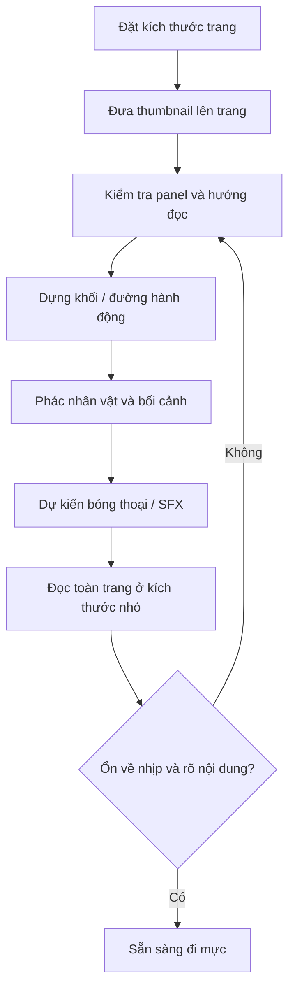

# Bài 06 — Phác thảo trang: chuyển storyboard thành hình vẽ hoàn chỉnh

**Nguồn video:** 06:43–07:20; 09:41–09:59.  
**Thời lượng gợi ý:** 120 phút trở lên, tùy độ dài truyện.

## Mục tiêu

- Biết chuyển bố cục thumbnail thành trang phác thảo có thể đi mực.
- Giữ ổn định tỷ lệ nhân vật, vị trí chữ và góc nhìn.
- Nhận diện các vùng dễ bị cắt, che khi đóng gáy hoặc hiển thị trên màn hình.

## 1. Vì sao phải có bước phác thảo?

**[Từ video]** Sau storyboard, người làm truyện đưa bố cục vào trang thực tế, thường bắt đầu bằng nét chì (*pencils*). Đây là lúc tăng độ chính xác trước bước đi mực, điều chỉnh panel và chừa không gian cho chữ.

**[Bổ sung sư phạm]** Không nên vẽ hoàn thiện một góc nhỏ trong khi tổng thể bố cục chưa ổn. Có thể làm theo thứ tự: khối lớn → đường hành động → tỷ lệ → biểu cảm → chi tiết trang phục → bóng thoại.

## 2. Quy trình từ thô đến tinh



## 3. Lề an toàn, vùng cắt và gáy

**[Từ video]** Người trình bày cảnh báo không để chữ và nội dung quan trọng sát mép vì có thể bị cắt khi in hoặc bị mất trong phần gáy.

**[Bổ sung sư phạm]** Phân biệt ba khái niệm thường gặp:

- **Trim line / đường xén:** giới hạn kích thước thành phẩm sau khi cắt giấy.
- **Bleed / vùng tràn lề:** hình nền đi vượt đường xén để tránh lộ viền trắng khi cắt lệch nhẹ.
- **Safe area / vùng an toàn:** nơi nên đặt chữ, khuôn mặt và chi tiết không được mất.

Không đưa một con số mm cố định cho mọi nhà in: độ tràn lề, vùng gáy và thông số kỹ thuật cần lấy từ dịch vụ in cuối cùng. Với bản chỉ đăng mạng, vẫn nên chừa khoảng thở để thuận tiện chuyển sang bản in về sau.

```text
+-------------------------------------------------+
| BLEED (hình nền có thể tràn ra ngoài đường xén)  |
|   +-----------------------------------------+   |
|   | TRIM: kích thước giấy thành phẩm         |   |
|   |    +-------------------------------+    |   |
|   |    | SAFE AREA: chữ/chi tiết chính  |    |   |
|   |    | không đặt sát cạnh             |    |   |
|   |    +-------------------------------+    |   |
|   +-----------------------------------------+   |
+-------------------------------------------------+
```

## 4. Tính nhất quán ở nhiều panel

Kiểm tra chiều cao nhân vật so với cửa, bàn, xe; vị trí phụ kiện; thời tiết, hướng ánh sáng; và chiều tay cầm đồ vật. Khi chuyển góc máy, hãy dựa vào character sheet, sơ đồ bối cảnh từ Bài 04.

## 5. Ví dụ thực hành

Ở cảnh nhân vật chìa ô, thử phác 3 phương án: cận tay, toàn thân hai nhân vật, hoặc góc nhìn từ người nhận. Chọn phương án làm cảm xúc **dễ hiểu nhất** thay vì chỉ đẹp nhất.

## 6. Bài tập và tiêu chí

1. Phác chi tiết 2 trang đầu từ nemu đã duyệt.
2. Đặt chữ nháp vào từng bong bóng để xem có bị quá chật không.
3. Thu nhỏ trang về kích cỡ đọc, ghi lại chi tiết bị mất.
4. Đánh dấu mép xén, gáy và vùng an toàn nếu làm bản in.

**Hoàn thành khi:** trang có thể đi mực mà không phải thay đổi cấu trúc câu chuyện.

**Tiếp theo:** [Bài 07 – Đi mực và phối hợp](07-di-muc-va-phoi-hop.md).
