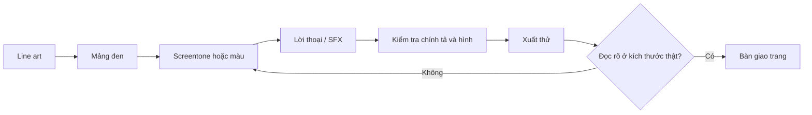

# Bài 08 — Screentone, tô màu, sắp chữ và hoàn thiện trang

**Nguồn video:** 08:30–09:13.  
**Thời lượng gợi ý:** 90–150 phút.

## Mục tiêu

- Hiểu *screentone* và cách dùng sắc độ trong truyện tranh trắng đen.
- Phân biệt hoàn thiện đơn sắc và màu; biết kiểm tra kích thước chữ, hiệu ứng âm thanh, lỗi hình.
- Tạo trang xuất thử để đọc trên màn hình.

## 1. Screentone là gì?

**[Từ video]** Sau đi mực, người sáng tác có thể thêm *screentone* (trạm sắc): một họa tiết chấm hoặc mẫu lặp để tạo cảm giác sắc độ, vật liệu, bóng tối. Có thể thực hiện bằng tấm tone vật lý hoặc kỹ thuật số. Theo chia sẻ của người trình bày, vật tư tone truyền thống có thể tốn kém và thao tác cắt/dán nhiều bước.

**[Bổ sung sư phạm]** Tone không thay thế hoàn toàn việc xử lý ánh sáng; nó chỉ là phương tiện mô tả độ tối, chất liệu hoặc tâm trạng. Nên có hệ thống tông đơn giản: trắng, xám nhạt, xám trung, đen.

## 2. Tạo phân cấp giá trị

| Vùng | Gợi ý xử lý | Mục đích |
|---|---|---|
| Mặt nhân vật chính | Ít tone ở vùng cần biểu cảm | Giữ mắt và miệng rõ |
| Quần áo | Tone nhất quán cho cùng chất liệu | Phân biệt lớp trang phục |
| Bối cảnh xa | Nhẹ, ít chi tiết | Tránh tranh sự chú ý |
| Điểm cao trào | Tương phản theo chủ đích | Dẫn mắt đến hành động |

Hãy xem toàn bộ trang dưới dạng hình thu nhỏ. Nếu mắt không nhận ra nhân vật hoặc hành động chính, cần điều chỉnh lại mức tương phản.

## 3. Kiểm lỗi tạo tone trên màn hình và in

**[Bổ sung sư phạm]** Dùng screentone quá mịn, thay đổi kích thước sai cách hoặc rasterize nhiều lần có thể khiến hoa văn nhìn nhiễu (moiré) hay bị mất nét. Hãy dùng thiết lập xuất phù hợp của phần mềm và hỏi nhà in nếu chưa chắc. Không cần gán một tần số chấm cố định cho mọi loại bản in.

## 4. Khi nào tô màu?

**[Từ video]** Video nói tô màu có thể dùng cho trang truyện, bìa hoặc ấn phẩm quảng bá; cách làm vẫn có thể truyền thống, kỹ thuật số hoặc kết hợp. Không phải manga nào cũng bắt buộc trắng đen hoặc phải có màu.

**[Bổ sung sư phạm]** Nếu làm bìa màu, thử dùng tối đa 3 màu chủ đạo ở bản đầu tiên để kiểm soát bố cục; đây là mẹo học tập, không phải tiêu chuẩn bắt buộc.

## 5. Chữ, bong bóng thoại và hiệu ứng âm thanh

Người đọc cần xác định được **ai nói**, **đọc câu nào trước** và chữ có đủ dễ đọc ở kích thước đầu ra. Dành chỗ cho lời thoại từ bước storyboard; đừng ép chữ vào khoảng trống còn sót.

**Checklist sắp chữ:**

- Bong bóng thoại có thứ tự phù hợp với luồng đọc.
- Đuôi bong bóng hướng đúng người nói, tránh giao nhau rối rắm.
- Chữ và hiệu ứng âm thanh không che thông tin quan trọng.
- Chính tả và dấu câu thống nhất.
- Đọc thử trên điện thoại, đặc biệt khi đăng mạng.

## 6. Quy trình hoàn thiện một trang

## 7. Bài thực hành

Hoàn thiện 1 trang với ít nhất 2 cấp độ tone, 2 bong bóng thoại, 1 hiệu ứng âm thanh có chủ đích. Xuất ảnh để kiểm thử: so sánh khi xem ở 100% và ở chiều rộng điện thoại. Ghi tối thiểu 3 chỉnh sửa đã thực hiện.

**Hoàn thành khi:** trang dễ đọc, sắc độ có trật tự, không có lỗi chữ thấy được.

**Tiếp theo:** [Bài 09 – Biên tập, xuất bản và quảng bá](09-bien-tap-xuat-ban-quang-ba.md).
