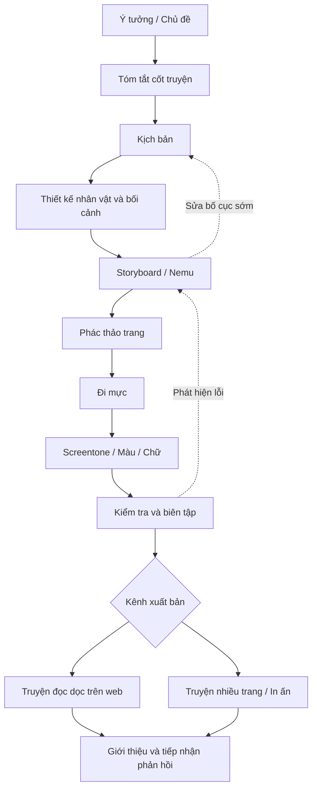

# KHÓA HỌC: TỰ SÁNG TÁC VÀ XUẤT BẢN MANGA

> Tài liệu học tập bằng tiếng Việt, biên soạn từ bản chép lời một video giới thiệu quy trình làm manga (khoảng 15 phút), có bổ sung ví dụ, bài tập và cấu trúc sư phạm. **Không phải bản dịch nguyên văn từng câu.**

## 1. Khóa học dành cho ai?

- Người mới muốn tự làm một truyện tranh theo phong cách manga.
- Người đã biết vẽ nhưng chưa biết biến ý tưởng thành trang truyện hoàn chỉnh.
- Người muốn so sánh quy trình truyền thống, kỹ thuật số và kết hợp.

**Đầu ra cuối khóa:** một truyện *one-shot* ngắn 6–10 trang ở dạng xem trên màn hình (và có thể chuẩn bị phiên bản in), kèm kịch bản, storyboard, trang hoàn thiện và bản tự đánh giá.

**Phạm vi:** video nguồn là bài tổng quan về quy trình, không phải khóa luyện giải phẫu, phối cảnh hay hướng dẫn phần mềm chuyên sâu. Các ví dụ và bài tập trong tài liệu này là phần biên soạn bổ sung, không phải lời nói nguyên văn của người trình bày.

## 2. Mục lục và lộ trình

| Bài | Nội dung | Sản phẩm nên có | Liên hệ video nguồn |
|---|---|---|---|
| [00](00-lo-trinh-va-cach-hoc.md) | Chuẩn bị và kế hoạch học | Lịch học, mục tiêu dự án | Xuyên suốt |
| [01](01-tong-quan-manga-va-dinh-dang.md) | Manga, webtoon, one-shot, đăng kỳ | Chọn hình thức truyện | 00:00–02:00; 13:11–13:52 |
| [02](02-cong-cu-va-quy-trinh.md) | Vẽ giấy, kỹ thuật số, kết hợp | Quy trình cá nhân | 00:46–01:37; 07:57–08:59 |
| [03](03-y-tuong-va-tom-tat-cot-truyen.md) | Ý tưởng, thông điệp, tóm tắt | Logline và synopsis | 03:09–04:55 |
| [04](04-kich-ban-va-thiet-ke.md) | Kịch bản, nhân vật, bối cảnh | Script và model sheet | 04:54–05:22 |
| [05](05-storyboard-va-khung-tranh.md) | Nemu, panel, nhịp kể, góc máy | Storyboard toàn truyện | 05:21–06:17 |
| [06](06-phac-thao-va-trang-in.md) | Dựng trang, safe area, bản in | Phác thảo từng trang | 06:43–07:20 |
| [07](07-di-muc-va-phoi-hop.md) | Inking, nét, trợ lý, tiến độ | Trang đi mực | 07:20–08:31 |
| [08](08-screentone-mau-va-hoan-thien.md) | Trạm sắc, màu, kiểm lỗi | Trang gần xuất bản | 08:30–09:13 |
| [09](09-bien-tap-xuat-ban-quang-ba.md) | Biên tập, hình thức phát hành, quảng bá | Kế hoạch công bố | 09:13–10:00; 13:52–14:35 |
| [10](10-du-an-one-shot.md) | Bài tập lớn tích hợp | Bộ truyện 6–10 trang | Tổng hợp |
| [11](11-kiem-tra-va-dap-an.md) | Tự đánh giá + đáp án | Bảng điểm tự chấm | Tổng hợp |
| [12](12-thuat-ngu-va-nguon.md) | Từ điển và đối chiếu nguồn | Bảng thuật ngữ | Tổng hợp |

## 3. Sơ đồ toàn bộ quy trình

> Các bước có thể lặp lại; không nhất thiết luôn là đường thẳng. Biên tập và phản hồi có thể xuất hiện từ khi mới có tóm tắt hoặc storyboard.

## 4. Học và nộp bài như thế nào?

1. Đọc bài theo thứ tự; xem lại mốc thời gian video ghi trong từng bài nếu có bản video gốc.
2. Tạo một thư mục dự án `manga-one-shot/` gồm `outline/`, `script/`, `design/`, `storyboard/`, `pages/` và `export/`.
3. Sau mỗi bài, hoàn thành **sản phẩm thực hành**; chỉ chuyển bài khi đủ tiêu chí tự kiểm.
4. Ở cuối khóa, theo rubric trong Bài 10 và đối chiếu phần kiểm tra ở Bài 11.

## 5. Quy ước chất lượng và nguồn

- **[Từ video]**: nội dung được rút ra từ phát biểu trong bản chép lời cung cấp.
- **[Bổ sung sư phạm]**: giải thích, ví dụ, checklist hoặc tiêu chí do tài liệu biên soạn để dễ thực hành.
- Bản chép lời có nhiều lỗi dịch tự động, đặc biệt tên riêng và thuật ngữ. Tài liệu ưu tiên thuật ngữ chuyên ngành như *mangaka*, *one-shot*, *storyboard/nemu*, *panel*, *gutter* và *screentone*.
- Không xem lịch đăng dày hay làm việc kiệt sức là tiêu chuẩn cần theo đuổi. Hãy lập kế hoạch có thời gian nghỉ.

---

**Bắt đầu:** [Bài 00 – Lộ trình và cách học](00-lo-trinh-va-cach-hoc.md).
