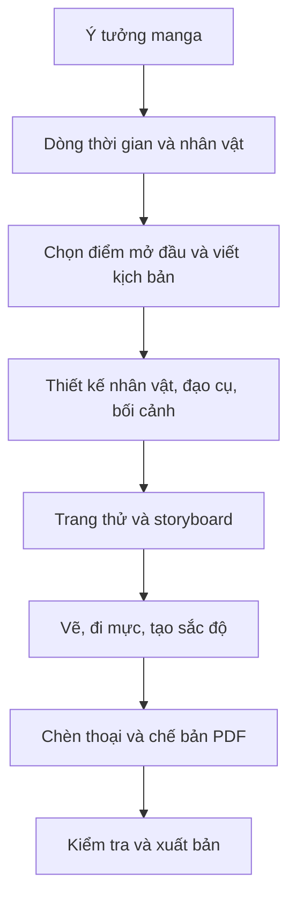

# Khóa học tự sáng tác, vẽ và xuất bản manga

## 1. Tổng quan

Khóa học hướng dẫn một quy trình sản xuất manga khép kín: **ý tưởng → kịch bản → thiết kế hình ảnh → storyboard → trang vẽ hoàn chỉnh → PDF → xuất bản**. Trọng tâm là thực hành sáng tác một manga ngắn trước khi mở rộng thành dự án nhiều chương.

**Đối tượng:** người mới học vẽ manga, người đã biết vẽ nhưng chưa sản xuất truyện nhiều trang, hoặc nhóm nhỏ có người viết kịch bản và người vẽ riêng.

**Sản phẩm đầu ra:** hồ sơ câu chuyện, bảng nhân vật, thiết kế bối cảnh, storyboard, những trang truyện đã hoàn thiện chữ và sắc độ, bản PDF theo yêu cầu đơn vị in hoặc nền tảng xuất bản, và phương án phát hành.

## 2. Lộ trình năm học phần

| Học phần | Bài học | Sản phẩm cần hoàn thành |
| --- | --- | --- |
| I. Câu chuyện | 01–03 | Dòng thời gian, hồ sơ thế giới, nhân vật và kịch bản mở đầu |
| II. Thiết kế | 04–05 | Character sheet, đạo cụ, bối cảnh và hướng dẫn phong cách |
| III. Sản xuất | 06–10 | Trang thử, storyboard, trang vẽ, đi mực và screentone |
| IV. Chế bản | 11–12 | Lời thoại, dàn trang, bìa và PDF |
| V. Phát hành | 13–14 | Kế hoạch xuất bản và dự án tổng kết |

Quy trình có các vòng phản hồi: nếu storyboard làm lộ vấn đề kể chuyện, hãy sửa kịch bản; nếu trang thử quá khó hoàn thành, hãy giảm mức độ chi tiết của thiết kế.

## 3. Danh mục bài học

1. [01 — Ý tưởng, lịch sử thế giới và dòng thời gian](01-y-tuong-va-dong-thoi-gian.md)
2. [02 — Hồ sơ nhân vật và xây dựng thế giới](02-ho-so-nhan-vat-va-the-gioi.md)
3. [03 — Chọn điểm mở đầu và viết kịch bản](03-diem-mo-dau-va-kich-ban.md)
4. [04 — Thiết kế nhân vật và đạo cụ](04-thiet-ke-nhan-vat-va-dao-cu.md)
5. [05 — Bối cảnh, bản đồ và phong cách hình ảnh](05-boi-canh-ban-do-phong-cach.md)
6. [06 — Thực hành làm một trang manga thử](06-lab-trang-manga-thu.md)
7. [07 — Storyboard và nhịp kể bằng khung truyện](07-storyboard-va-nhip-truyen.md)
8. [08 — Dựng trang và vùng an toàn khi in](08-bo-cuc-trang-va-vung-in.md)
9. [09 — Phác thảo, đi nét và tô mực](09-phac-thao-di-net-to-muc.md)
10. [10 — Screentone và hoàn thiện sắc độ](10-screentone-va-hoan-thien.md)
11. [11 — Bong bóng thoại và chèn chữ](11-bong-bong-thoai-va-chen-chu.md)
12. [12 — Dàn trang, xuất PDF và thiết kế bìa](12-dan-trang-pdf-va-bia.md)
13. [13 — Các phương án xuất bản manga](13-phuong-an-xuat-ban.md)
14. [14 — Dự án cuối khóa: manga ngắn](14-du-an-cuoi-khoa.md)

Bảng mẫu đi kèm: [15 — Bộ biểu mẫu thực hành](15-bieu-mau-thuc-hanh.md).

## 4. Cách học hiệu quả

Học theo thứ tự, nhưng không cần chờ vẽ giỏi mới bắt đầu kể chuyện. Mỗi bài có mục tiêu rõ ràng, thao tác hoặc bài tập, tiêu chí kiểm tra và câu hỏi ôn tập. Hãy tạo thư mục riêng cho câu chuyện, nhân vật, bối cảnh, storyboard, trang cuối và bản xuất.

**Dự án đầu tiên nên ngắn.** Một truyện ít trang với mở đầu, xung đột và kết thúc rõ ràng dễ giúp bạn đi hết quy trình hơn một bộ trường thiên chưa xác định điểm dừng. Thời gian hoàn thành phụ thuộc vào số trang, độ phức tạp và mức độ thành thạo; không đặt mục tiêu thời lượng cứng cho mọi người.

## 5. Những nguyên tắc cần nhớ

- Viết **dòng thời gian toàn thế giới truyện**, không chỉ các sự kiện người đọc nhìn thấy.
- Thiết kế cá tính nhân vật trước khi chốt ngoại hình; lưu hình tham chiếu để nhất quán.
- Không bỏ qua storyboard, kể cả khi đã biết kịch bản.
- Vùng cắt xén và vùng an toàn phải được xác nhận theo quy cách bản in cụ thể.
- Không có một công cụ duy nhất bắt buộc; có thể kết hợp vẽ tay, vẽ số và chế bản số.
- Không đồng nhất “đã xuất PDF” với “đủ tiêu chuẩn in”: cần kiểm tra font, kích thước, chất lượng ảnh và yêu cầu từ nhà in.

## 6. Ghi chú về phạm vi

Khóa học tập trung vào **quy trình sản xuất manga**. Kỹ thuật giải phẫu, phối cảnh, vẽ chuyển động hoặc xử lý phần mềm chuyên sâu là các kỹ năng hỗ trợ có thể cần học thêm. Những tiêu chuẩn kỹ thuật in ấn được nêu theo nguyên tắc chung; thông số cuối cùng phải dựa trên đơn vị phát hành hoặc in thực tế.
