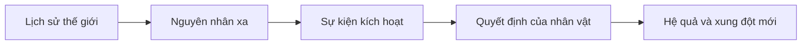

# Bài 01. Biến ý tưởng thành dòng thời gian câu chuyện manga

## 1. Tóm tắt

Một ý tưởng thú vị chưa phải là một câu chuyện có thể sản xuất. Trước khi vẽ khung truyện, cần biết **điều gì đã xảy ra, điều gì đang xảy ra và điều gì khiến các sự kiện nối tiếp nhau**. Dòng thời gian (timeline) giúp người sáng tác tránh mâu thuẫn và tạo nền tảng cho cốt truyện.

## 2. Mục tiêu học tập

Sau bài này, người học có thể:

- Phân biệt ý tưởng, tiền đề và chuỗi sự kiện.
- Xây dựng dòng thời gian gồm cả lịch sử trước thời điểm truyện mở đầu.
- Kiểm tra quan hệ nguyên nhân–kết quả và các lỗ hổng logic cơ bản.
- Chọn phạm vi câu chuyện phù hợp với manga đầu tay.

## 3. Từ ý tưởng đến tiền đề

**Ý tưởng** có thể chỉ là một hình ảnh hoặc một câu hỏi: “Nếu một thành phố mất bóng khi mặt trời lặn thì sao?”. Muốn phát triển thành truyện, hãy xác định nhân vật chính, mong muốn, trở ngại và hệ quả thất bại.

Một **tiền đề** mẫu: “Một người đưa thư trẻ phải đưa chiếc đèn cuối cùng tới tháp đồng hồ trước hoàng hôn, trong khi thành phố dần mất phương hướng”. Tiền đề chưa cho biết toàn bộ tình tiết nhưng đã gợi ra hành động và xung đột.

Bắt đầu bằng cách ghi bốn thành phần:

| Thành phần | Câu hỏi cần trả lời |
| --- | --- |
| Bối cảnh | Câu chuyện diễn ra trong thế giới nào? |
| Nhân vật | Ai là người ra quyết định quan trọng nhất? |
| Mục tiêu | Nhân vật cần đạt điều gì? |
| Xung đột | Điều gì khiến mục tiêu khó thực hiện? |

## 4. Dòng thời gian không đồng nghĩa thứ tự chương

**Dòng thời gian thế giới truyện** ghi các sự kiện theo thứ tự chúng thực sự xảy ra. **Thứ tự kể chuyện** là thứ tự độc giả được biết các sự kiện. Hai thứ tự có thể khác nhau vì tác giả sử dụng hồi tưởng, bí mật hoặc tiết lộ muộn.

Ví dụ:

| Thời điểm trong thế giới | Sự kiện | Xuất hiện trong truyện |
| --- | --- | --- |
| Nhiều năm trước | Tháp đồng hồ bị phong tỏa | Chỉ được nhắc sau |
| Một tuần trước | Đèn canh giữ bị đánh cắp | Hồi tưởng |
| Ngày hiện tại, buổi sáng | Người đưa thư nhận nhiệm vụ | Chương mở đầu |
| Ngày hiện tại, hoàng hôn | Thành phố mất ánh sáng | Cao trào |

Nếu chỉ ghi “chương 1 làm gì, chương 2 làm gì”, bạn dễ bỏ sót những nguyên nhân có trước sự kiện mở đầu.

## 5. Dựng timeline có thể kiểm chứng

Hãy ghi cho mỗi sự kiện: **mốc thời gian — người hoặc tổ chức liên quan — nguyên nhân — kết quả — bằng chứng/chi tiết cần giữ nhất quán**. Không nhất thiết mọi mốc đều có ngày tháng cụ thể; có thể dùng “5 năm trước”, “ngày thứ ba”, miễn đủ rõ để so sánh.

Mỗi mũi tên thể hiện quan hệ cần giải thích. Nếu một quyết định không có động cơ, hoặc hệ quả xảy ra mà không có điều kiện dẫn tới, hãy bổ sung sự kiện hoặc sửa lại logic.

## 6. Kiểm tra tính hợp lý

Kiểm tra theo ba lượt: (1) **thời gian**: nhân vật có thể cùng lúc ở hai nơi hay không? (2) **kiến thức**: nhân vật đã biết thông tin đó từ khi nào? (3) **nguyên nhân**: một đồ vật, năng lực hoặc tổ chức đã được thiết lập đủ sớm chưa? Đặc biệt theo dõi các sự kiện có ảnh hưởng lâu dài như tai nạn, chiến tranh, thay đổi quyền lực và sự ra đời của công nghệ.

Không cần xây dựng toàn bộ vũ trụ đến từng chi tiết. Hãy ưu tiên những sự kiện làm thay đổi lựa chọn của nhân vật trong câu chuyện bạn định kể.

## 7. Thực hành

Tạo timeline tối thiểu **8 sự kiện**, gồm ít nhất 3 sự kiện xảy ra trước đoạn mở đầu dự kiến. Tô dấu các mốc thuộc “lịch sử nền” và “cảnh độc giả thực sự thấy”. Viết 2–3 câu giải thích vì sao mỗi sự kiện quan trọng.

**Tiêu chí hoàn thành:** có một tiền đề rõ ràng; các sự kiện chính có thứ tự; những nguyên nhân quan trọng không xuất hiện đột ngột; câu chuyện có điểm dừng dự kiến.

## 8. Câu hỏi ôn tập

**Câu 1.** Timeline khác với danh sách chương ở điểm nào?

A. Timeline chỉ mô tả hình ảnh.  
B. Timeline luôn phải có ngày tháng thực.  
C. Timeline ghi sự kiện theo thời gian của thế giới, kể cả quá khứ chưa được kể.  
D. Timeline chỉ dùng khi truyện dài.

**Đáp án:** C. **Giải thích:** Timeline là trình tự các sự kiện trong thế giới truyện; chương là đơn vị trình bày cho độc giả.

**Câu 2.** Nhân vật sử dụng một vật phẩm bí mật ở đoạn cao trào. Cách chuẩn bị phù hợp nhất là gì?

A. Xác định vật phẩm tồn tại từ khi nào và vì sao nhân vật có được nó.  
B. Chỉ vẽ vật phẩm thật đẹp ở đoạn cao trào.  
C. Xóa tất cả sự kiện trước đó.  
D. Đổi tên vật phẩm ở mỗi chương.

**Đáp án:** A. **Giải thích:** Bối cảnh và nguyên nhân phải đủ nhất quán để chi tiết quan trọng có sức thuyết phục.

**Câu 3.** Một nhân vật biết bí mật xảy ra trước khi họ ra đời. Điều cần kiểm tra trước tiên là gì?

A. Kiểu tóc nhân vật.  
B. Số khung truyện.  
C. Kích thước giấy.  
D. Con đường nhân vật nhận được thông tin đó.

**Đáp án:** D. **Giải thích:** Biết sự kiện trong quá khứ không sai; thiếu cơ chế tiếp nhận thông tin mới gây lỗ hổng logic.

**Câu 4.** Vì sao nên giới hạn phạm vi ở manga đầu tay?

A. Vì manga ngắn không cần nhân vật.  
B. Vì dễ hoàn thành trọn quy trình và đánh giá chất lượng.  
C. Vì manga không được có thế giới giả tưởng.  
D. Vì storyboard chỉ dùng được cho truyện ngắn.

**Đáp án:** B. **Giải thích:** Quy mô vừa phải giúp kiểm soát công việc và rút kinh nghiệm từ sản phẩm hoàn chỉnh.

**Câu 5.** Đâu là quan hệ tốt nhất giữa timeline và nhịp kể?

A. Mọi sự kiện timeline đều phải vẽ thành cảnh.  
B. Phải mở đầu tại sự kiện sớm nhất.  
C. Timeline quản lý logic, còn nhịp kể quyết định thời điểm tiết lộ.  
D. Không thể dùng hồi tưởng.

**Đáp án:** C. **Giải thích:** Một lịch sử đầy đủ cho phép tác giả chọn cách trình bày hấp dẫn mà không đánh mất tính nhất quán.

## 9. Tổng kết

Hãy hoàn thành **thế giới truyện diễn ra như thế nào** trước khi quyết định **độc giả sẽ nhìn thấy sự kiện theo thứ tự nào**. Timeline là bản đồ logic, không phải danh sách khung hình phải vẽ.
