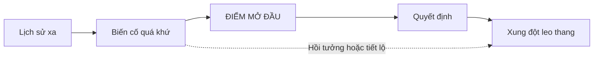

# Bài 03. Chọn điểm mở đầu và viết kịch bản manga

## 1. Tóm tắt

Sau khi xây dựng lịch sử thế giới và nhân vật, tác giả phải chọn **thời điểm độc giả bước vào câu chuyện**. Điểm mở đầu không nhất thiết là sự kiện xảy ra sớm nhất. Chọn đúng nơi để bắt đầu giúp người đọc cảm nhận xung đột sớm mà không bị ngập trong phần giải thích.

## 2. Mục tiêu học tập

- Phân biệt mốc bắt đầu kể chuyện với mốc đầu tiên của timeline.
- Chọn một “điểm thả kim” (needle drop) tạo sự tò mò hợp lý.
- Viết các cảnh mở đầu theo mục tiêu, hành động, xung đột và kết quả.
- Xác định lượng thông tin có thể tiết lộ sau qua đối thoại hoặc hồi tưởng.

## 3. Phương pháp điểm thả kim

Hãy tưởng tượng timeline là một dải dài chứa hàng trăm sự kiện. Ta đặt đầu kim vào **một sự kiện đáng kể** để bắt đầu câu chuyện được trình bày cho độc giả. Những sự kiện trước đó tiếp tục tồn tại và có thể được hé lộ ở thời điểm thích hợp.

Một điểm mở đầu hiệu quả thường có ít nhất một trong các yếu tố: quyết định khó khăn, biến cố làm thay đổi đời sống thường ngày, bí ẩn có hệ quả rõ ràng, hoặc sự kiện buộc nhân vật hành động. Không cần dồn tất cả bí mật của thế giới vào chương đầu.

## 4. Chọn điểm mở đầu bằng so sánh

Giả sử truyện về thành phố mất ánh sáng có ba điểm có thể bắt đầu:

| Phương án | Ưu thế | Rủi ro |
| --- | --- | --- |
| Người sáng lập xây tháp hàng chục năm trước | Giới thiệu lịch sử | Xa nhân vật chính và mục tiêu hiện tại |
| Người đưa thư nhận chiếc đèn cuối cùng | Có mục tiêu, câu hỏi, hành động | Cần tiết lộ bối cảnh vừa đủ |
| Thành phố đã chìm hoàn toàn trong bóng tối | Tình thế căng thẳng | Khó giải thích vì sao nhân vật bị cuốn vào |

Có thể chọn phương án thứ hai để nhân vật chính được hành động ngay. Phương án thứ nhất trở thành bí mật được kể sau; phương án thứ ba là nguy cơ sắp xảy ra.

## 5. Từ timeline thành kịch bản cảnh

**Timeline trả lời “chuyện gì diễn ra?”; kịch bản cảnh trả lời “độc giả trải nghiệm chuyện đó ra sao?”** Mỗi cảnh cần tối thiểu: địa điểm, nhân vật hiện diện, mục tiêu trước mắt, trở ngại và thay đổi ở cuối cảnh.

Ví dụ mô tả cảnh:

> **Cảnh: Trạm thư, sáng sớm.** Người quản lý giao một chiếc đèn có ánh sáng đang yếu cho người đưa thư. Anh nhận nhiệm vụ nhưng từ chối bạn đồng hành. Khi vừa ra khỏi cửa, biển tên các con phố bắt đầu biến mất. Anh buộc phải dựa vào trí nhớ để tìm đường.

Đây chưa phải storyboard. Nó là chất liệu kể chuyện để chuyển thành hình ảnh và lời thoại.

## 6. Điều chỉnh lượng thông tin

Không cần giải thích ngay mọi quy luật. Chỉ đưa thông tin giúp độc giả theo dõi hành động đang diễn ra: nhân vật đang làm gì, vì sao nguy hiểm và điều gì xảy ra nếu thất bại. Giữ lại những bí mật có thể tạo sức tò mò; nhưng không được giấu các thông tin tối thiểu khiến hành động hoàn toàn khó hiểu.

**Lỗi thường gặp:** mở đầu bằng hàng trang lịch sử không gắn với xung đột; đưa quá nhiều nhân vật mới cùng lúc; chọn điểm mở đầu chỉ vì cảnh hành động đẹp nhưng không có hậu quả với câu chuyện.

## 7. Thực hành

Chọn **ba điểm khởi đầu** trên timeline của bạn. Viết cho mỗi điểm: một câu hỏi mà độc giả có thể đặt ra, hành động chính của nhân vật và rủi ro nếu họ thất bại. Chọn một điểm, rồi viết kịch bản cho **ba cảnh liên tiếp** có quan hệ nguyên nhân–kết quả.

**Tiêu chí hoàn thành:** cảnh đầu tạo động lực đọc tiếp; độc giả hiểu tình huống cốt lõi; mỗi cảnh làm thay đổi điều kiện của cảnh sau; thông tin lịch sử chưa biết không phá vỡ logic.

## 8. Câu hỏi ôn tập

**Câu 1.** “Điểm thả kim” là gì?

A. Thời điểm đầu tiên có trong lịch sử thế giới.  
B. Mọi cảnh cần vẽ trong manga.  
C. Nơi đặt nhạc nền cho cảnh mở đầu.  
D. Mốc được chọn để độc giả bắt đầu theo dõi câu chuyện.

**Đáp án:** D. **Giải thích:** Điểm mở đầu do tác giả chọn trong timeline, không nhất thiết trùng sự kiện sớm nhất.

**Câu 2.** Khi chương đầu có quá nhiều giải thích lịch sử, cách sửa nào thường hữu ích?

A. Đưa hành động và mục tiêu nhân vật lên trước, tiết lộ quá khứ khi cần.  
B. Thêm nhiều thuật ngữ mới.  
C. Xóa xung đột hiện tại.  
D. Viết câu thoại dài hơn.

**Đáp án:** A. **Giải thích:** Độc giả cần một tình huống để quan tâm trước khi tiếp nhận quá nhiều bối cảnh.

**Câu 3.** Một cảnh đã có địa điểm, nhân vật và đối thoại nhưng không làm thay đổi gì. Phần nào cần xem lại?

A. Độ dày ngòi bút.  
B. Tên thư mục.  
C. Trở ngại, lựa chọn và kết quả của cảnh.  
D. Loại file PDF.

**Đáp án:** C. **Giải thích:** Cảnh có ý nghĩa khi hành động hoặc thông tin làm thay đổi trạng thái câu chuyện.

**Câu 4.** Dùng hồi tưởng đúng cách là gì?

A. Không cần biết nó xảy ra vào lúc nào.  
B. Hé lộ sự kiện quá khứ đã được giữ nhất quán trong timeline.  
C. Luôn phải đưa hồi tưởng vào trang một.  
D. Chỉ dùng hồi tưởng để kéo dài số trang.

**Đáp án:** B. **Giải thích:** Hồi tưởng thay đổi thứ tự trình bày, không phải lịch sử đã xảy ra.

**Câu 5.** Mục tiêu quan trọng nhất của phần mở đầu manga là gì?

A. Giới thiệu toàn bộ nhân vật.  
B. Giải thích mọi địa danh.  
C. Vẽ cảnh phức tạp nhất.  
D. Giúp độc giả nắm một tình huống đáng quan tâm và muốn tiếp tục đọc.

**Đáp án:** D. **Giải thích:** Khởi đầu nên kích hoạt sự tò mò và tạo mục tiêu, thay vì chỉ tải thông tin.

## 9. Tổng kết

Lịch sử giúp chuyện hợp lý; điểm mở đầu giúp chuyện hấp dẫn; kịch bản cảnh giúp lịch sử và nhân vật trở thành hành động mà người đọc có thể theo dõi.
