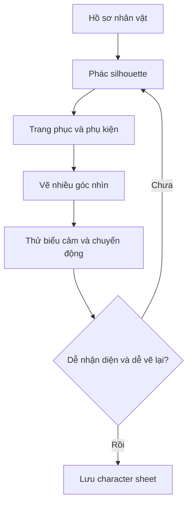

# Bài 04. Thiết kế tạo hình nhân vật và đạo cụ nhất quán

## 1. Tóm tắt

Thiết kế manga tốt không chỉ là vẽ một nhân vật đẹp ở một góc nhìn. Tạo hình cần **được nhận ra nhanh, phù hợp tính cách hoặc vai trò, và có thể vẽ lặp lại** qua hàng chục khung truyện. Với đạo cụ và các yếu tố tưởng tượng, thiết kế nhiều góc nhìn giúp tránh thay đổi cấu trúc vô ý giữa các trang.

## 2. Mục tiêu học tập

- Dùng silhouette để kiểm tra khả năng nhận diện nhân vật.
- Liên hệ trang phục, phụ kiện và kiểu tóc với tính cách hoặc công việc.
- Thiết kế character sheet có góc nhìn và chi tiết ổn định.
- Xây dựng bản tham chiếu cho đạo cụ, sinh vật và vật phẩm quan trọng.

## 3. Nhận diện từ bóng dáng

**Silhouette** là hình khối tổng thể khi chỉ nhìn thấy nhân vật như một mảng đen. Khi phóng nhỏ hoặc lược bớt chi tiết, kiểu tóc, chiều cao tương đối, dáng đứng, tỷ lệ cơ thể và các phụ kiện lớn vẫn nên giúp phân biệt nhân vật chủ chốt.

Bài kiểm tra đơn giản: vẽ ba nhân vật ở cùng kích thước; tô đen hoàn toàn; đặt cạnh nhau. Nếu chúng trông gần như giống nhau, thử điều chỉnh tỷ lệ tổng thể, hình dạng tóc, vai, cổ áo, túi hoặc tư thế thường dùng. **Không nhất thiết mọi nhân vật phải có hình dáng kỳ dị**; tính dễ nhận ra cần cân bằng với bối cảnh truyện.

## 4. Ngoại hình phải kể chuyện

Một người đưa thư thường xuyên đi bộ có thể dùng giày chắc chắn, áo khoác nhiều túi, dây đeo cặp đã mòn. Các chi tiết nên cho thấy cuộc sống của người đó, thay vì gắn phụ kiện không có chủ đích.

| Yếu tố | Câu hỏi thiết kế |
| --- | --- |
| Kiểu tóc | Có dễ vẽ từ trước, nghiêng và sau không? |
| Trang phục | Có phù hợp nghề nghiệp, thời tiết, thời đại không? |
| Phụ kiện | Có liên hệ vai trò hay thói quen không? |
| Tỷ lệ | Có dễ phân biệt với các nhân vật cùng cảnh không? |
| Biểu cảm | Có nhiều biểu cảm mà vẫn nhận ra đúng nhân vật không? |

Không nên suy luận cứng rằng một kiểu tóc luôn tương ứng một tính cách. Hãy dùng ngoại hình như **dấu hiệu gợi ý**, và để hành động phát triển chiều sâu nhân vật.

## 5. Character sheet cần gồm gì?

Một bộ tham chiếu hữu ích có thể gồm: chính diện, nghiêng, sau lưng, góc 3/4, cận khuôn mặt và 4–6 biểu cảm thường dùng. Ngoài hình, ghi chú các đặc điểm tuyệt đối không được đổi: vị trí khuy áo, bên mang túi, vết sẹo, chiều dài tay áo, chất liệu hoặc tỷ lệ phụ kiện.

Đừng chỉ vẽ nhân vật trong một tư thế tạo dáng đẹp. Hãy kiểm tra chuyển động: chạy, ngồi, quay đầu, đưa tay và cầm vật phẩm. Bộ đồ quá rườm rà có thể tốn công vẽ lại hoặc che mất hành động quan trọng.

## 6. Thiết kế vật phẩm và sinh vật

Đối với đạo cụ xuất hiện nhiều lần (gươm, máy móc, đèn, phương tiện), hãy xác định cấu tạo, kích thước so với tay người, mặt trước–sau, cách cầm và các bộ phận chuyển động. Một vật phẩm trông hợp lý ở góc chính diện nhưng vô lý ở góc nghiêng sẽ gây khó khi vào cảnh hành động.

**Mô hình 3D đơn giản** có thể dùng làm công cụ tham khảo góc nhìn. Đây là một lựa chọn, không phải yêu cầu bắt buộc; mục tiêu là giữ thể tích và tỷ lệ ổn định, không nhất thiết làm mô hình game-ready.

## 7. Quy trình thiết kế lặp

Tại bước đánh giá, hãy thử vẽ lại không nhìn mẫu rồi so sánh; các chi tiết khó nhớ hoặc không có chức năng có thể được đơn giản hóa.

## 8. Thực hành

Thiết kế **hai nhân vật có silhouette khác nhau** và một đạo cụ quan trọng. Chuẩn bị character sheet với ít nhất ba góc nhìn, ba biểu cảm và ghi chú 5 đặc điểm cố định của mỗi nhân vật. Vẽ đạo cụ từ trước, bên và góc 3/4.

**Tiêu chí hoàn thành:** nhận diện được khi bỏ màu và nét nhỏ; đặc điểm phù hợp vai trò; các góc nhìn không mâu thuẫn; thiết kế đủ đơn giản để xuất hiện nhiều lần.

## 9. Câu hỏi ôn tập

**Câu 1.** Silhouette dùng để kiểm tra chủ yếu điều gì?

A. Độ phân giải trang in.  
B. Hình dáng tổng thể có giúp nhận ra nhân vật không.  
C. Kiểu font trong lời thoại.  
D. Số trang của manga.

**Đáp án:** B. **Giải thích:** Silhouette loại chi tiết nhỏ để đánh giá cấu trúc tổng thể và khả năng phân biệt nhân vật.

**Câu 2.** Một phụ kiện được thiết kế tốt nhất khi nào?

A. Khi nhiều chi tiết nhất.  
B. Khi chỉ đẹp ở chính diện.  
C. Khi không cần vẽ lại.  
D. Khi có vai trò tạo hình hoặc kể chuyện và vẽ được ở nhiều góc.

**Đáp án:** D. **Giải thích:** Phụ kiện vừa phục vụ câu chuyện vừa phải nhất quán trong quá trình sản xuất.

**Câu 3.** Vì sao nên thử nhân vật trong tư thế chạy hoặc ngồi?

A. Để phát hiện trang phục, hình khối và phụ kiện có gây vướng khi vẽ chuyển động.  
B. Để xác nhận số lượng chương.  
C. Để bỏ qua thiết kế khuôn mặt.  
D. Để tính giá in.

**Đáp án:** A. **Giải thích:** Manga là chuỗi hành động, không chỉ tập hợp chân dung tĩnh.

**Câu 4.** Dùng mô hình 3D tham chiếu có lợi nhất trong trường hợp nào?

A. Để mọi hình đều phải render 3D.  
B. Để khỏi viết kịch bản.  
C. Để kiểm tra đạo cụ có hình dạng phức tạp từ nhiều góc.  
D. Để tự động tạo lời thoại.

**Đáp án:** C. **Giải thích:** Mô hình hỗ trợ quan sát thể tích và phép xoay không gian của vật thể.

**Câu 5.** Một thiết kế rất đẹp nhưng khó vẽ lại, cách xử lý phù hợp là gì?

A. Bỏ kiểm tra nhận diện.  
B. Giữ các dấu hiệu chính, đơn giản hóa chi tiết không phục vụ câu chuyện.  
C. Chỉ vẽ nhân vật một lần.  
D. Đổi tên nhân vật.

**Đáp án:** B. **Giải thích:** Sản xuất truyện nhiều trang đòi hỏi thiết kế vừa biểu cảm vừa thực tế để lặp lại.

## 10. Tổng kết

Một thiết kế thành công là thiết kế có **cá tính, chức năng và tính nhất quán trong sản xuất**.
