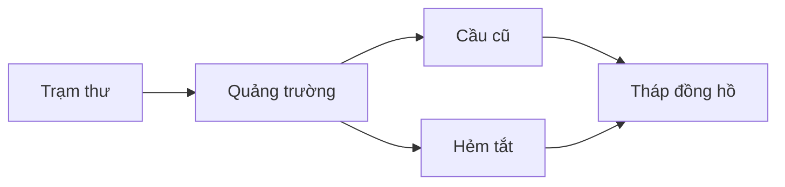

# Bài 05. Thiết kế bối cảnh, bản đồ và phong cách mỹ thuật manga

## 1. Tóm tắt

Bối cảnh đặt nhân vật vào một không gian có quy luật. Phong cách hình ảnh quyết định tác phẩm trông và được cảm nhận như thế nào. Cả hai cần được chuẩn bị trước khi vẽ hàng loạt trang để tránh việc một căn phòng, thành phố hay chất liệu thay đổi tùy tiện.

## 2. Mục tiêu học tập

- Xây dựng bản tham chiếu vị trí và cấu tạo của bối cảnh chính.
- Tạo sơ đồ không gian giúp duy trì hướng di chuyển giữa các cảnh.
- Phân tích ảnh tham chiếu theo nét vẽ, sắc độ và độ chi tiết.
- Viết bản hướng dẫn phong cách (style guide) có thể áp dụng nhất quán.

## 3. Hồ sơ địa điểm

Một địa điểm chính cần nhiều hơn một hình minh họa đẹp. Hãy ghi lại **chức năng, kích thước tương đối, lối vào–ra, vật mốc, hướng sáng và các vật không nên thay đổi**. Với căn phòng, một sơ đồ mặt bằng đơn giản giúp bạn biết cửa sổ nằm ở bức tường nào. Với thành phố, cần vị trí tương đối giữa những điểm nhân vật thường ghé tới.

Ví dụ hồ sơ **trạm thư**:

- Cửa chính hướng ra phố lớn; quầy làm việc ở bên trái cửa.
- Cửa sổ lớn nằm phía sau quầy; ánh sáng buổi sáng đổ từ phía đó.
- Giá thư chứa chiếc hộp đèn ở góc phải; đây là đạo cụ tạo biến cố ở cảnh mở đầu.
- Dây đeo túi của nhân vật có thể mắc vào góc quầy khi vội vã.

Các chi tiết này vừa giúp định hướng không gian vừa gợi ra cơ hội kể chuyện bằng hình ảnh.

## 4. Bản đồ thế giới và lộ trình nhân vật

Không cần vẽ bản đồ địa lý hoàn hảo nếu câu chuyện chỉ diễn ra trong vài khu phố. Một sơ đồ gồm các điểm đến, đường kết nối và trở ngại cũng đủ giúp quản lý hướng di chuyển. Khi vẽ cảnh, đặt câu hỏi: nhân vật từ đâu đến, đi về phía nào và phía sau họ là gì?

Sơ đồ cho phép kiểm tra tính hợp lý của lựa chọn đường đi. Nếu nhân vật chọn hẻm tắt để tiết kiệm thời gian, truyện nên cho thấy sự khác biệt hoặc rủi ro khiến lựa chọn ấy có ý nghĩa.

## 5. Tạo style guide từ tham chiếu

Thu thập một nhóm hình ảnh mà bạn thích, nhưng đừng sao chép nguyên một trang của tác giả khác. Hãy phân tích **đặc điểm có thể học được**:

| Yếu tố | Các lựa chọn cần quyết định |
| --- | --- |
| Nét vẽ | Mảnh hoặc dày; đều hoặc biến đổi theo ánh sáng |
| Tỷ lệ nhân vật | Cách điệu mạnh hay gần thực tế |
| Bối cảnh | Tối giản hay chi tiết, ít hay nhiều kết cấu |
| Sắc độ | Đen–trắng tương phản mạnh hay nhiều screentone |
| Độ rõ hành động | Đường chuyển động, khoảng trống, số chi tiết mỗi khung |
| Trang trí | Họa tiết, hiệu ứng, cách vẽ âm thanh |

**Ví dụ lựa chọn phong cách:** nhân vật có nét rõ và tỷ lệ hơi cách điệu, nền kiến trúc chi tiết vừa phải, screentone chỉ dùng cho chất liệu và vùng tối lớn. Khi đã chọn, hãy dùng nó trên mọi trang thử để xem có khả thi hay không.

## 6. Đảm bảo khả năng thực thi

Phong cách có thể thay đổi khi tác giả tìm được giải pháp tốt hơn, nhưng thay đổi giữa dự án cần có chủ đích. Nếu một phong cách đòi hỏi vẽ quá nhiều chi tiết cho mỗi khung, hãy giảm mức độ chi tiết ở cảnh chuyển tiếp và giữ chi tiết cao cho cảnh quan trọng.

**Lỗi thường gặp:** nền thiếu bản đồ nên thay đổi hướng cửa; cùng một vật thể có tỷ lệ khác nhau; trộn chất liệu và kiểu nét không có nguyên tắc; dùng ảnh tham chiếu mà không xem xét quyền sử dụng.

## 7. Thực hành

Tạo một **bản đồ địa điểm** có tối thiểu bốn điểm đến và một **style guide một trang** gồm: 3 đặc điểm nét vẽ, 3 đặc điểm sắc độ, 2 nguyên tắc vẽ bối cảnh, và một khung mẫu thử. Vẽ cùng địa điểm dưới hai góc khác nhau, giữ đúng cửa, cửa sổ và vật mốc.

**Tiêu chí hoàn thành:** định hướng không gian rõ; địa điểm không thay đổi vô lý; phong cách đủ cụ thể để người khác có thể mô phỏng; bản thử có mức độ chi tiết khả thi.

## 8. Câu hỏi ôn tập

**Câu 1.** Vì sao cần mặt bằng hoặc bản đồ cho bối cảnh?

A. Để đảm bảo hướng di chuyển và vị trí vật mốc nhất quán.  
B. Để tự động tô mực.  
C. Để chọn cỡ chữ bìa.  
D. Để không cần kịch bản.

**Đáp án:** A. **Giải thích:** Bản đồ là công cụ quản lý không gian và quan hệ giữa các cảnh.

**Câu 2.** Khi tham khảo phong cách manga khác, cách tiếp cận có trách nhiệm hơn là gì?

A. Sao chép toàn bộ trang và đổi tên nhân vật.  
B. Xóa mọi chi tiết bối cảnh.  
C. Phân tích cách dùng nét, tỷ lệ, sắc độ rồi tạo quy tắc riêng.  
D. Chỉ dùng một ảnh duy nhất.

**Đáp án:** C. **Giải thích:** Học từ nguyên lý thể hiện khác với sao chép trực tiếp một tác phẩm cụ thể.

**Câu 3.** Một căn phòng có cửa sổ đổi chỗ giữa hai khung. Nên kiểm tra phần nào?

A. Số trang in.  
B. Hồ sơ bối cảnh và sơ đồ không gian.  
C. Phông chữ lời thoại.  
D. Cỡ ngòi bút.

**Đáp án:** B. **Giải thích:** Sơ đồ hỗ trợ đối chiếu các thành phần cố định khi thay đổi góc nhìn.

**Câu 4.** Style guide hữu ích nhất khi nào?

A. Khi chỉ nêu “vẽ thật đẹp”.  
B. Khi chỉ liệt kê tên tác giả yêu thích.  
C. Khi không có hình mẫu thử.  
D. Khi ghi rõ quy tắc nét, sắc độ và độ chi tiết có thể áp dụng.

**Đáp án:** D. **Giải thích:** Các nguyên tắc cụ thể mới hỗ trợ nhất quán trong sản xuất.

**Câu 5.** Khi style guide khiến mỗi trang mất quá nhiều công, nên làm gì?

A. Giữ dấu hiệu phong cách chính nhưng điều chỉnh độ chi tiết theo mục đích cảnh.  
B. Bỏ luôn storyboard.  
C. Đặt thêm càng nhiều họa tiết càng tốt.  
D. Không cần kiểm tra trang thử.

**Đáp án:** A. **Giải thích:** Phong cách phải cân bằng chất lượng hình ảnh và khả năng hoàn thành toàn bộ manga.

## 9. Tổng kết

Bối cảnh rõ giúp người đọc không bị lạc trong không gian; phong cách thống nhất giúp câu chuyện có bản sắc thị giác. Cả hai cần được thử nghiệm trước khi sản xuất hàng loạt.
