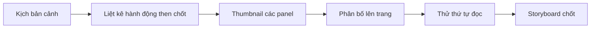

# Bài 07. Storyboard: Biến kịch bản thành các trang manga

## 1. Tóm tắt

**Storyboard** trong manga là bản phác bố cục các trang và khung truyện (panel) trước khi tạo nét hoàn chỉnh. Đây là bước nối giữa chữ viết và ngôn ngữ hình ảnh. Kịch bản tốt nhưng storyboard thiếu rõ ràng vẫn khiến câu chuyện khó đọc.

## 2. Mục tiêu học tập

- Phân biệt kịch bản cảnh với storyboard.
- Chuyển hành động thành chuỗi khung có thứ tự đọc rõ.
- Điều chỉnh kích thước panel để thể hiện nhịp kể.
- Lên kế hoạch trang trái, trang phải và thời điểm lật trang khi làm bản in.

## 3. Vì sao cần storyboard?

Kịch bản có thể viết “Nhân vật chạy tới tháp và nhận ra cửa đã khóa”; storyboard cần quyết định khung nào cho thấy bước chân chạy, khung nào thiết lập tháp, khung nào cận bàn tay nắm cửa và khung nào giữ lại phản ứng. Storyboard cho phép thử nhiều nhịp kể mà không phải vẽ lại trang đã đi mực.

## 4. Tư duy theo khoảnh khắc

Một khung nên chuyển tải một thời điểm hoặc trọng tâm nhận thức đủ rõ. Ví dụ một chuỗi:

1. Khung rộng: con phố vắng, nhân vật nhỏ ở xa.
2. Khung trung: nhân vật dừng lại, nghe tiếng động.
3. Cận cảnh: bàn tay siết chiếc đèn.
4. Khung lớn: ánh sáng bất ngờ bùng lên.

Chuỗi trên đi từ **thiết lập không gian → phản ứng → chuẩn bị → biến cố**. Chọn một khung lớn cho biến cố giúp tạo trọng lượng thị giác. Tuy nhiên, không có công thức cứng cho số khung; mục tiêu là nhịp đọc phù hợp tình huống.

## 5. Điều hướng mắt người đọc

Trong nhiều ấn phẩm manga Nhật, trang được đọc theo hướng **phải sang trái**, và theo chiều từ trên xuống dưới. Hãy xác định quy ước cho ấn phẩm ngay từ đầu; một số bản phát hành đã chuyển hoặc thiết kế theo hướng đọc khác. Quy ước đọc ảnh hưởng tới vị trí nhân vật, bong bóng thoại, chiều hành động và thứ tự panel.

Lưu ý ba mối liên hệ:

- **Khoảng cách giữa khung:** khoảng trắng và sự sắp xếp giúp phân biệt ranh giới thời gian hoặc sự kiện.
- **Luồng thoại:** bong bóng thoại nên dẫn mắt theo cùng thứ tự với hành động.
- **Điểm nhìn:** thay đổi góc máy có mục đích; không liên tục đảo hướng vô cớ khiến người đọc mất phương hướng.

## 6. Trang trái, trang phải và cú lật trang

Khi làm bản in, một trang có thể thuộc mặt trái hoặc mặt phải của cặp trang. Thứ tự trang và hướng đóng gáy phụ thuộc quy cách xuất bản. Vì vậy, phải kiểm tra bản xem thử theo **trang đôi (spread)**, không chỉ kiểm tra từng ảnh rời.

Một tiết lộ bất ngờ có thể được đặt ngay sau cú lật trang nếu bố cục hỗ trợ. Nhưng không cần gượng ép mọi trang thành “cliffhanger”. Quan trọng hơn là đọc mạch lạc và quản lý chỗ đặt khung, thoại gần gáy.

## 7. Sửa storyboard trước khi lên nét

Đọc toàn bộ storyboard ở kích thước nhỏ; với cảnh hành động, thử kể lại bằng miệng mà không đọc kịch bản. Nếu độc giả không rõ ai đang làm gì, hãy thêm khung thiết lập, phản ứng hoặc một hình trung gian. Nếu một hành động bị lặp nhiều lần mà không tăng thông tin, có thể gộp khung để tăng nhịp.

**Lỗi thường gặp:** panel nào cũng cùng kích thước; thiếu khung cho thấy vị trí nhân vật; bong bóng thoại ngược thứ tự; cảnh quan trọng bị nhồi vào trang không đủ chỗ; bỏ qua trang chẵn/lẻ.

## 8. Thực hành

Chuyển ba cảnh ở bài viết kịch bản thành storyboard hoàn chỉnh của **ít nhất hai trang**. Làm hai phiên bản thumbnail cho một trang, một phiên bản nhịp chậm và một phiên bản nhịp nhanh. So sánh số panel, mức độ rõ và điểm nhấn.

**Tiêu chí hoàn thành:** mỗi panel có mục đích; người đọc nhận ra thứ tự; có khung thiết lập không gian; bố cục xem được ở dạng spread dự kiến.

## 9. Câu hỏi ôn tập

**Câu 1.** Storyboard khác với kịch bản ở điểm cốt lõi nào?

A. Storyboard phải có màu.  
B. Storyboard chỉ là danh sách nhân vật.  
C. Storyboard không cần hành động.  
D. Storyboard quyết định cảnh được chia thành khung và trang như thế nào.

**Đáp án:** D. **Giải thích:** Storyboard chuyển mô tả chữ thành bố cục và trình tự hình ảnh cụ thể.

**Câu 2.** Một đoạn rượt đuổi khó theo dõi vì người đọc không rõ hai nhân vật ở đâu. Nên làm gì?

A. Thêm hoặc chỉnh khung thiết lập quan hệ không gian.  
B. Bỏ tất cả khung trung.  
C. Thay toàn bộ bong bóng thoại thành chữ nhỏ.  
D. Chỉ tăng mức screentone.

**Đáp án:** A. **Giải thích:** Khung thiết lập giúp định vị nhân vật và hành động.

**Câu 3.** Cách dùng panel lớn hợp lý nhất là gì?

A. Dùng cho mọi lời thoại.  
B. Dùng tùy ý không liên quan nhịp kể.  
C. Nhấn mạnh khoảnh khắc hoặc hình ảnh quan trọng.  
D. Chỉ dùng ở trang đầu.

**Đáp án:** C. **Giải thích:** Kích thước panel là một tín hiệu thị giác về trọng lượng và nhịp của sự kiện.

**Câu 4.** Vì sao cần xem trang đôi khi làm manga in?

A. Để có thể bỏ qua lề.  
B. Vì gáy, thứ tự trái–phải và cú lật trang ảnh hưởng bố cục.  
C. Vì mọi manga đều dùng cùng cách đóng gáy.  
D. Vì truyện chỉ được vẽ trên trang đôi.

**Đáp án:** B. **Giải thích:** Bản in được trải nghiệm dưới dạng trang liên tiếp, không chỉ file ảnh đơn lẻ.

**Câu 5.** Khi nào nên sửa storyboard?

A. Chỉ sau khi đã in sách.  
B. Chỉ khi thay đổi tên truyện.  
C. Không bao giờ nên sửa.  
D. Ngay khi phát hiện lỗi luồng đọc hoặc nhịp kể, trước lúc hoàn thiện nét.

**Đáp án:** D. **Giải thích:** Sửa ở bước phác thường ít tốn công hơn khi đã tô mực và tạo sắc độ.

## 10. Tổng kết

Storyboard là công cụ kiểm soát **thời gian, nhịp điệu và sự chú ý** của độc giả trên từng trang manga.
