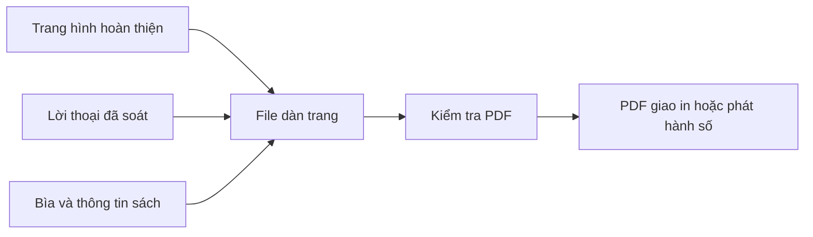

# Bài 12. Dàn trang, xuất PDF và thiết kế bìa manga

## 1. Tóm tắt

Khi từng trang đã hoàn thiện, bước tiếp theo là kết hợp chúng thành bản thảo liên tục và tạo file giao cho nhà in hoặc nền tảng xuất bản. Công việc này gọi là **chế bản và dàn trang**; nó bao gồm thứ tự trang, kích thước, font, bìa và kiểm tra file đầu ra.

## 2. Mục tiêu học tập

- Sắp các trang manga theo thứ tự đọc và quy ước trái–phải.
- Phân biệt file ảnh trang đơn và file PDF nhiều trang.
- Chuẩn bị bìa phù hợp với bản số hoặc bản in.
- Kiểm tra một bản PDF trước khi gửi phát hành.

## 3. Chuẩn bị file nguồn

Trước khi dàn trang, quy ước tên file nhất quán để không đảo trang ngoài ý muốn. Ví dụ:

```text
manga-project/
├── pages-source/
│   ├── 001.psd
│   └── 002.psd
├── pages-final/
│   ├── 001.png
│   └── 002.png
├── cover/
├── layout/
└── export/
```

Tên định dạng trong ví dụ chỉ minh họa cách tổ chức, không phải yêu cầu mọi phần mềm phải dùng PSD hoặc PNG. Giữ file nguồn có thể sửa riêng với file xuất cuối. Nếu cần, tạo bản dự phòng theo phiên bản.

## 4. Dàn trang thành tài liệu liên tục

Tạo tài liệu ở đúng kích thước đã chốt. Đưa từng trang vào vị trí, kiểm tra thứ tự, hướng đọc và các cặp trang. Có thể dùng phần mềm dàn trang chuyên dụng như Adobe InDesign hoặc một công cụ khác có khả năng kiểm soát trang và xuất PDF theo yêu cầu.

Với quy trình linh hoạt, lời thoại có thể được đặt trực tiếp trong trang ảnh hoặc dàn dưới dạng thành phần chữ của tài liệu. Đặt chữ trong phần mềm chế bản thường giúp sửa nội dung và quản lý font thuận tiện, nhưng cần kiểm tra tương thích giữa file ảnh và hệ thống font khi xuất.



## 5. Thiết kế bìa

Bìa có nhiệm vụ giới thiệu bản sắc tác phẩm và thu hút người đọc. Một bìa cơ bản gồm hình chủ đạo, tên manga và thông tin tác giả. Hãy ưu tiên thứ bậc thị giác: tiêu đề nhìn rõ, hình không gây rối và phù hợp thể loại.

**Bìa cho sách in** có thể bao gồm bìa trước, gáy và bìa sau, tùy cách đóng sách. Chiều rộng gáy không nên tự ước lượng; nó phụ thuộc số trang, định lượng giấy và quy cách in. **Bìa số** có thể chỉ cần ảnh đại diện một mặt và kích thước theo nền tảng.

## 6. Kiểm tra PDF trước khi phát hành

Dùng bảng sau như một danh mục kiểm thử, không thay thế yêu cầu kỹ thuật của nhà in:

| Hạng mục | Cần kiểm tra |
| --- | --- |
| Thứ tự | Trang đầu, trang cuối, trang trái–phải và cặp trang đúng |
| Kích thước | Kích thước thành phẩm, bleed, lề an toàn đúng quy cách |
| Chất lượng | Ảnh và screentone không bị nhòe, vỡ hoặc xuất hiện vân lạ |
| Chữ | Font hiển thị đúng, có dấu, không mất ký tự hoặc đổi dòng |
| Bìa | Tiêu đề, hình, gáy và vùng cắt đúng bản in dự kiến |
| Định dạng | Cấu hình PDF, không gian màu, các yêu cầu kỹ thuật do bên nhận file chỉ định |
| Nội dung | Không thiếu trang, không sót ghi chú hướng dẫn, không đảo tranh |

Nên mở lại **chính file PDF đã xuất**, lật toàn bộ trang, không chỉ xem bản trong phần mềm biên tập. Nếu có điều kiện, in thử một vài trang chứa chữ nhỏ và tone phức tạp.

## 7. Thực hành

Tạo một file PDF gồm **bìa và ít nhất bốn trang truyện**, kiểm tra ở chế độ từng trang và chế độ xem cặp trang. Ghi lại các lỗi bạn phát hiện, sửa rồi xuất phiên bản mới với tên rõ ràng.

**Tiêu chí hoàn thành:** file mở được; thứ tự và hướng đọc đúng; chữ rõ; bìa phù hợp; thông số kỹ thuật đầu ra được đối chiếu với nơi sẽ sử dụng.

## 8. Câu hỏi ôn tập

**Câu 1.** Vì sao không nên coi ảnh trang đơn là bản in hoàn chỉnh của cả tập?

A. Ảnh luôn có màu.  
B. Ảnh không có nhân vật.  
C. Ảnh không thể chứa screentone.  
D. Cần kiểm soát thứ tự, quy cách trang và file giao nhận toàn bộ ấn phẩm.

**Đáp án:** D. **Giải thích:** Chế bản quản lý tài liệu liên tục và thông số xuất cuối.

**Câu 2.** Chiều rộng gáy bìa sách nên được xác định như thế nào?

A. Theo quy cách đóng gáy, số trang và loại giấy do đơn vị in xác nhận.  
B. Luôn cố định 5 mm.  
C. Bằng chiều cao sách.  
D. Chỉ dựa vào minh họa bìa.

**Đáp án:** A. **Giải thích:** Độ dày khối giấy và quy trình đóng sách quyết định chiều rộng gáy.

**Câu 3.** Khi PDF đã xuất, bước kiểm tra quan trọng là gì?

A. Chỉ xem ảnh bìa.  
B. Xóa hết file nguồn.  
C. Mở chính PDF đó và rà soát tuần tự toàn bộ trang.  
D. Đổi tên tất cả nhân vật.

**Đáp án:** C. **Giải thích:** Lỗi xuất có thể không hiển thị trong file đang biên tập.

**Câu 4.** Việc đặt lời thoại trong phần mềm chế bản mang lại lợi ích nào?

A. Tự thay thế storyboard.  
B. Thuận tiện quản lý và sửa chữ trước khi xuất cuối.  
C. Làm bức vẽ tự có chiều sâu.  
D. Xóa mọi yêu cầu bản in.

**Đáp án:** B. **Giải thích:** Chữ được quản lý như một thành phần dàn trang riêng, hỗ trợ biên tập.

**Câu 5.** Nền tảng in và nền tảng phát hành số có cần cùng một cấu hình không?

A. Luôn giống hệt nhau.  
B. Không cần quan tâm tới kích thước.  
C. Chỉ khác tên file.  
D. Không; cần căn cứ quy cách của từng nơi nhận file.

**Đáp án:** D. **Giải thích:** Phương thức hiển thị và giao nhận của từng nền tảng có thể khác nhau.

## 9. Tổng kết

Tác phẩm chỉ thật sự sẵn sàng bàn giao khi **file cuối đã được kiểm tra trong điều kiện sử dụng thực**, không chỉ khi quá trình vẽ đã kết thúc.
