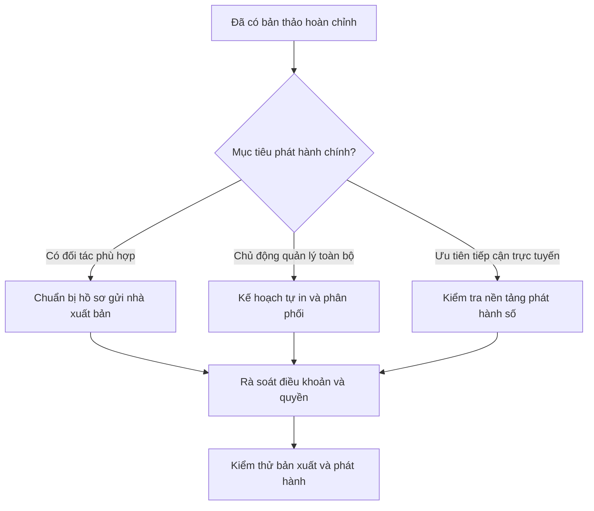

# Bài 13. Lựa chọn phương án xuất bản manga

## 1. Tóm tắt

Sau khi hoàn thành bản thảo và PDF, tác giả có nhiều cách đưa manga tới độc giả: tìm đối tác xuất bản, tự in hoặc phát hành trên nền tảng số. Mỗi lựa chọn có lợi thế, chi phí, mức kiểm soát sáng tạo và trách nhiệm vận hành khác nhau.

## 2. Mục tiêu học tập

- Phân biệt hợp tác với nhà xuất bản và tự xuất bản.
- Liệt kê các công việc thường phát sinh khi tự phát hành.
- Chọn kênh xuất bản phù hợp độ dài, đối tượng đọc và nguồn lực.
- Chuẩn bị danh mục kiểm tra trước khi công khai hoặc bán tác phẩm.

## 3. Làm việc với nhà xuất bản

Nhà xuất bản hoặc đối tác phát hành có thể hỗ trợ biên tập, thiết kế, in ấn, phân phối và tiếp cận hiệu sách hoặc kênh trực tuyến. Đổi lại, bản thảo có thể phải trải qua đánh giá, thương lượng điều khoản và đề xuất chỉnh sửa.

Không nên mặc định mọi nhà xuất bản sẽ yêu cầu viết lại truyện hoặc mọi nhà xuất bản đều hỗ trợ toàn bộ khâu sản xuất. **Phạm vi hỗ trợ và quyền quyết định phải được làm rõ trong thỏa thuận cụ thể**.

## 4. Tự xuất bản

Tự xuất bản cho phép tác giả kiểm soát nhiều quyết định về nội dung và cách phát hành, đồng thời thường phải tự xử lý nhiều khâu:

| Công việc | Câu hỏi cần trả lời |
| --- | --- |
| Sản xuất | Ai rà soát lỗi, chuẩn bị file, thiết kế bìa? |
| In ấn | In ở đâu, in thử thế nào, chất lượng cần đạt? |
| Bán hàng | Bán trực tiếp, qua cửa hàng hay sàn trực tuyến? |
| Phân phối | Đóng gói, giao hàng và xử lý lỗi thế nào? |
| Quảng bá | Làm sao giới thiệu tác phẩm tới đúng độc giả? |
| Tài chính | Có những khoản chi nào và rủi ro hàng tồn ra sao? |
| Pháp lý | Quyền đối với truyện, ảnh, font, thỏa thuận cộng tác đã rõ chưa? |

Nếu kinh phí thấp, có thể cân nhắc bản số hoặc quy mô in thử hạn chế. Không tự kết luận rằng phương thức nào luôn có lợi hơn; cần dựa trên điều kiện thực tế.

## 5. Xuất bản số

Bản phát hành số có thể là PDF hoặc định dạng theo yêu cầu nền tảng. Khi lựa chọn kênh, cần kiểm tra quy định về định dạng, kích thước ảnh, hướng đọc, giới hạn nội dung, điều khoản cấp phép và cách tiếp cận độc giả.

Trong một số kênh, đọc trên điện thoại có thể khiến chữ nhỏ hoặc trang đôi khó nhìn. Hãy thử nghiệm với thiết bị người đọc thường sử dụng trước khi phát hành công khai.

## 6. Quy trình ra quyết định

Các nhánh không loại trừ nhau tuyệt đối. Tác giả có thể phát hành thử bản số rồi cân nhắc bản in, tùy thỏa thuận, quyền phát hành và kế hoạch phát triển.

## 7. Checklist trước khi công bố

- [ ] Đã đọc lại bản thảo và kiểm tra file xuất.
- [ ] Đã xác định rõ tên tác giả/đồng tác giả, người biên tập và ghi công.
- [ ] Có quyền sử dụng hình ảnh, font, họa tiết và nội dung đưa vào tác phẩm.
- [ ] Đã kiểm tra quy định và điều khoản của kênh phát hành.
- [ ] Biết ai chịu trách nhiệm sửa lỗi, tái bản, phản hồi độc giả.
- [ ] Nếu bán bản in, đã có cách kiểm soát chất lượng và chi phí.

## 8. Thực hành

Viết **kế hoạch xuất bản một trang** cho truyện ngắn của bạn. So sánh hai phương án: một kênh số và một kênh in hoặc hợp tác xuất bản. Nêu đối tượng độc giả, đầu ra kỹ thuật, việc phải làm, rủi ro lớn nhất và điều kiện để chọn mỗi phương án.

**Tiêu chí hoàn thành:** không đánh đồng kiểm soát sáng tạo với không có chi phí; có bước kiểm tra quyền sử dụng; lựa chọn dựa trên mục tiêu và nguồn lực.

## 9. Câu hỏi ôn tập

**Câu 1.** Điểm khác biệt thường gặp giữa tự xuất bản và hợp tác nhà xuất bản là gì?

A. Tự xuất bản không cần file hoàn chỉnh.  
B. Nhà xuất bản luôn miễn phí.  
C. Tự xuất bản thường khiến tác giả tự chịu nhiều khâu sản xuất và phân phối hơn.  
D. Tự xuất bản luôn có số lượng bán cao hơn.

**Đáp án:** C. **Giải thích:** Mức độ tự chủ thường đi kèm trách nhiệm vận hành và chi phí.

**Câu 2.** Trước khi ký hợp tác xuất bản, cần ưu tiên làm rõ điều gì?

A. Quyền, phạm vi hỗ trợ và điều khoản chỉnh sửa/phân phối.  
B. Chỉ màu bìa.  
C. Chỉ số khung mỗi trang.  
D. Chỉ tên phần mềm vẽ.

**Đáp án:** A. **Giải thích:** Thỏa thuận quyết định quyền và trách nhiệm của các bên đối với tác phẩm.

**Câu 3.** Vì sao cần thử bản manga số trên thiết bị đích?

A. Vì chỉ máy tính mới đọc được manga.  
B. Vì bản số không có chữ.  
C. Vì mọi nền tảng có cùng giao diện.  
D. Vì độ rõ chữ và bố cục phụ thuộc kích thước hiển thị thực.

**Đáp án:** D. **Giải thích:** Một trang đọc dễ trên màn hình lớn có thể khó theo dõi trên điện thoại.

**Câu 4.** Khi tự phát hành tác phẩm sử dụng font tải từ mạng, cần làm gì?

A. Mặc định được phép dùng thương mại.  
B. Xác nhận giấy phép và điều kiện sử dụng font.  
C. Chỉ đổi tên font.  
D. Bỏ qua toàn bộ danh sách tài sản.

**Đáp án:** B. **Giải thích:** Quyền sử dụng tài sản sáng tạo phải được kiểm tra trước khi phát hành.

**Câu 5.** Chọn kênh phát hành theo nguyên tắc nào?

A. Theo nền tảng nổi tiếng nhất trong mọi trường hợp.  
B. Theo kênh có nhiều hiệu ứng nhất.  
C. Theo đối tượng đọc, quy cách, quyền và nguồn lực thực tế.  
D. Theo mẫu bìa người khác.

**Đáp án:** C. **Giải thích:** Kênh phù hợp phải gắn với mục tiêu và khả năng triển khai của tác giả.

## 10. Tổng kết

Xuất bản là một phần của sáng tác: phải chuẩn bị **đường đi của tác phẩm đến độc giả**, không chỉ hoàn thành phần hình ảnh.
