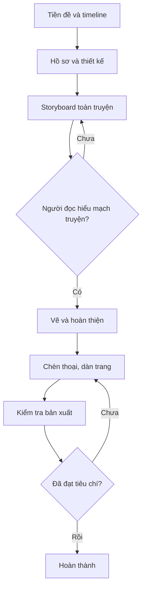

# Bài 14. Dự án cuối khóa: Sáng tác một manga ngắn hoàn chỉnh

## 1. Bài toán

Bạn sẽ xây dựng một manga ngắn độc lập từ ý tưởng đến file có thể gửi cho người đọc hoặc chuẩn bị in. Dự án kết hợp các kỹ năng: xây dựng cốt truyện, thiết kế nhân vật–bối cảnh, storyboard, vẽ trang, đi nét, tạo sắc độ, chèn thoại và chế bản.

Để giới hạn khối lượng, **đề bài gợi ý** dùng truyện ngắn 4–8 trang; đây là phạm vi thực hành đề xuất, không phải tiêu chuẩn chung bắt buộc của ngành manga.

## 2. Mục tiêu sản phẩm

- Có một câu chuyện mở đầu, xung đột, cao trào và kết thúc rõ.
- Có file tham chiếu giữ hình nhân vật và bối cảnh nhất quán.
- Có storyboard trước khi hoàn thiện trang.
- Có bản đọc cuối cùng với hình, chữ và thứ tự rõ ràng.
- Có file xuất được kiểm tra theo kênh sử dụng thực tế.

## 3. Yêu cầu

**Bắt buộc:** ít nhất một nhân vật chính có mục tiêu; một trở ngại khiến nhân vật phải ra quyết định; ít nhất một bối cảnh có bản tham chiếu; chữ và hình đọc được; không thiếu trang.

**Khuyến khích:** dùng một trang tràn mép đúng quy cách nếu dự định in; dùng screentone có chủ đích; thử phản hồi từ một người đọc chưa biết trước nội dung.

Không bắt buộc dùng một phần mềm vẽ, một định dạng file nguồn hoặc một phong cách hình ảnh cụ thể.

## 4. Các mốc thực hiện

| Mốc | Kết quả bàn giao | Kiểm tra |
| --- | --- | --- |
| M1. Chuẩn bị | Tiền đề, timeline, hồ sơ 1–2 nhân vật | Có mục tiêu và quan hệ nhân quả |
| M2. Thiết kế | Character sheet, đạo cụ, bối cảnh, style guide | Các góc nhìn không mâu thuẫn |
| M3. Phân cảnh | Storyboard toàn truyện | Thứ tự đọc và nhịp cảnh rõ |
| M4. Sản xuất | Trang vẽ hoàn thiện nét, sắc độ | Các trang có chất lượng đồng đều |
| M5. Chế bản | Thoại, bìa, bản xuất PDF hoặc định dạng đích | Đọc được, không lỗi font, đúng thứ tự |
| M6. Kiểm thử | Biên bản tự đánh giá và sửa lỗi | Có thay đổi dựa trên kiểm tra thực tế |

## 5. Quy trình sản xuất và kiểm thử



**Kiểm thử mạch truyện:** đưa storyboard cho người chưa biết kịch bản, nhờ họ kể lại hành động chính và xác định tình huống cao trào. **Kiểm thử hình ảnh:** kiểm tra ở kích thước đọc thực và đối chiếu character sheet. **Kiểm thử kỹ thuật:** mở file xuất, rà lần lượt trang, font, số trang, vùng cắt và các yêu cầu của nơi phát hành.

## 6. Cấu trúc bộ sản phẩm nộp

```text
Manga_Ngan/
├── 01-kich-ban/
│   ├── timeline.md
│   └── kich-ban.md
├── 02-thiet-ke/
│   ├── nhan-vat/
│   ├── boi-canh/
│   └── style-guide.md
├── 03-storyboard/
├── 04-trang-hoan-thien/
├── 05-bia/
├── 06-ban-xuat/
│   └── manga-final.pdf
└── 07-kiem-tra/
    └── danh-gia.md
```

Các tên thư mục là gợi ý tổ chức. Nếu phát hành trên nền tảng yêu cầu bộ ảnh riêng, thay file `manga-final.pdf` bằng đúng định dạng mà nền tảng đó hỗ trợ.

## 7. Tiêu chí đánh giá

| Tiêu chí | Trọng số gợi ý |
| --- | ---: |
| Câu chuyện rõ ràng, có nguyên nhân–kết quả | 25% |
| Nhân vật, đạo cụ và bối cảnh nhất quán | 20% |
| Storyboard và nhịp đọc hiệu quả | 20% |
| Nét, sắc độ và chữ rõ ở kích thước sử dụng | 20% |
| Bản xuất và hồ sơ bàn giao đầy đủ | 15% |

Trọng số chỉ dùng để **tự đánh giá trong khóa học**, không phải quy chuẩn tuyển chọn của nhà xuất bản.

## 8. Definition of Done

Dự án chỉ được xem là hoàn thành khi:

- [ ] Có kịch bản và kết thúc xác định.
- [ ] Đã hoàn thiện mọi trang đã cam kết, không còn placeholder.
- [ ] Đã kiểm tra storyboard, chữ và ảnh ở kích thước đọc thực.
- [ ] Bản xuất không thiếu hoặc đảo trang.
- [ ] Đã sửa ít nhất một vấn đề được phát hiện khi kiểm thử.
- [ ] Đã xác định phương án phát hành và kiểm tra những quyền sử dụng liên quan.

## 9. Câu hỏi tự đánh giá

1. Người đọc chưa biết nội dung có thể xác định **ai muốn gì** trong phần mở đầu không?
2. Có khung nào chỉ đẹp nhưng không bổ sung thông tin, cảm xúc hoặc nhịp đọc không?
3. Có chi tiết nào thay đổi ngoài ý muốn giữa hai trang không?
4. Bong bóng thoại có che đi hành động hoặc biểu cảm quan trọng không?
5. Bản xuất cuối có hiển thị đúng trên thiết bị hoặc quy trình in dự kiến không?

**Cách sử dụng:** trả lời mỗi câu bằng ví dụ hoặc ảnh minh chứng từ chính truyện của bạn; nếu câu trả lời là “chưa”, ghi một sửa đổi cụ thể vào biên bản kiểm tra.

## 10. Tổng kết

Giá trị lớn nhất của dự án không nằm ở số trang mà ở việc **đi hết quy trình sản xuất**, kiểm tra kết quả, và có một tác phẩm hoàn chỉnh có thể đưa cho người khác đọc.
